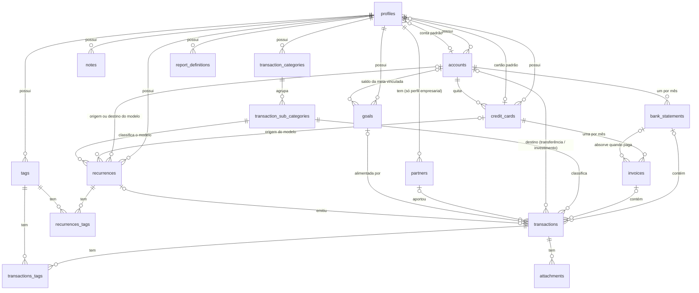
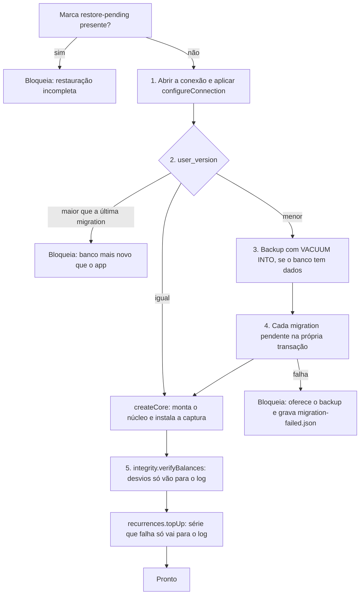

# Banco de dados

Esta página descreve o banco SQLite do Finanças como ele está hoje: por que SQLite, como a
conexão é configurada, as convenções que valem para todas as tabelas, cada tabela com as
restrições que importam, a evolução do schema por migrations e os adaptadores que ligam o
núcleo ao driver de cada plataforma. As regras de negócio que as tabelas sustentam são
resumidas aqui e detalhadas nas páginas de [regras de negócio](../README.md); o código que lê e
escreve o schema está descrito em [Núcleo](core.md).

A fonte da verdade do schema são os arquivos `.sql` de
[db/migrations](../../../db/migrations/). Esta página e a DDL precisam concordar; quando
divergirem, vale a DDL, e a página é corrigida.

## 1. Escopo

### 1.1 O que o schema cobre

O schema cobre todo o domínio do app: perfis, contas, cartões de crédito, os contêineres mensais
(extratos bancários e faturas), transações com sua classificação (categorias, subcategorias,
tags), sócios, recorrências, metas, anotações, anexos, definições de relatórios personalizados e
os metadados da sincronização entre dispositivos.

Fica de fora a **proveniência da importação**: reimportar um arquivo duplica lançamentos, e o
caminho de volta é a cópia do banco feita antes (ver [Importação](../regras-de-negocio/importacao.md)).

### 1.2 Onde estão a DDL e o código de acesso

| O quê | Onde |
|---|---|
| DDL, uma migration por arquivo | [db/migrations/](../../../db/migrations/) |
| Trava de imutabilidade das migrations | [db/migrations/checksums.lock](../../../db/migrations/checksums.lock) |
| Migrations embutidas no bundle | [embedded.generated.ts](../../../packages/core/src/infrastructure/migrations/embedded.generated.ts) |
| Configuração da conexão | [connection.ts](../../../packages/core/src/infrastructure/sqlite/connection.ts) |
| Runner de migrations e backup | [MigrationRunner.ts](../../../packages/core/src/infrastructure/migrations/MigrationRunner.ts), [PreMigrationBackup.ts](../../../packages/core/src/infrastructure/migrations/PreMigrationBackup.ts) |
| Repositories (SQL) | [packages/core/src/infrastructure/sqlite/](../../../packages/core/src/infrastructure/sqlite/) |
| Adaptadores de driver | [packages/sqlite-better](../../../packages/sqlite-better/src/index.ts), [packages/sqlite-expo](../../../packages/sqlite-expo/src/ExpoSqliteDatabase.ts) |

## 2. Relações entre entidades

Tudo pende de `profiles`, direta ou transitivamente (§3.8). As tabelas da sincronização (§4.16)
não têm chave estrangeira e ficam fora do diagrama.

## 3. Convenções

Regras que valem para todas as tabelas; a §4 não as repete.

### 3.1 Motor de armazenamento: SQLite

O armazenamento é **SQLite**, um único arquivo de banco por dispositivo (`finance.sqlite`). As
restrições do projeto — embarcado, gratuito, no desktop e no celular, sem impedir a
sincronização — eliminam quase todo o resto, e o SQLite é forte justamente onde o app precisa:

- **Está em todas as plataformas.** Android e iOS já o trazem, e tanto o `better-sqlite3`
  (desktop) quanto o `expo-sqlite` (celular) embarcam a própria versão.
- **Relatórios são relacionais e orientados a mês.** Window functions, CTEs, índices parciais e
  de expressão fazem de saldos acumulados e comparações mês a mês consultas comuns, executadas no
  código C do SQLite e não em JavaScript.
- **Os dados são do usuário de forma literal:** um arquivo que ele copia, guarda e abre com
  qualquer ferramenta, num formato com compromisso público de legibilidade por décadas.
- **`CHECK`, índices parciais e ações `ON DELETE`** deixam o banco garantir a estrutura (§3.10),
  e `REAL` é o double IEEE-754 que o `number` do JavaScript também é (§3.7).

As alternativas consideradas (PostgreSQL, DuckDB, PouchDB/RxDB, Realm, libSQL/Turso) estão nas
[decisões](../decisoes.md) ([ADR 27](../decisoes.md#adr-27)).

### 3.2 A configuração da conexão faz parte do contrato do schema

Toda conexão passa por `configureConnection`
([connection.ts](../../../packages/core/src/infrastructure/sqlite/connection.ts)), chamada por
`openDatabase` antes das migrations. Nada disso está na DDL:

- **Versão mínima do SQLite.** A conexão recusa SQLite anterior à 3.37 (sem `STRICT`) com
  `ConnectionContractError`. A suíte de contrato e o adaptador do celular exigem 3.38, por causa
  do `json_valid` usado em `report_definitions` (§6.3).
- **`PRAGMA foreign_keys = ON`.** O SQLite vem com chaves estrangeiras desligadas por
  compatibilidade; sem o pragma, toda ação `ON DELETE` silenciosamente não faz nada. Por isso o
  valor é **lido de volta e conferido**, e a conexão é recusada se não ficou ligado.
- **`PRAGMA journal_mode = WAL`.** Melhor concorrência e resiliência a falhas; persiste no
  arquivo (num banco em memória o SQLite mantém `memory`, o que é esperado).

O modo de falha de chaves estrangeiras desligadas é silencioso, então ele tem teste próprio: o
caso de contrato "liga foreign_keys na abertura: o hard delete de perfil cascateia"
([databaseContract.ts](../../../packages/core/src/contract/databaseContract.ts)).

### 3.3 A camada Repository abstrai o driver, não apenas o banco

Os Repositories são escritos contra a porta estreita `Database` (`run`, `get`, `all`, `exec`,
`transaction`), e cada plataforma fornece um adaptador fino por trás dela (§6). O motor e o SQL
são os mesmos em todo lugar; o **driver** não é — `better-sqlite3` no Electron, `expo-sqlite` no
celular, com APIs diferentes. Sem a porta, essa diferença vazaria para todos os Repositories.

Três traduções vivem só nessa fronteira (nos `Sqlite*Repository` e no
[RowReader.ts](../../../packages/core/src/infrastructure/sqlite/RowReader.ts)), e aparecer em
dois lugares é bug:

- a caixa dos identificadores, `snake_case` no banco e `camelCase` no TypeScript (§3.4);
- o carimbo de `updated_at` pela porta `Clock` (§3.6);
- a normalização dos UUIDs para minúsculas (`parseUuid`), porque o SQLite compara chaves byte a
  byte (§3.5).

O `RowReader` também confere o tipo de cada coluna lida e lança `CorruptRowError` quando o driver
devolve algo inesperado: `STRICT` garante o que está gravado, não o que cada driver entrega, e um
`REAL` lido como texto viraria `NaN` num saldo.

### 3.4 Nomenclatura

- **Tabelas no plural**, com o plural no substantivo principal: `transactions`,
  `transaction_categories` (não `categories_transaction`). Tabelas de junção juntam os dois lados:
  `transactions_tags`, `recurrences_tags`. As classes de domínio ficam no singular
  (`Transaction`, `Account`).
- **Identificadores físicos em `snake_case`** — tabelas, colunas, índices e restrições. O
  TypeScript usa `camelCase` e o Repository traduz (§3.3). Um nome de coluna idêntico a uma
  propriedade soldaria o domínio ao armazenamento; o mapeamento explícito é a fronteira. Por isso
  existem `credit_cards.limit_value` (`limit` é palavra-chave) e `goals.target_date`.
- **Chave estrangeira:** `<pai_no_singular>_id`.
- **Índices:** `idx_<tabela>_<colunas>`; únicos: `uq_<tabela>_<colunas>`.
- **Restrições nomeadas:** `ck_<tabela>_<coluna>` e `fk_<tabela>_<coluna>`, para que a violação
  diga qual regra falhou (`CHECK constraint failed: ck_profiles_currency`).

### 3.5 Chaves primárias são UUIDs

Toda tabela de domínio tem `id TEXT NOT NULL PRIMARY KEY CHECK (length(id) = 36)`, uma chave
substituta UUID, nunca um inteiro autoincremental: dois aparelhos offline gerariam o mesmo `47`
para registros diferentes, e reconciliar exigiria reescrever a chave e toda chave estrangeira que
aponta para ela. Com UUID, qualquer dispositivo cria um registro a qualquer momento, sem
coordenação.

- **Versão 4 (aleatória)**, pela porta `IdGenerator` (`random()`): `crypto.randomUUID()` no
  desktop, `expo-crypto` no celular. É porta porque o React Native não tem `crypto.randomUUID()`.
- **Versão 5 (determinística) para linhas identificadas pelo conteúdo**, calculada no próprio
  núcleo ([DeterministicIds.ts](../../../packages/core/src/domain/shared/DeterministicIds.ts)) a
  partir de um namespace fixo da aplicação (`APP_UUID_NAMESPACE`, que **nunca muda**) e da chave
  natural da linha:

  | Linha | Chave natural | Função |
  |---|---|---|
  | `bank_statements` | conta + competência | `bankStatementIdFor` |
  | `invoices` | cartão + competência | `invoiceIdFor` |
  | ocorrência de recorrência em `transactions` | `recurrence_id` + número da ocorrência | `occurrenceIdFor` |
  | `transactions_tags` | transação + tag | `transactionTagIdFor` |
  | `recurrences_tags` | recorrência + tag | `recurrenceTagIdFor` |

  Dois aparelhos offline que criam "o extrato de março da conta X" derivam o mesmo id, e a
  sincronização mescla uma linha em vez de colidir no índice único parcial. Recriar uma dessas
  linhas depois de um soft delete a **revive** (mesmo id) em vez de inserir outra. O formato de
  cada chave é contrato permanente, como o namespace.
- **Quem gera o id é a aplicação**, não o banco: o Service monta o grafo completo, ids incluídos,
  antes de o Repository gravar, pais primeiro, numa única transação.
- **`TEXT` canônico** (36 caracteres, minúsculo, com hífens), não `BLOB`: nesta escala o tamanho
  não importa e chaves legíveis facilitam a depuração.
- **Tabelas rowid comuns**, não `WITHOUT ROWID` (a exceção são tabelas locais da sincronização,
  §4.16).

Por que v4 e não v7, e por que não `BLOB`: ver [decisões](../decisoes.md) ([ADR 31](../decisoes.md#adr-31)).

### 3.6 Colunas presentes em todas as tabelas

Toda tabela de domínio, inclusive as de junção, tem:

| Coluna | Tipo | Restrições | Notas |
|---|---|---|---|
| `id` | TEXT | NN, PK, `CHECK (length(id) = 36)` | §3.5 |
| `created_at` | TEXT | NN, timestamp, `DEFAULT (strftime('%Y-%m-%d %H:%M:%S', 'now'))` | UTC. O banco preenche; a aplicação não escreve. Exceção: a ocorrência de recorrência revivida recebe um `created_at` novo, também pelo relógio do motor (§4.12) |
| `updated_at` | TEXT | NN, timestamp | UTC. Carimbado pela aplicação em todo insert e update; sem trigger |
| `deleted_at` | TEXT | null, timestamp | Soft delete: a linha está viva quando `deleted_at IS NULL` |

**Quem carimba o quê.** `created_at` é escrito uma vez, e o relógio do motor basta; o default
mantém honestas as inserções manuais. `updated_at` muda a cada escrita, e um trigger seria lógica
escondida no armazenamento. A rotina de recálculo grava os caches de saldo **sem** carimbar
`updated_at` (`saveBalances`): recalcular não é revisão do usuário, e carimbar transformaria cada
recálculo numa mudança sincronizada. Nenhum dos dois é o relógio da sincronização, que é um HLC
em tabelas próprias (§4.16).

**Nada é removido fisicamente.** Excluir é preencher `deleted_at`, com quatro consequências:

1. **As ações `ON DELETE` não fazem o trabalho.** Soft delete é `UPDATE`, então nenhum cascade
   dispara: a exclusão em cadeia (conta, cartão) é feita pela camada Service
   (`CascadeDeletionService`), numa unidade de trabalho, seguindo o mesmo grafo de propriedade das
   chaves estrangeiras. As ações declaradas continuam como rede de segurança para um hard delete.
2. **Toda regra de unicidade é um índice único parcial** `WHERE deleted_at IS NULL`; sem isso,
   recriar o extrato de março colidiria com a linha excluída.
3. **Toda leitura filtra `deleted_at IS NULL`.** Esquecer isso numa consulta de saldo ressuscita
   transações excluídas nos totais — um número errado, não um erro. Os testes de mesa incluem
   transações excluídas justamente por isso ([Testes](testes.md)).
4. **É o `deleted_at` que propaga a exclusão entre dispositivos**; um hard delete não deixaria
   nada para replicar. Uma purga futura só poderia remover linhas cuja exclusão todos os aparelhos
   já confirmaram ([Sincronização](sincronizacao.md)).

Desativar uma conta ou um cartão não é excluir: usa a coluna própria `disabled_at` (§4.4).

### 3.7 Dinheiro

**Toda coluna monetária é `REAL`** (double IEEE-754): `transactions.value`, `charges` e
`conversion_rate`, os saldos de `accounts` e `bank_statements`, `invoices.balance`,
`goals.value`, `credit_cards.limit_value` e os campos de modelo de `recurrences`. Unidades
inteiras (centavos) foram rejeitadas: o sistema não se limita a moedas de duas casas, e
`conversion_rate` precisa de muito mais precisão. O banco não protege contra desvio de
arredondamento; **validação e arredondamento são da aplicação**, feitos pelo Value Object `Money`
([Núcleo](core.md) §6.3–§6.4):

- arredondar só nas fronteiras de persistência e de apresentação, nunca em valores intermediários;
- por moeda, pela precisão decimal de cada uma;
- modo **meio para longe do zero** (`2,345 → 2,35`; `-2,345 → -2,35`);
- comparar sempre com epsilon (meia unidade mínima da moeda), nunca por igualdade exata.

**Toda coluna monetária está na moeda do perfil.** Há três colunas de moeda, com papéis
diferentes:

| Coluna | Significado |
|---|---|
| `profiles.currency` | A moeda de relatório, a única unidade em que algo é armazenado |
| `accounts.currency` | Em que moeda a conta do mundo real é mantida; rótulo, não unidade |
| `transactions.currency` | A moeda de origem de um valor; só proveniência (§4.13) |

Com uma moeda só, todo saldo e todo relatório é um `SUM`, sem conversão. A troca e as
alternativas estão nas [decisões](../decisoes.md) ([ADR 28](../decisoes.md#adr-28), [ADR 29](../decisoes.md#adr-29)).

**Saldos armazenados são cache.** Os saldos de `accounts`, `bank_statements` e `invoices` são
agregados desnormalizados das transações: recalcular todo o histórico a cada leitura seria a
troca errada para um app que abre numa tela de saldo. A camada Service os mantém corretos com
**uma** rotina de recálculo (`BalanceRecalculationService`), que reconstrói o cache a partir das
transações do mês afetado e propaga o fechamento para os meses seguintes — nunca `saldo += valor`.
A mesma rotina é usada no lançamento, no pagamento de fatura, na exclusão em cadeia, no reparo
explícito (`balances.rebuildAccount`), na aplicação de lotes da sincronização e, numa transação
desfeita, como oráculo da verificação de integridade (§7).

Regra de negócio (Saldos): todo saldo de conta e de extrato existe em duas versões, lado a lado:

| Saldo | O que entra |
|---|---|
| **Consolidado** | Só transações pagas e faturas pagas — o que já aconteceu |
| **Previsto** | Todas as transações vivas, pagas ou não, e as faturas em aberto no mês do vencimento (§4.7) — o que vai acontecer se nada mudar |

Os dois seguem a mesma cadeia de fechamentos e a mesma rotina; só o filtro muda. Um saldo
recalculado que diverge do armazenado além do epsilon da moeda é bug a **expor**, não a corrigir
em silêncio (§7). Detalhes das regras de saldo em
[Contas](../regras-de-negocio/contas.md) e [Visão do mês](../regras-de-negocio/visao-do-mes.md).

### 3.8 O perfil é a raiz do tenant, e as chaves estrangeiras seguem o relacionamento

Tudo pertence a um perfil, direta ou transitivamente. O app é local-first e de usuário único, mas
a mesma pessoa precisa manter finanças pessoais e empresariais separadas; fazer do perfil a raiz
dá essa separação sem multi-tenancy. Categorias, tags e metas, portanto, não são vocabulário
global: cada perfil tem o seu. As **únicas** referências que atravessam a fronteira do perfil são a
conta de destino de uma **transferência entre perfis** e o sócio dela (§4.13). Mover uma
transação para outro perfil troca todas as referências pelas do destino, sem criar referência
cruzada.

A ação `ON DELETE` de cada chave é escolhida pelo que o relacionamento significa:

| Tipo | Significado | Ação | Exemplos |
|---|---|---|---|
| **Propriedade** | O filho não existe sem o pai | `CASCADE` | `accounts.profile_id`, `bank_statements.account_id`, `transactions.bank_statement_id`, `goals.account_id` |
| **Referência** | O filho sobrevive; só o vínculo some | `SET NULL` | `transactions.goal_id`, `transactions.partner_id`, `transactions.destination_account_id`, `invoices.bank_statement_id`, `profiles.default_account_id` |
| **Vocabulário** | O pai é uma classificação de que o filho precisa | `NO ACTION` | `transactions.sub_category_id`, `recurrences.sub_category_id` |

**`NO ACTION`, e não `RESTRICT`, no vocabulário:** o SQLite verifica `RESTRICT` no instante em que
o pai é removido e `NO ACTION` no fim do comando. Num hard delete de perfil, o cascade pode chegar
a `transaction_sub_categories` antes de `transactions`; com `RESTRICT` a exclusão inteira falharia.
Os dois continuam recusando apagar uma subcategoria realmente em uso.

Uma transação sem nenhum contêiner (o estado inválido que o banco aceita, §3.10) não é alcançada
pelo cascade e faz o hard delete do perfil falhar com erro de chave estrangeira — o resultado certo.

### 3.9 Tipos e domínios de colunas

O SQLite usa afinidade de tipo e aceitaria uma string numa coluna numérica, o que contraria a
tipagem estrita do projeto. Por isso:

- **Toda tabela é `STRICT`.** O SQLite rejeita valores que não convertem sem perda para o tipo da
  coluna. Nuance: `'1'` ainda entra numa coluna `INTEGER`; a fronteira tipada do Repository faz o
  resto.
- **Dinheiro → `REAL`; booleanos → `INTEGER` 0/1; enums → `INTEGER`** com códigos fixos
  ([enumCodes.ts](../../../packages/core/src/infrastructure/sqlite/enumCodes.ts));
  **UUIDs → `TEXT`**.
- **Datas → `TEXT` ISO-8601** (`YYYY-MM-DD`; timestamps `YYYY-MM-DD HH:MM:SS`, UTC). Texto ISO
  ordena e compara como string, funciona com as funções de data do SQLite e continua legível.

Como `STRICT` só conhece `INTEGER`, `REAL` e `TEXT`, o **domínio** de cada coluna é completado por
um `CHECK`:

| Domínio | Restrição |
|---|---|
| bool | `CHECK (col IN (0, 1))` |
| enum | `CHECK (col IN (1, 2, …))` |
| date | `CHECK (col IS strftime('%Y-%m-%d', col))` — data inválida ou não canônica (`2024-02-30`) faz o `strftime` devolver outra coisa |
| timestamp | `CHECK (col IS strftime('%Y-%m-%d %H:%M:%S', col))` |
| uuid | `CHECK (length(col) = 36)` |
| currency | `CHECK (length(col) = 3 AND col = upper(col))` — ISO 4217 |
| `varchar(n)` | `CHECK (length(col) <= n)` |
| faixas | `month` 1–12, dia do mês 1–31, `year` 1900–9999, `installments > 0`, `percentage` 0–100 |
| filename | 1–255, sem `/` nem `\` — só `attachments.name`, que é componente de caminho |
| json | `CHECK (json_valid(col))` — só `report_definitions.definition` |

**Defaults só onde a ausência tem significado no domínio** (`paid = 0`, `charges = 0`,
`conversion_rate = 1`, `consider_balance = 1`, `opening_balance = 0`, `goals.kind = 1`,
`goal_withdrawal = 0`), nunca para cobrir um Repository que esqueceu uma coluna.

O SQLite não altera um `CHECK` sem reconstruir a tabela (§5.7), então só invariantes estáveis
viram `CHECK`. Aumentar um enum é a mudança previsível e custa uma reconstrução.

**Notação na §4:** *NN* = `NOT NULL`; *null* = anulável; *date* e *timestamp* são as verificações
de formato acima.

### 3.10 O que o banco garante e o que a aplicação garante

| Garantido pelo banco | Garantido pela aplicação |
|---|---|
| Tipos — tabelas `STRICT` (§3.9) | Regras de negócio e validade condicional de campos |
| Domínio de cada coluna — `CHECK` (§3.9) | Validade de uma coluna em função de outra (`paid`/`payment_date`, `installments` dado o `type`) |
| Integridade referencial — chaves estrangeiras (§3.8) | Arredondamento e precisão monetária (§3.7) |
| Unicidade — índices únicos parciais (§3.11) | Consistência entre colunas e entre linhas, incluindo os arcos exclusivos |

Estrutura é trabalho do banco; significado é trabalho da aplicação. Um domínio diz o que **uma**
coluna pode conter, isoladamente, e não muda com regra de negócio. Tudo que relaciona duas colunas
ou duas linhas fica na aplicação: os arcos exclusivos de `transactions` e `recurrences`, `paid`
versus `payment_date`, sócios só em perfil empresarial, a conta de um cartão ser do mesmo perfil,
as participações somarem 100, o sinal de `value`, nomes únicos sem diferenciar acentos. Um `CHECK`
que codificasse "a transação pertence a um extrato **ou** a uma fatura" seria regra de negócio
escondida no armazenamento, invisível para o código que precisa cumpri-la e cara de mudar.

**A troca aceita:** o banco aceita linhas inválidas. Por isso a validação fica em pontos de
controle únicos na camada Service e no domínio — por exemplo `TransactionComposer` para
lançamentos, as entidades (`Transaction`, `Partner`...) para invariantes da própria linha —, os
testes cobrem os estados inválidos, e a verificação de integridade procura desvios (§7).

### 3.11 Índices

- **Toda chave estrangeira tem índice simples próprio.** O SQLite não o cria; sem ele, cada
  verificação de cascade e cada "transações deste extrato" varre a tabela filha. Esses índices
  **não** são parciais: uma linha com soft delete continua sendo filho para a verificação de
  chave estrangeira.
- **Toda unicidade é um índice único parcial** `WHERE deleted_at IS NULL` (§3.6).
- **Nomes únicos no escopo, sem diferenciar maiúsculas:** `tags` e `transaction_categories` por
  perfil, `transaction_sub_categories` por categoria, `attachments` por transação, com
  `COLLATE NOCASE`. O `NOCASE` só dobra ASCII (`Alimentação` e `alimentação` passam); a aplicação
  completa a comparação com `sameName`/`foldName`
  ([names.ts](../../../packages/core/src/domain/shared/names.ts)) antes de gravar.
  `report_definitions` tem nome único por perfil só na aplicação.
- `accounts`, `credit_cards`, `partners` e `goals` **não** têm nome único: duas contas "Corrente"
  em bancos diferentes são legítimas.
- `idx_transactions_due_date` existe para relatórios por período.

## 4. Tabelas

Uma seção por tabela, em ordem de dependência. As colunas da §3.6 são omitidas.

### 4.1 profiles

A raiz do tenant (§3.8). Excluir um perfil é, por definição, excluir tudo abaixo dele; hoje não há
rota que exclua perfil (ver §8).

- **`type` separa pessoal e empresarial**, e isso controla os sócios: só perfil empresarial tem
  sócios e relatórios por sócio (`partner-requires-business-profile`, regra da aplicação porque
  relaciona duas tabelas).
- **`currency` é a unidade de tudo** que o perfil armazena (§3.7). Ela fica travada quando o perfil
  recebe transferências de outro perfil (`profile-currency-locked`), porque a linha grava um único
  `value` somado como está nos dois lados.
- **Conta e cartão padrão do lançamento** (`default_account_id`, `default_credit_card_id`): as
  origens que o atalho "Débito / Crédito" do lançamento novo escolhe. Ficam no perfil, e não como
  marcador em `accounts`/`credit_cards`, porque "no máximo um padrão de cada por perfil" vale por
  construção numa coluna só — inclusive quando a sincronização mescla célula a célula escolhas
  feitas em dois aparelhos. A conta ou o cartão tem de ser do perfil e estar ativo ao ser escolhido;
  desativado ou excluído depois, deixa de valer como padrão **na leitura**, sem apagar a escolha,
  e reativar devolve o padrão.

Regras completas em [Perfis](../regras-de-negocio/perfis.md).

| Coluna | Tipo | Restrições | Notas |
|---|---|---|---|
| `name` | TEXT | NN, `<= 45` | |
| `type` | INTEGER | NN, enum | `1` pessoal, `2` empresarial |
| `currency` | TEXT | NN, currency | ISO 4217 |
| `default_account_id` | TEXT | null, FK → `accounts`, `SET NULL` | conta padrão (débito) |
| `default_credit_card_id` | TEXT | null, FK → `credit_cards`, `SET NULL` | cartão padrão (crédito) |

Índices: `idx_profiles_default_account_id`, `idx_profiles_default_credit_card_id`.

### 4.2 partners

Pessoas com participação num perfil **empresarial**. `percentage` é o que o sócio **possui**; quem
de fato **aportou** numa transação fica em `transactions.partner_id` (§4.13). A diferença entre os
dois é o relatório por sócio. Que as participações somem 100 (`partner-shares-not-100`) e que o
perfil seja empresarial são regras da aplicação; nomes não são únicos. Regras em
[Sócios](../regras-de-negocio/socios.md).

| Coluna | Tipo | Restrições | Notas |
|---|---|---|---|
| `profile_id` | TEXT | NN, FK → `profiles`, `CASCADE` | propriedade |
| `name` | TEXT | NN, `<= 100` | |
| `percentage` | REAL | NN, `0 <= percentage <= 100` | participação, escala 0–100 |

Índice: `idx_partners_profile_id`.

### 4.3 notes

Lista simples de observações e lembretes do perfil, de propósito sem vínculo com transação ou
conta. Regras em [Anotações](../regras-de-negocio/anotacoes.md).

| Coluna | Tipo | Restrições | Notas |
|---|---|---|---|
| `profile_id` | TEXT | NN, FK → `profiles`, `CASCADE` | propriedade |
| `note` | TEXT | NN | sem limite de tamanho |

Índice: `idx_notes_profile_id`.

### 4.4 accounts

Conta corrente ou de investimentos de um perfil. Regras em
[Contas](../regras-de-negocio/contas.md).

- **`balance` e `projected_balance` são cache**, na moeda do **perfil**: o saldo final
  (consolidado e previsto) do extrato do **mês corrente**, o número que a tela inicial mostra sem
  consultar extrato. Só a rotina de recálculo os escreve (`saveBalances`); `save` nunca toca o
  cache de uma conta existente.
- **`opening_balance` é dado do usuário, não cache.** É o saldo que a conta já tinha antes do seu
  primeiro extrato — informado no cadastro ou na importação — e é o saldo inicial do primeiro
  extrato vivo (§4.6). Não é uma transação (apareceria como receita nos relatórios), a rotina de
  recálculo o lê e nunca o escreve, ele sincroniza como coluna comum, e editá-lo recalcula todos
  os extratos da conta. O default `0` é "conta aberta agora, sem dinheiro".
- **`currency` é rótulo; `consider_balance` é o isolamento.** Uma conta no exterior registra sua
  moeda, mas o saldo continua armazenado convertido na moeda do perfil e se afasta do que o banco
  estrangeiro mostra conforme o câmbio muda. Em vez de modelar isso, o usuário desliga
  `consider_balance` e a conta sai do total consolidado do perfil, com o histórico intacto.
- **Desativar não é excluir.** `disabled_at` (timestamp do primeiro desligamento; nulo = ativa) tira
  a conta das escolhas de lançamentos novos (`account-disabled`), mas ela continua em extratos,
  faturas, saldos e relatórios e pode ser reativada. É coluna própria porque `deleted_at` significa
  "não existe mais" para toda leitura e para a sincronização.
- **Tipo de conta de investimento que financia meta não muda** (`account-type-funds-goal`, §4.11).

| Coluna | Tipo | Restrições | Notas |
|---|---|---|---|
| `profile_id` | TEXT | NN, FK → `profiles`, `CASCADE` | propriedade |
| `name` | TEXT | NN, `<= 45` | não é único |
| `balance` | REAL | NN | consolidado do mês corrente, cache |
| `projected_balance` | REAL | NN | previsto do mês corrente, cache |
| `opening_balance` | REAL | NN, `DEFAULT 0` | saldo anterior ao primeiro extrato, dado do usuário |
| `currency` | TEXT | NN, currency | descritivo |
| `consider_balance` | INTEGER | NN, `DEFAULT 1`, bool | entra no consolidado do perfil |
| `type` | INTEGER | NN, enum | `1` corrente, `2` investimento |
| `disabled_at` | TEXT | null, timestamp | desativação |

Índice: `idx_accounts_profile_id`.

### 4.5 credit_cards

Cartão de um perfil, quitado por uma conta. Regras em
[Cartões e faturas](../regras-de-negocio/cartoes-e-faturas.md).

- **`account_id` é a conta que paga as faturas.** O cartão não existe sem ela: `CASCADE`, e não
  `RESTRICT`, para não bloquear o cascade do perfil (§3.8). Que a conta seja do mesmo perfil é regra
  da aplicação.
- **`closing_date` e `due_date` são dias do mês (1–31), não datas.** Regras de negócio (Cartão de
  crédito): dia inexistente vira o último dia do mês, ajustado mês a mês (o dia guardado continua
  31); a compra feita **no** dia do fechamento entra na fatura seguinte; e isso é só a sugestão —
  o usuário escolhe a fatura (§4.7). O cálculo mora em
  [BillingCycle.ts](../../../packages/core/src/domain/creditCard/BillingCycle.ts), e a versão SQL
  do mês de vencimento ([periodSql.ts](../../../packages/core/src/infrastructure/sqlite/periodSql.ts))
  é testada contra ele para todo par de dias.
- **`disabled_at`** segue a regra da conta (§4.4): sai das escolhas de lançamentos novos
  (`credit-card-disabled`), faturas e relatórios continuam.

| Coluna | Tipo | Restrições | Notas |
|---|---|---|---|
| `profile_id` | TEXT | NN, FK → `profiles`, `CASCADE` | propriedade |
| `account_id` | TEXT | NN, FK → `accounts`, `CASCADE` | conta que quita |
| `name` | TEXT | NN, `<= 45` | |
| `limit_value` | REAL | NN | limite |
| `closing_date` | INTEGER | NN, 1–31 | dia de fechamento |
| `due_date` | INTEGER | NN, 1–31 | dia de vencimento |
| `disabled_at` | TEXT | null, timestamp | desativação |

Índices: `idx_credit_cards_profile_id`, `idx_credit_cards_account_id`.

### 4.6 bank_statements

O contêiner mensal da conta: uma linha por conta por mês, com id determinístico (§3.5).

- **A consolidação mensal é materializada.** Relatórios são orientados a mês; uma linha por mês
  mantém as consultas baratas e dá um registro estável. `(account_id, year, month)` é único entre
  as linhas vivas, e a camada Service cria e recalcula a linha sempre que as transações do mês
  mudam. Um mês sem movimento não tem linha.
- **Cada extrato guarda quatro saldos:** inicial e final, consolidado e previsto. Sem o inicial
  armazenado, abrir março de 2024 obrigaria a reconstruir a cadeia inteira e a achar o extrato
  anterior, que pode não ser o mês imediatamente anterior. O inicial é o final do extrato vivo
  **anterior** da mesma conta — ou o `accounts.opening_balance`, no primeiro —, e o final é o
  inicial mais o movimento do mês. Os quatro são cache; editar um mês recalcula esse mês e todos
  os seguintes da conta (lógica de cadeia em
  [StatementChain.ts](../../../packages/core/src/domain/balance/StatementChain.ts)).
- **O movimento do mês** é composto por: as transações do extrato (`bank_statement_id`); as
  transferências e investimentos que **chegam** à conta (`destination_account_id`) no mês da data
  de caixa delas; as faturas pagas vinculadas ao extrato, pelo `balance` de cada uma; e, só no
  previsto, as faturas em aberto dos cartões quitados pela conta, no mês do vencimento (§4.7).

| Coluna | Tipo | Restrições | Notas |
|---|---|---|---|
| `account_id` | TEXT | NN, FK → `accounts`, `CASCADE` | propriedade |
| `month` | INTEGER | NN, 1–12 | |
| `year` | INTEGER | NN, 1900–9999 | |
| `opening_balance` | REAL | NN | consolidado inicial, cache |
| `closing_balance` | REAL | NN | consolidado final, cache |
| `projected_opening_balance` | REAL | NN | previsto inicial, cache |
| `projected_closing_balance` | REAL | NN | previsto final, cache |

Índices: `idx_bank_statements_account_id`; `uq_bank_statements_account_period`
`(account_id, year, month)`, único parcial.

### 4.7 invoices

O contêiner mensal do cartão: uma linha por cartão por mês, com id determinístico (§3.5). Regras
completas em [Cartões e faturas](../regras-de-negocio/cartoes-e-faturas.md).

- **A fatura é quitada contra um extrato.** Paga, ela é vinculada (`bank_statement_id`) ao extrato
  do mês em que foi paga, para que o movimento do cartão entre no saldo da conta dona. O mês da
  fatura e o do extrato que a absorve costumam ser diferentes (fecha em março, paga em abril).
  `bank_statement_id` é nulo enquanto em aberto e `SET NULL` na exclusão do extrato: a fatura
  sobrevive e volta a ficar em aberto.
- **O dia do pagamento é registro, não regra.** `payment_date` guarda o dia, gravado na mesma
  escrita do vínculo e apagado com ele ao reabrir; o extrato o usa para mostrar a fatura paga na
  data em que o dinheiro saiu. Quem decide a situação é o vínculo vivo, não o dia. Faturas pagas
  antes da coluna existir têm o dia nulo, porque inventá-lo mostraria uma data que não aconteceu.
- **`balance` tem o sinal do efeito na conta que quita:** negativo quando há valor a pagar,
  positivo quando estornos superam as compras. Assim o extrato soma faturas como soma transações; a
  tela mostra o valor a pagar em módulo.
- **No previsto, a fatura em aberto pesa no mês do vencimento:** o primeiro dia `due_date` do
  cartão (com o ajuste de fim de mês) depois do fechamento. Paga, ela sai do vencimento e entra, nos
  dois saldos, no extrato vinculado.
- Regras de negócio (Fatura) que a tabela sustenta: o usuário escolhe a fatura de cada despesa e o
  `invoice_id` gravado é a verdade (a sugestão nunca é recalculada); a fatura está **paga** ou **em
  aberto**, nunca pela metade; reabrir limpa o vínculo e o valor sai do extrato; pagar só uma parte
  é uma transferência na fatura com `value` negativo (§4.13); escolher uma fatura paga para uma
  despesa a reabre.

| Coluna | Tipo | Restrições | Notas |
|---|---|---|---|
| `credit_card_id` | TEXT | NN, FK → `credit_cards`, `CASCADE` | propriedade |
| `bank_statement_id` | TEXT | null, FK → `bank_statements`, `SET NULL` | extrato do mês do pagamento |
| `payment_date` | TEXT | null, date | dia do pagamento; só vale com o vínculo |
| `month` | INTEGER | NN, 1–12 | |
| `year` | INTEGER | NN, 1900–9999 | |
| `balance` | REAL | NN | total com o sinal do efeito na conta, cache |

Índices: `idx_invoices_credit_card_id`, `idx_invoices_bank_statement_id`;
`uq_invoices_credit_card_period` `(credit_card_id, year, month)`, único parcial.

### 4.8 transaction_categories

Nível superior da classificação de dois níveis, por perfil. Nome único por perfil, sem diferenciar
maiúsculas (§3.11). Regras em [Categorias e tags](../regras-de-negocio/categorias-e-tags.md).

| Coluna | Tipo | Restrições | Notas |
|---|---|---|---|
| `profile_id` | TEXT | NN, FK → `profiles`, `CASCADE` | propriedade |
| `name` | TEXT | NN, `<= 45` | |

Índices: `idx_transaction_categories_profile_id`; `uq_transaction_categories_profile_name`
`(profile_id, name COLLATE NOCASE)`, único parcial.

### 4.9 transaction_sub_categories

Nível inferior: toda transação e todo modelo de recorrência apontam para uma subcategoria, que
pertence a uma categoria (e ao perfil, por ela). Nome único por categoria. Apagar uma subcategoria
em uso é recusado (`sub-category-in-use`) a menos que os lançamentos sejam movidos; o `NO ACTION`
das referências (§3.8) é a rede de segurança.

| Coluna | Tipo | Restrições | Notas |
|---|---|---|---|
| `category_id` | TEXT | NN, FK → `transaction_categories`, `CASCADE` | propriedade |
| `name` | TEXT | NN, `<= 45` | |

Índices: `idx_transaction_sub_categories_category_id`;
`uq_transaction_sub_categories_category_name` `(category_id, name COLLATE NOCASE)`, único parcial.

### 4.10 tags

Rótulos livres do perfil, em muitos-para-muitos com transações (§4.14) e com modelos de
recorrência (§4.12). Nome único por perfil, sem diferenciar maiúsculas.

| Coluna | Tipo | Restrições | Notas |
|---|---|---|---|
| `profile_id` | TEXT | NN, FK → `profiles`, `CASCADE` | propriedade |
| `name` | TEXT | NN, `<= 45` | |

Índices: `idx_tags_profile_id`; `uq_tags_profile_name` `(profile_id, name COLLATE NOCASE)`, único
parcial.

### 4.11 goals

Meta de economia do perfil: um valor que se quer guardar. Regras completas em
[Metas](../regras-de-negocio/metas.md).

- **`kind` diz de onde vem o progresso:** `1` por lançamentos (as transações com `goal_id`) ou `2`
  vinculada a uma conta de investimento (`account_id`), cujo saldo consolidado é o guardado e que
  não recebe lançamentos (`goal-funded-by-account`). O arco `kind` × `account_id` é da aplicação.
- **O progresso é calculado, nunca armazenado.** Ao contrário dos saldos (§3.7), não há coluna de
  progresso: a meta só é lida na tela de metas e o conjunto de transações por trás dela é pequeno,
  então um cache seria um segundo valor a manter correto em troca de nada. O cálculo mora em
  [GoalProgress.ts](../../../packages/core/src/domain/goal/GoalProgress.ts).
- **`account_id` é `CASCADE`:** sem a conta, a meta vinculada não mede nada; a exclusão em cadeia
  da conta exclui a meta.
- **`archived_at`** tira a meta de vista sem apagar nada (nulo = ativa) e a remove das escolhas de
  lançamentos novos (`goal-archived`).
- Regras de negócio (Metas) que dependem do schema: só receitas e transferências se vinculam
  (`goal-requires-saving-type`); só a transferência pode retirar (`goal_withdrawal`,
  `goal-withdrawal-requires-transfer`); só conta de investimento financia meta
  (`goal-account-not-investment`); excluir a meta limpa `goal_id` das transações e dos modelos de
  recorrência na mesma unidade de trabalho, porque o `SET NULL` não dispara num soft delete.

| Coluna | Tipo | Restrições | Notas |
|---|---|---|---|
| `profile_id` | TEXT | NN, FK → `profiles`, `CASCADE` | propriedade |
| `name` | TEXT | NN, `<= 45` | |
| `kind` | INTEGER | NN, `DEFAULT 1`, enum | `1` por lançamentos, `2` vinculada a conta |
| `account_id` | TEXT | null, FK → `accounts`, `CASCADE` | conta de investimento da meta vinculada |
| `value` | REAL | NN | valor-alvo |
| `target_date` | TEXT | null, date | prazo; nulo = sem prazo |
| `archived_at` | TEXT | null, timestamp | arquivamento |

Índices: `idx_goals_profile_id`, `idx_goals_account_id`.

### 4.12 recurrences

A regra que produz transações repetidas, em duas formas separadas por `type`: `1` **parcelada**
(número fixo de partes, série finita) e `2` **fixa** (sem fim inerente; segue até `end_at` ou
indefinidamente). `recurrence` é a periodicidade (`1` diária, `2` semanal, `3` mensal, `4` anual).
As regras completas — escopos de edição, mudança de série, revisão — estão em
[Recorrências](../regras-de-negocio/recorrencias.md); aqui fica o que o schema sustenta e por quê.

- **Pertence diretamente ao perfil** (`profile_id` NN, `CASCADE`). A chave entre regra e
  ocorrência aponta da transação para a regra, então sem o próprio `profile_id` uma regra cujas
  ocorrências fossem todas excluídas ficaria inalcançável, e ocorrências ainda não materializadas
  não teriam onde ser emitidas. Regra de negócio (Recorrências): mover uma ocorrência para outro
  perfil leva a série inteira, só no escopo "todas" (`recurrence-move-requires-all`); a regra é
  revista (mesmo id, calendário e marca d'água), não recriada.
- **Uma regra materializa uma transação real por ocorrência**, não um template expandido na
  leitura: toda transação precisa estar num contêiner com saldo (§4.13), e a parcela 3 de 12 precisa
  cair numa fatura, ser paga e editada individualmente. Criar uma série é escrever N linhas numa
  transação.
- **`installments` e `end_at` são exclusivos por tipo; `value_type` só vale na parcelada** (`1`
  total, "1200 em 12x"; `2` por parcela, "12x de 100"). Qual coluna precisa estar preenchida para
  cada `type` é regra da aplicação; os `CHECK` só limitam o valor quando presente. Regra de negócio
  (Parcelamento): no "total", o resto do arredondamento vai para a **primeira** parcela
  (`Money.split`), e a soma é sempre exatamente o total.
- **A regra guarda o modelo e o calendário da série.** O **modelo** são as mesmas colunas de
  `transactions` (tipo, origem conta **ou** cartão, destino, subcategoria, sócio, meta, nome,
  descrição, valor, encargos, moeda, taxa, `goal_withdrawal`) mais as tags em `recurrences_tags`;
  tags e descrição são copiadas para todas as ocorrências. `invoice_offset` guarda quantos meses a
  fatura escolhida está depois da sugerida, aplicado a cada ocorrência. O **calendário** é
  `starts_on` (data de uma ocorrência de referência), `starts_at` (o número dela) e `anchor_day` (dia
  do mês em mensal e anual, dia ISO da semana em semanal, nulo em diária). Regra de negócio
  (Recorrências): num mês sem o dia âncora a ocorrência cai no último dia do mês, e a seguinte volta
  ao âncora. Guardar o modelo na regra é o que permite emitir ocorrências que ainda não existem sem
  copiar de uma ocorrência editada em "somente esta". Cálculo em
  [RecurrenceSchedule.ts](../../../packages/core/src/domain/recurrence/RecurrenceSchedule.ts).
- **Cada ocorrência tem um número, que é a sua identidade.** `transactions.occurrence` é o número na
  série (o "3/12" da tela) e, com `recurrence_id`, a chave do id determinístico (§3.5) e do índice
  `uq_transactions_recurrence_occurrence`. Pela data não serviria: a data de uma série muda ("esta e
  as futuras" troca o dia). Gerar de novo um número excluído **revive** a linha, com conteúdo novo e
  `created_at` novo. Duas ocorrências da mesma série podem vencer no mesmo dia (quando o usuário move
  uma), e o banco não recusa.
- **Parceladas são gravadas inteiras; fixas avançam por um horizonte de 12 meses.**
  `materialized_count` é a **marca d'água**: quantas ocorrências a regra já emitiu. O complemento
  (top-up) emite de `materialized_count + 1` em diante enquanto vencer até hoje + 12 meses (e até
  `end_at`), e avança a marca. É idempotente, faz a exclusão valer (um número excluído nunca é
  revisitado) e é inspecionável. Roda na abertura do app depois da verificação de integridade
  (§5.5) e logo após criar ou mudar uma série, cada série na **própria transação**
  (`UnitOfWork.runAlone`). Um número já vivo acima da marca, vindo de outro aparelho, é pulado; na
  sincronização a marca mescla como o maior dos dois valores.
- **Escopos de edição e exclusão** ("somente esta", "esta e as futuras", "todas") são cláusulas
  `WHERE` sobre as linhas vivas com o mesmo `recurrence_id`, e "futuras" é definido pelo **número**
  da ocorrência, nunca pela data. Toda criação de série e toda edição ou exclusão em "esta e as
  futuras" ou "todas" passa por um diálogo de revisão que o Service calcula executando a própria
  operação numa transação desfeita (`UnitOfWork.rehearse`), para nunca discordar do que é gravado.
- **Contas e cartões:** a série cuja origem foi **desativada** continua emitindo; a **exclusão** da
  conta ou do cartão de origem ou de destino exclui a regra na mesma cadeia — daí `CASCADE` nessas
  chaves.

| Coluna | Tipo | Restrições | Notas |
|---|---|---|---|
| `profile_id` | TEXT | NN, FK → `profiles`, `CASCADE` | propriedade |
| `type` | INTEGER | NN, enum | `1` parcelada, `2` fixa |
| `recurrence` | INTEGER | NN, enum | `1` diária, `2` semanal, `3` mensal, `4` anual |
| `installments` | INTEGER | null, `> 0` | só parcelada |
| `value_type` | INTEGER | null, enum | `1` total, `2` por parcela; só parcelada |
| `end_at` | TEXT | null, date | última data em que emite; só fixa; nulo = sem fim |
| `starts_on` | TEXT | NN, date | data da ocorrência de referência |
| `starts_at` | INTEGER | NN, `> 0` | número da ocorrência de `starts_on` |
| `anchor_day` | INTEGER | null, 1–31 | dia do mês ou da semana ISO; nulo em diária |
| `materialized_count` | INTEGER | NN, `>= 0` | marca d'água; só avança |
| `transaction_type` | INTEGER | NN, enum | modelo, como `transactions.type` |
| `account_id` | TEXT | null, FK → `accounts`, `CASCADE` | modelo: origem em conta; exclusiva com `credit_card_id` |
| `credit_card_id` | TEXT | null, FK → `credit_cards`, `CASCADE` | modelo: origem em cartão |
| `invoice_offset` | INTEGER | null | meses entre a fatura escolhida e a sugerida; só com cartão |
| `destination_account_id` | TEXT | null, FK → `accounts`, `CASCADE` | modelo: tipos 3 e 4 |
| `sub_category_id` | TEXT | NN, FK → `transaction_sub_categories`, `NO ACTION` | vocabulário |
| `partner_id` | TEXT | null, FK → `partners`, `SET NULL` | modelo |
| `goal_id` | TEXT | null, FK → `goals`, `SET NULL` | modelo |
| `goal_withdrawal` | INTEGER | NN, `DEFAULT 0`, bool | modelo: retirada da meta |
| `name` | TEXT | NN, `<= 100` | modelo |
| `description` | TEXT | null | modelo |
| `value` | REAL | NN | o total no "total"; senão o valor de cada ocorrência |
| `charges` | REAL | NN | modelo |
| `currency`, `conversion_rate` | TEXT, REAL | NN | modelo; proveniência, como em `transactions` |

Índices: `idx_recurrences_profile_id`, `idx_recurrences_account_id`,
`idx_recurrences_credit_card_id`, `idx_recurrences_destination_account_id` (estes três servem a
exclusão em cadeia).

**`recurrences_tags`** repete `transactions_tags` (§4.14) com `recurrence_id` no lugar de
`transaction_id`: id derivado do par, `CASCADE` dos dois lados, índices
`idx_recurrences_tags_recurrence_id`, `idx_recurrences_tags_tag_id` e `uq_recurrences_tags_pair`,
único parcial.

### 4.13 transactions

A entidade central: toda movimentação de dinheiro — receita, despesa, transferência ou
investimento — é uma transação classificada por uma subcategoria. As regras completas estão em
[Transações](../regras-de-negocio/transacoes.md); aqui, o que o schema sustenta.

- **Exatamente um contêiner mensal.** Transação de conta cai num extrato (`bank_statement_id`);
  de cartão, numa fatura (`invoice_id`). As duas colunas formam um **arco exclusivo** garantido na
  aplicação ([TransactionContainer.ts](../../../packages/core/src/domain/transaction/TransactionContainer.ts)),
  não por `CHECK` (§3.10). O preço: uma linha com as duas nulas não viola nada e sumiria de todos os
  relatórios. Regra de negócio (Extrato): a transação de conta cai no extrato do mês da **data de
  caixa** — `payment_date` quando paga, `due_date` em aberto —; pagar, desmarcar ou mudar a data de
  pagamento de mês muda a transação de extrato e recalcula os dois meses. Na transação de cartão a
  data de pagamento não decide nada: o contêiner é a fatura escolhida.
- **`value` é armazenado convertido; `currency` e `conversion_rate` são proveniência.** `value` está
  sempre na moeda do perfil; a moeda de origem e a taxa declarada pelo usuário não entram em cálculo
  nenhum. **Nenhuma consulta multiplica por `conversion_rate`** — se alguma fizer, é bug. O valor
  original em moeda estrangeira não é armazenado.
- **O sinal: o tipo dá a direção, o negativo é estorno.** Regra de negócio (Transações): `value` é
  lançado positivo e o `type` diz se entra ou sai; um `value` negativo inverte o efeito (despesa de
  cartão negativa é estorno e reduz a fatura). Nenhum relatório lê o sinal sem o `type`.
- **Encargos são sempre custo da origem.** Regra de negócio (Encargos): o efeito na origem é
  `direção(type) × value − charges`; no destino de transferência ou investimento, `+value`. A
  fórmula é linear e por isso aplicável a somas agregadas por tipo no SQL; no total do perfil uma
  transferência interna soma só `−charges`.
- **Transferências e investimentos têm conta de destino** (`destination_account_id`, nula nos outros
  tipos). Regra de negócio (Transferência): **uma linha só**, no contêiner da origem, que sai da
  origem e entra no destino no mês da sua data de caixa, com o mesmo valor e o mesmo `paid` — não
  pode ficar pela metade, e duas edições concorrentes não deixam pontas diferentes. O pagamento
  parcial de fatura é uma transferência com a fatura como origem e `value` negativo.
- **Transferência entre perfis.** O destino de uma `transference` pode ser conta de outro perfil
  (a única referência que cruza perfis, §3.8), desde que a origem seja conta e as moedas sejam
  iguais (`reference-outside-profile`, `cross-profile-transfer-requires-account`,
  `cross-profile-transfer-currency-mismatch`, verificadas no `TransactionComposer`). A linha é do
  perfil de origem; o destino a vê só para leitura.
- **Mover para outro perfil** troca a conta ou o cartão por um do destino e confere todas as
  referências contra ele; a transação não tem `profile_id` próprio (o perfil vem do contêiner). As
  moedas precisam ser iguais (`transaction-move-currency-mismatch`).
- **O tipo é fixo desde a criação** (`transaction-type-locked`).
- **`partner_id`** é o sócio que aportou: só em receita de perfil empresarial ou em transferência que
  chega a um, com o sócio do perfil de destino; anulável mesmo aí. Não faz parte de arco nenhum.
- **Os demais vínculos:** `goal_id` (receita ou transferência que alimenta uma meta) e
  `goal_withdrawal` (a transferência retira da meta); `recurrence_id` e `occurrence`, preenchidos
  juntos só em ocorrências de série (§4.12). `paid` e `payment_date` precisam concordar — regra da
  entidade `Transaction`.

| Coluna | Tipo | Restrições | Notas |
|---|---|---|---|
| `sub_category_id` | TEXT | NN, FK → `transaction_sub_categories`, `NO ACTION` | vocabulário |
| `bank_statement_id` | TEXT | null, FK → `bank_statements`, `CASCADE` | contêiner; exclusivo com `invoice_id` |
| `invoice_id` | TEXT | null, FK → `invoices`, `CASCADE` | contêiner; exclusivo com `bank_statement_id` |
| `destination_account_id` | TEXT | null, FK → `accounts`, `SET NULL` | só tipos 3 e 4 |
| `partner_id` | TEXT | null, FK → `partners`, `SET NULL` | sócio que aportou |
| `goal_id` | TEXT | null, FK → `goals`, `SET NULL` | meta alimentada |
| `goal_withdrawal` | INTEGER | NN, `DEFAULT 0`, bool | retirada da meta |
| `recurrence_id` | TEXT | null, FK → `recurrences`, `SET NULL` | regra que emitiu |
| `occurrence` | INTEGER | null, `> 0` | número na série; junto com `recurrence_id` |
| `name` | TEXT | NN, `<= 100` | |
| `description` | TEXT | null | texto livre |
| `value` | REAL | NN | sempre convertido para a moeda do perfil |
| `currency` | TEXT | NN, currency | moeda de origem; proveniência |
| `conversion_rate` | REAL | NN, `DEFAULT 1` | taxa declarada; proveniência |
| `due_date` | TEXT | NN, date | |
| `paid` | INTEGER | NN, `DEFAULT 0`, bool | |
| `payment_date` | TEXT | null, date | |
| `charges` | REAL | NN, `DEFAULT 0` | encargos, custo da origem |
| `type` | INTEGER | NN, enum | `1` receita, `2` despesa, `3` transferência, `4` investimento |

Índices: um simples por chave estrangeira (`idx_transactions_sub_category_id`,
`_bank_statement_id`, `_invoice_id`, `_destination_account_id`, `_partner_id`, `_goal_id`,
`_recurrence_id`); `idx_transactions_due_date`; `uq_transactions_recurrence_occurrence`
`(recurrence_id, occurrence) WHERE deleted_at IS NULL AND recurrence_id IS NOT NULL`.

### 4.14 transactions_tags

Junção entre transações e tags. Tem as colunas comuns, soft delete incluído, então o par é único só
entre as linhas vivas; o id é derivado do par (§3.5).

| Coluna | Tipo | Restrições | Notas |
|---|---|---|---|
| `transaction_id` | TEXT | NN, FK → `transactions`, `CASCADE` | propriedade |
| `tag_id` | TEXT | NN, FK → `tags`, `CASCADE` | o vínculo não sobrevive a nenhum lado |

Índices: `idx_transactions_tags_transaction_id`, `idx_transactions_tags_tag_id`;
`uq_transactions_tags_pair` `(transaction_id, tag_id)`, único parcial.

### 4.15 attachments

Arquivo anexado a uma transação (recibo, nota fiscal). A linha guarda só o `name`, com extensão; os
bytes ficariam em disco, num caminho derivado por convenção:
`profile/{profileID}/attachments/{transactionID}/{attachmentName}`. Fotos e PDFs incharam o arquivo
que todo backup e toda sincronização movem, para dados escritos uma vez e lidos raramente.

Consequências do desenho: o banco deixa de ser o registro completo (backup e exportação precisam da
árvore de anexos); linha e arquivo podem se desencontrar; o soft delete deixa o arquivo em disco; e
`name` é componente de caminho, daí o domínio *filename* (§3.9) e a unicidade por transação sem
diferenciar maiúsculas (os sistemas de arquivos do macOS e do Windows não diferenciam).

**Estado atual:** a tabela existe, está no catálogo da sincronização e recebe soft delete junto com
a transação, mas nenhum caso de uso cria anexo e não existe porta de arquivos (ver §8).

| Coluna | Tipo | Restrições | Notas |
|---|---|---|---|
| `transaction_id` | TEXT | NN, FK → `transactions`, `CASCADE` | propriedade |
| `name` | TEXT | NN, filename | nome original, com extensão |

Índices: `idx_attachments_transaction_id`; `uq_attachments_transaction_name`
`(transaction_id, name COLLATE NOCASE)`, único parcial.

### 4.16 Tabelas da sincronização

Metadados da sincronização entre dispositivos
([0009_sync_tables.sql](../../../db/migrations/0009_sync_tables.sql)). O protocolo, a captura e a
aplicação dos lotes estão em [Sincronização](sincronizacao.md); aqui fica o contrato físico.
**Nenhuma tabela de domínio muda por causa da sincronização.** Os relógios são o HLC de largura
fixa (`{ms 13}.{contador 5}.{device_id}`, 56 caracteres), comparados como texto.

| Tabela | Escopo | Chave | Colunas | Por quê |
|---|---|---|---|---|
| `sync_rows` | sincronizada | `(table_name, row_id)` | `hlc`, `origin`, `seq` | Relógio da criação de cada linha; `idx_sync_rows_origin_seq` responde "o que falta a um vetor" |
| `sync_cells` | sincronizada | `(table_name, row_id, column_name)` | `hlc`, `origin`, `seq` | Relógio de cada célula alterada depois da criação; `idx_sync_cells_origin_seq` |
| `sync_members` | sincronizada, capturada como domínio | `id` (do aparelho) | `name` (1–60), `platform` (`1` desktop, `2` Android, `3` iOS), `public_key` (X25519 em hex, 64), `added_by`, `created_at`, `updated_at`, `removed_at` | Lista replicada de aparelhos; `removed_at` é lápide permanente, por isso não há `deleted_at` |
| `sync_vector` | local | `origin` | `seq` | Maior sequência possuída por origem |
| `sync_state` | local | `singleton = 1` | `device_id`, `group_id`, `hlc`, `next_seq` | Identidade deste aparelho no grupo; existe só enquanto ele pertence a um |

- `sync_rows`, `sync_cells` e `sync_vector` são `WITHOUT ROWID` (chave composta ou textual).
- **Nenhuma tem chave estrangeira:** uma entrada de relógio pode chegar antes da linha que descreve
  dentro de um lote, e as tabelas de domínio não podem depender delas.
- A captura (triggers `TEMP` instalados a cada abertura pela raiz de composição) não fica gravada no
  arquivo.
- O catálogo do que sincroniza, com as colunas derivadas que **não** trafegam (os caches de saldo) e
  as que mesclam como máximo (`materialized_count`), está em
  [SyncCatalog.ts](../../../packages/core/src/domain/sync/SyncCatalog.ts).

### 4.17 report_definitions

Definição salva de um relatório personalizado do perfil — nome, filtro e formato —
([0007_report_definitions.sql](../../../db/migrations/0007_report_definitions.sql)). Regra de negócio
(Relatórios): a definição não guarda resultado; abrir o relatório roda o filtro contra as transações
do momento. Regras em [Relatórios](../regras-de-negocio/relatorios.md).

- **Filtro e formato numa coluna JSON**, e não em tabelas de vínculo: as listas de ids do filtro não
  têm consulta própria além de carregar a definição. O JSON leva `version` e é lido pelo mesmo schema
  zod da rota, então mudar o formato é conversão na leitura, não migration de dados. Ser uma célula só
  também serve à sincronização: duas edições concorrentes não se misturam campo a campo; vence a mais
  recente inteira.
- **Nome único no perfil sem diferenciar maiúsculas**, conferido na aplicação (`sameName`), como o das
  tags.

| Coluna | Tipo | Restrições | Notas |
|---|---|---|---|
| `profile_id` | TEXT | NN, FK → `profiles`, `CASCADE` | propriedade |
| `name` | TEXT | NN, 1–100 | |
| `definition` | TEXT | NN, `json_valid` | filtro e formato, com `version` |

Índice: `idx_report_definitions_profile_id`.

## 5. Migrations

### 5.1 O problema

Não existe "rodar as migrations em produção": cada aparelho é uma produção, atualizada quando a loja
ou o instalador decide, possivelmente pulando versões, sem ninguém olhando. Um aparelho pode ficar
meses parado e abrir um app três versões à frente; dois aparelhos sincronizados podem estar em
versões diferentes. Uma migration que falha no meio deixa o usuário sem o próprio histórico
financeiro. As regras abaixo partem disso.

### 5.2 A versão do schema é `PRAGMA user_version`

O número da última migration aplicada fica no `PRAGMA user_version`, um inteiro no cabeçalho do
arquivo que toda ferramenta SQLite lê. A escrita dele é transacional, então aplicar a migration e
avançar a versão é atômico. Uma tabela `schema_migrations` seria mais uma tabela a excluir da
sincronização e da verificação, para guardar uma rastreabilidade que ninguém lê.

### 5.3 Migrations são somente para a frente e imutáveis

- **Não existe `down`.** Ninguém a executaria no aparelho, e uma volta que apaga coluna apaga dados.
  A volta é o backup (§5.6).
- **Migration publicada nunca é editada.** Aparelhos que já rodaram a versão antiga não rodariam a
  corrigida, e os bancos divergiriam em silêncio; um erro se corrige com migration nova. A trava é o
  [checksums.lock](../../../db/migrations/checksums.lock) (formato do `sha256sum`): o
  `pnpm embed:migrations` acrescenta o hash de cada migration nova e falha se uma travada mudou ou
  sumiu, e um teste do núcleo confere os hashes de novo, lendo o lock por conta própria. Para
  corrigir uma migration ainda **não publicada**, apaga-se a linha dela no lock de propósito — a
  remoção aparece no diff.
- **Numeração sequencial de quatro dígitos** (`NNNN_nome.sql`), sem lacuna: o número é o próprio
  `user_version`.

### 5.4 Formato e embutimento

- **SQL puro.** Os arquivos `db/migrations/*.sql` são a fonte da verdade do schema, legíveis sem o
  app.
- **Embutidos no bundle do núcleo** por `pnpm embed:migrations`
  ([embed-migrations.mjs](../../../scripts/embed-migrations.mjs)), que gera
  `embedded.generated.ts` com cada migration como string. O celular não tem diretório para varrer em
  tempo de execução, e o desktop empacotado também não deveria depender de um. **Depois de criar uma
  migration, rode `pnpm embed:migrations`**; um teste falha se o arquivo gerado divergir dos `.sql`.
- Migrations recebem apenas a porta `Database`, nunca um Service: a regra de negócio de hoje não pode
  reescrever dados de um schema antigo que ela não conhece. Migrations em TypeScript (para um
  backfill que o SQL não alcança, como derivar um UUID v5) são previstas pelo desenho, mas não
  existem hoje — o runner só aplica `sql`.

### 5.5 A sequência de abertura

Toda abertura do banco, nos dois apps, passa por `openCoreSequence`
([openCoreSequence.ts](../../../packages/client/src/startup/openCoreSequence.ts)), que mora no
`client` porque decidir quando bloquear é regra comum ao desktop e ao celular. Os passos 1 a 4 são o
`openDatabase` do núcleo
([createCore.ts](../../../packages/core/src/composition/createCore.ts)):

1. Abrir a conexão e aplicar a configuração obrigatória (§3.2).
2. Ler `user_version`. Se for **maior** que a última migration conhecida, parar (§5.8). Se for igual,
   ir ao passo 5.
3. Fazer o backup (§5.6).
4. Aplicar cada migration pendente **na sua própria transação**: executar, rodar
   `PRAGMA foreign_key_check`, gravar o novo `user_version`, confirmar. Falha desfaz aquela migration,
   mantém as anteriores e abre o app em modo de bloqueio com a opção de restaurar o backup — nunca com
   o banco pela metade. Uma transação por migration, e não uma para todas: um aparelho que pula da 3
   para a 9 e falha na 7 fica na 6, utilizável pela versão anterior do app.
5. Montar o núcleo, rodar a verificação de integridade (§7) e só então o complemento de recorrências
   (§4.12), que escreve e por isso não pode rodar antes de o banco estar pronto.

Qualquer falha da sequência bloqueia a abertura, inclusive não conseguir montar o núcleo ou rodar a
verificação. Duas exceções não bloqueiam: os **desvios** encontrados pela verificação (vão para o log)
e a falha de **uma série** no complemento (`recurrences.top-up-partial` no log): cada série roda na
própria transação, o banco continua íntegro, e bloquear repetiria a mesma falha em toda abertura sem o
usuário chegar à tela para corrigir a série.

Duas marcas em arquivo protegem a recuperação:

- **`restore-pending.json`:** a restauração do backup copia a cópia para um arquivo provisório antes
  de tirar o banco do lugar, desfaz as etapas se uma falhar e mantém a marca até terminar. Com a marca
  presente, a abertura bloqueia sem abrir o arquivo — o driver criaria um banco vazio no lugar, e o app
  abriria como primeiro uso.
- **`migration-failed.json`:** a primeira migration que falha grava a marca com o backup daquela
  tentativa. As aberturas seguintes oferecem esse backup, e não o novo (gravado depois das migrations
  que passaram, que a versão anterior do app recusaria), e a rotação não o apaga até a migration
  passar (`KeepingBackupDirectory`).

Os detalhes de cada shell (telas de bloqueio, restauração) estão em [Desktop](desktop.md) e
[Mobile](mobile.md).

### 5.6 Backup antes de migrar

Antes de aplicar qualquer migration num banco com dados, o núcleo grava uma cópia consistente com
`VACUUM INTO` em `backups/pre-v{versão}-{AAAA-MM-DD}-{HHMMSS}.sqlite`, ao lado do banco
([PreMigrationBackup.ts](../../../packages/core/src/infrastructure/migrations/PreMigrationBackup.ts)).

- **Guardam-se as três mais recentes**, ordenadas pelo instante do nome (e não pelo texto: `pre-v10`
  é mais novo que `pre-v9`); arquivos que não seguem o padrão nunca são apagados.
- **A hora UTC entra no nome** porque `VACUUM INTO` não sobrescreve: duas tentativas no mesmo dia
  colidiriam.
- **Banco novo (versão 0) não é copiado**: não há dado a preservar.
- **Falha na cópia impede a migration** (`MigrationBackupError`): sem backup, não há migration.
- A pasta entra no núcleo pela porta `BackupDirectory` (`NodeBackupDirectory` no desktop,
  `ExpoBackupDirectory` no celular), síncrona como a de banco.
- O caminho vai como parâmetro do `VACUUM INTO`, para um apóstrofo no nome da pasta não quebrar o SQL.

Sem DBA, o backup automático é o único `down` que existe; o custo é espaço proporcional ao banco.

### 5.7 Mudanças que o `ALTER TABLE` não faz

O SQLite não altera `CHECK`, chave estrangeira nem `STRICT` de uma tabela existente; essas mudanças
seguem o procedimento de reconstrução do SQLite (criar a tabela nova, copiar, apagar a antiga,
renomear, recriar índices), **preservando os ids**, para que chaves estrangeiras e metadados de
sincronização continuem apontando para as mesmas linhas. O procedimento exige desligar
`PRAGMA foreign_keys` **fora** de uma transação, e o desenho prevê que o runner faça isso para a
migration que declarar reconstrução; **isso ainda não está implementado** (§8). A única recriação até
hoje, a de `recurrences` na `0004`, foi feita com `DROP` + `CREATE` protegida por uma tabela `TEMP` de
guarda que faz a migration falhar se `recurrences` tiver linhas.

### 5.8 Banco mais novo que o app

Se `user_version` for maior que a última migration que o app conhece — um backup restaurado numa
instalação antiga, um downgrade —, o runner lança `SchemaNewerThanAppError` (código
`SCHEMA_NEWER_THAN_APP`) e o app **não abre o banco**, nem para leitura, e pede atualização. Um app
antigo escreveria linhas que violam regras que ele nunca viu, e mesmo só lendo mostraria saldos
calculados por regra desatualizada. A importação de uma cópia do banco aplica a mesma recusa
(`inspectDatabaseCopy` em [DatabaseCopy.ts](../../../packages/core/src/infrastructure/sqlite/DatabaseCopy.ts)).

### 5.9 Migrations e sincronização

- **A versão do schema entra no handshake da sessão**, e a sessão é recusada quando as versões
  diferem, dizendo qual aparelho atualizar: aceitar células de uma coluna que o receptor não tem
  quebraria a convergência. O aparelho que entra num grupo precisa estar na mesma versão de quem
  convida.
- **Migrations não passam pela captura.** Elas rodam no `openDatabase`, antes de `createCore` instalar
  os triggers `TEMP` de captura, então não geram entradas em `sync_rows`/`sync_cells`. Por isso **toda
  migration de dados precisa ser determinística e depender só dos dados locais**: cada aparelho a roda
  por conta própria e precisa chegar ao mesmo resultado. Migration que precise de valor aleatório ou
  do relógio é rejeitada na revisão.

Detalhes em [Sincronização](sincronizacao.md).

### 5.10 Runner próprio

O runner ([MigrationRunner.ts](../../../packages/core/src/infrastructure/migrations/MigrationRunner.ts))
é código do núcleo sobre a porta `Database`, com poucas dezenas de linhas, e é o mesmo nas duas
plataformas. Drizzle Kit, Prisma Migrate, Kysely, Umzug ou uma implementação por adaptador foram
descartados — ver [decisões](../decisoes.md) ([ADR 35](../decisoes.md#adr-35)). Erros que ele lança:
`SchemaNewerThanAppError`, `MigrationFailedError` (SQL falhou; a migration foi desfeita),
`MigrationIntegrityError` (`foreign_key_check` encontrou violações) e, do backup,
`MigrationBackupError`.

### 5.11 Catálogo das migrations

| Versão | Arquivo | O que faz |
|---|---|---|
| 1 | `0001_initial_schema.sql` | Schema inicial: todas as tabelas de domínio de §4.1–§4.15 |
| 2 | `0002_disabled_registries.sql` | `disabled_at` em `accounts` e `credit_cards` |
| 3 | `0003_invoice_payment_date.sql` | `invoices.payment_date` |
| 4 | `0004_recurrence_template.sql` | Recria `recurrences` com modelo e calendário, cria `recurrences_tags`, acrescenta `transactions.occurrence` e troca a unicidade das ocorrências da data pelo número |
| 5 | `0005_goal_funding.sql` | `goals.kind`, `goals.account_id`, `goal_withdrawal` em `transactions` e `recurrences` |
| 6 | `0006_goal_archive.sql` | `goals.archived_at` |
| 7 | `0007_report_definitions.sql` | Tabela `report_definitions` |
| 8 | `0008_default_sources.sql` | `profiles.default_account_id` e `default_credit_card_id` |
| 9 | `0009_sync_tables.sql` | Tabelas da sincronização |

Toda migration nova ajusta a versão do `packages/sqlite-better` (regra de versionamento do
`CLAUDE.md`) e exige `pnpm embed:migrations`.

## 6. Adaptadores de driver

Os adaptadores são finos e sem regra: traduzem a porta `Database` para a API síncrona do driver e
nada mais. A configuração da conexão e as migrations são do núcleo (§3.2, §5), para que haja uma única
implementação do procedimento crítico.

### 6.1 `packages/sqlite-better` (desktop e testes)

[`BetterSqliteDatabase`](../../../packages/sqlite-better/src/index.ts) sobre o `better-sqlite3`: API
síncrona madura com `transaction()`, e a mesma versão do SQLite embarcada no Electron e na suíte de
testes. Guarda as instruções preparadas num cache por texto SQL e abre `:memory:` nos testes. Espelha
os tipos da porta (`SqlValue`, `SqlParams`, `SqlRow`) em vez de importá-los, porque o núcleo usa este
pacote nos próprios testes e a importação criaria um ciclo; a tipagem estrutural garante que a
divergência quebre a compilação na suíte de contrato. Também fornece `NodeBackupDirectory`. O custo é
recompilar o módulo nativo para o Electron.

### 6.2 `packages/sqlite-expo` (celular)

[`ExpoSqliteDatabase`](../../../packages/sqlite-expo/src/ExpoSqliteDatabase.ts) sobre a API síncrona
do `expo-sqlite` (`prepareSync`, `executeSync`, `withTransactionSync`). Particularidades que o
adaptador resolve:

- **Prefixa os parâmetros com `:`**: sem o prefixo o driver deixaria o parâmetro `NULL` em silêncio.
- **Cache de instruções** com `resetSync` depois de cada leitura e `finalizeSync` no `close`; a
  instrução que falha sai do cache, para o erro antigo não reaparecer no fechamento.
- **`openExpoDatabase`** ([openExpoDatabase.ts](../../../packages/sqlite-expo/src/openExpoDatabase.ts))
  abre `finance.sqlite` em `Paths.document/SQLite`, com `backups/` ao lado, e confere antes de
  qualquer migration a versão mínima, o `STRICT` e o `json_valid`
  ([sqliteCapabilities.ts](../../../packages/sqlite-expo/src/sqliteCapabilities.ts)), lançando
  `UnsupportedSqliteError` — uma configuração de build pode trocar o SQLite embarcado, e a falha
  apareceria no meio de uma migration.
- Lint próprio: o pacote só importa `@finance/core` e `@finance/core/contract`, sem Node nem React.

### 6.3 Suíte de contrato

Uma única suíte ([databaseContract.ts](../../../packages/core/src/contract/databaseContract.ts),
exportada como `@finance/core/contract`) verifica o que o núcleo espera de qualquer adaptador: SQLite
3.38 ou mais novo com `STRICT`, rollback em exceção, commit com valor devolvido, `REAL` como `number` e
`NULL` como `null`, inteiros acima de 32 bits, parâmetro nomeado repetido, reuso de instrução,
`foreign_keys` ligado com hard delete de perfil cascateando, migrations embutidas aplicadas uma vez,
recusa de banco mais novo e falha de migration mantendo as anteriores. Ela roda contra o
`better-sqlite3`, contra o `ExpoSqliteDatabase` sobre um dublê no Node e contra o `expo-sqlite` real no
Hermes, pelo app de contrato. Ver [Testes](testes.md) §3.2.

## 7. Verificação de integridade

A rotina de recálculo é também o oráculo de integridade. `BalanceIntegrityService`
([BalanceIntegrityService.ts](../../../packages/core/src/services/integrity/BalanceIntegrityService.ts),
rota `integrity.verifyBalances`) roda o recálculo de **todas** as contas vivas numa transação sempre
desfeita (`UnitOfWork.rehearse`) e compara, dentro do epsilon da moeda, cada saldo em cache — os quatro
de cada extrato, o total de cada fatura e o cache da conta — com o recalculado. O resultado é só um
relatório para log, na abertura (§5.5): um desvio é bug a expor, e a correção é a ação explícita
`balances.rebuildAccount`. Reaproveitar a rotina, em vez de um cálculo paralelo só de leitura, mantém
um único oráculo.

Das três verificações previstas pelo desenho — desvio de saldo, transações órfãs (sem contêiner) e
anexos ausentes —, só a primeira existe; as outras ficam para quando houver o que as produza (§8).

## 8. Limitações conhecidas

- **Reconstrução de tabela no runner:** o desligamento de `foreign_keys` fora da transação para
  migrations que reconstroem tabelas (§5.7) não está implementado; a próxima migration desse tipo
  precisa dele.
- **Migrations em TypeScript** não existem; o runner só aplica SQL (§5.4).
- **Verificação de integridade parcial:** não procura transações órfãs nem anexos ausentes (§7).
- **Anexos:** a tabela existe, mas não há caso de uso nem porta de arquivos (§4.15).
- **Exclusão de perfil:** não há rota; o cascade de perfil só é exercitado como hard delete no teste
  de contrato.
- **Dados semeados no primeiro uso** (categorias sugeridas) recebem UUID v4, e não v5 como o desenho
  original previa; dois aparelhos que fizessem o primeiro uso offline gerariam categorias com ids
  diferentes, e a sincronização as concilia pelo nome (chave natural do catálogo da sincronização).
- **Proveniência da importação** não é modelada (§1.1).
