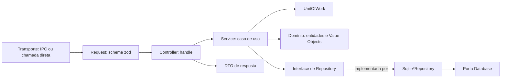

# Núcleo (`packages/core`)

Esta página descreve o núcleo compartilhado do Finanças: o pacote TypeScript que contém toda a
regra de negócio e o acesso ao banco, e que roda igual no desktop (Electron) e no celular (React
Native/Hermes). Cobre as camadas Request → Controller → Service → Repository → Model, o mapa de
rotas, os erros como resultado, as portas e seus adaptadores, a raiz de composição, a unidade de
trabalho, o domínio puro com seus Value Objects, a aritmética monetária, as fronteiras verificadas
por lint e a paridade entre runtimes. O schema que o núcleo lê e escreve está em
[Banco de dados](banco-de-dados.md); a visão do sistema inteiro, em
[Visão geral](visao-geral.md).

## 1. Papel e restrições

### 1.1 Um núcleo TypeScript que não depende do Node

O núcleo é um único pacote, `@finance/core`, em **TypeScript puro**: usa só a linguagem e a
biblioteca padrão do ECMAScript (mais `zod` e as bibliotecas criptográficas `@noble/*`, também
puras). Tudo que é da plataforma — banco, relógio, geração de ids, pasta de backups, rede da
sincronização — entra por portas (§4).

O motivo é que o mesmo código precisa rodar em três ambientes sem reescrita: o processo Node do
Electron, o Hermes do React Native (que não tem `fs`, `crypto` do Node, `Buffer` nem módulos
nativos) e, eventualmente, um servidor. Um único `import 'node:fs'` quebraria o celular, e só no
celular. Por isso a regra é verificada por lint (§7), não por disciplina.

O `number` do JavaScript é o mesmo double IEEE-754 que o `REAL` do SQLite, então um valor lido do
banco, somado no núcleo e gravado de volta não passa por conversão nenhuma (§6.4). Por que
TypeScript e não Rust, Kotlin Multiplatform ou Flutter: ver [decisões](../decisoes.md)
([ADR 3](../decisoes.md#adr-3)).

### 1.2 O risco é exatidão, não desempenho

A escala é de dezenas de milhares de transações em anos de uso. Recalcular os saldos de uma conta é
somar algumas centenas de linhas por mês, na casa de milissegundos, e **a agregação pesada fica no
SQL** (`SUM` por contêiner mensal, window functions, CTEs), executada no código C do SQLite. O
núcleo orquestra e aplica regras; não itera o histórico inteiro.

Os bugs prováveis são de **exatidão**: em qual fatura cai uma compra, como uma parcela é
arredondada, se uma transação excluída entrou num total, se o fechamento de abril acompanhou a
edição de março. Isso se resolve com contratos explícitos (o Value Object `Money`, §6.3) e testes
([Testes](testes.md)), não com uma linguagem mais rápida. O orçamento de desempenho das chamadas
interativas (p95 ≤ 50 ms) é medido por um benchmark próprio ([Testes](testes.md) §5).

### 1.3 Onde o núcleo roda

| Destino | Processo | Como as rotas são expostas |
|---|---|---|
| Desktop (Electron) | Um `utilityProcess` dedicado, dono da única conexão com o banco | `core.dispatch` atrás de mensagens IPC; o renderer nunca acessa o banco |
| Celular (React Native) | A thread JavaScript do app (Hermes) | `core.call` direto, encapsulado no `DirectCoreClient` |
| Testes | O processo do Vitest | `core.call` ou os Services diretamente |

No desktop o núcleo não roda no processo principal porque a porta de banco é síncrona (§4.2): uma
consulta lenta ali congelaria janelas e menus. Um processo separado isola o banco e mantém uma única
conexão escritora, o modelo de concorrência que o SQLite prefere. No celular as consultas desta
escala levam milissegundos e a renderização do React Native acontece em outra thread; o `client`
ainda adia a chamada para depois do frame corrente. Detalhes em [Desktop](desktop.md) e
[Mobile](mobile.md).

### 1.4 Estrutura do pacote

| Pasta | Conteúdo |
|---|---|
| `src/requests/` | Schemas zod da camada Request, um arquivo por área, e os campos comuns (`fields.ts`) |
| `src/controllers/` | Um Controller por área, `CoreResult.ts` e o mapa de rotas `routes.ts` |
| `src/services/` | Casos de uso por área e a `UnitOfWork` |
| `src/repositories/` | **Interfaces** dos Repositories, em termos do domínio |
| `src/domain/` | Modelo: entidades, Value Objects e regras puras, sem I/O |
| `src/dto/` | DTOs de resposta e as funções `to...Response` |
| `src/ports/` | Portas (`Database`, `Clock`, `IdGenerator`, `WallClock`, `BackupDirectory`, rede da sincronização) |
| `src/infrastructure/` | Implementações sobre a porta `Database`: Repositories SQLite, migrations, captura da sincronização |
| `src/composition/` | A raiz de composição: `openDatabase` e `createCore` |
| `src/protocol/` | Protocolo e canal seguro da sincronização ([Sincronização](sincronizacao.md)) |
| `src/contract/` | Suíte de contrato da porta `Database`, exportada como `@finance/core/contract` |
| `src/golden/` | Vetores de ouro para paridade entre runtimes (§8) |
| `src/benchmark/` | Roteiro de medição das chamadas interativas |

O pacote exporta pelo `package.json`: `.` (API pública, [index.ts](../../../packages/core/src/index.ts)),
`./requests` (os schemas, para os formulários da UI validarem com o mesmo schema da fronteira),
`./contract`, `./golden` e `./benchmark`.

## 2. Camadas

Cada camada só conhece a de baixo. A dependência entre camadas não é verificada por lint (só as
fronteiras de plataforma são, §7); ela é mantida por convenção e pela própria tipagem — um
Controller só recebe Services no construtor, e um Service só recebe interfaces de Repository e
portas.

### 2.1 Request

A entrada de toda rota é tratada como **não confiável** — o renderer do Electron é um cliente como
um cliente HTTP seria — e validada por um schema zod em `src/requests/`. O schema não só valida: ele
**produz o comando tipado** do Service, já com Value Objects. Os campos comuns
([fields.ts](../../../packages/core/src/requests/fields.ts)) mostram o padrão:

- `parsedText(parse)` converte texto num tipo de domínio pelo parser do próprio Value Object (ids
  marcados, `LocalDate`, `YearMonth`), de modo que a validação e o tipo vêm do mesmo lugar;
- `moneyField` limita o valor a ±1 trilhão (`MONEY_MAX_AMOUNT`, §6.4);
- `registryNameField` corta espaços e limita o nome a 45 caracteres.

Os schemas usam `z.strictObject`, que recusa campos desconhecidos. Uma entrada recusada vira
`VALIDATION_FAILED` com o campo e o motivo do primeiro problema, para a UI apontar o campo do
formulário. Os mesmos schemas são exportados por `@finance/core/requests` para os formulários, para
que a validação da tela e a recusa do núcleo nunca discordem.

### 2.2 Controller

Um Controller por área ([controllers/](../../../packages/core/src/controllers/)), sem regra: cada
método chama `handle(schema, raw, action, onUnexpected)`
([CoreResult.ts](../../../packages/core/src/controllers/CoreResult.ts)), que valida com o schema,
executa o caso de uso e converte o resultado num DTO. `handle` é **o único lugar que traduz exceção
em resultado**, para que todas as rotas falhem do mesmo jeito (§3.3). As rotas da sincronização, que
esperam a rede, usam `handleAsync`.

Os Controllers devolvem `Promise` mesmo com o trabalho síncrono por baixo: a assincronia existe na
fronteira de transporte (IPC, ponte do React Native), não dentro da regra de negócio (§4.2).

### 2.3 Service e unidade de trabalho

Os Services ([services/](../../../packages/core/src/services/)) implementam os casos de uso: validam
as regras que relacionam várias linhas ou tabelas, montam o grafo de objetos (ids incluídos), gravam
pelos Repositories e disparam o recálculo de saldos. Exemplos: `TransactionService` e
`TransactionComposer` (o ponto de controle de validação dos lançamentos), `RecurrenceService`,
`InvoiceService`, `CascadeDeletionService`, `BalanceRecalculationService`.

A [`UnitOfWork`](../../../packages/core/src/services/UnitOfWork.ts) é como um caso de uso inteiro
acontece numa **única transação de banco** — gravar o lançamento, garantir extrato e fatura,
recalcular os saldos:

- **`run(work)`** é **reentrante**: Services chamam Services (o lançamento chama o recálculo, que
  também é caso de uso), então só a chamada mais externa abre a transação e as internas participam
  dela. Fazer isso na unidade de trabalho, e não com transações aninhadas no driver, evita depender
  de savepoints, que cada adaptador implementa de um jeito.
- **`runAlone(work)`** exige ser a unidade mais externa e lança se for chamada dentro de outra. É
  para quem trata a falha de uma parte e segue com as outras — o complemento das recorrências, série
  a série. Dentro de outra unidade, `run` só participaria dela, e a parte que falhou ficaria gravada
  pela metade.
- **`rehearse(work)`** executa numa transação **sempre desfeita** e devolve o resultado. É usada
  pela verificação de integridade (roda o recálculo de verdade e compara com o cache sem gravar) e
  pelo plano do diálogo de revisão das recorrências (executa a própria operação para listar o que
  ela faria, e por isso nunca discorda do que é gravado). Também recusa rodar dentro de outra
  unidade, porque o rollback desfaria escritas legítimas da externa.

### 2.4 Repository

As **interfaces** ficam em [repositories/](../../../packages/core/src/repositories/) e falam a língua
do domínio (`findById(id: AccountId): Account | null`); as **implementações** ficam em
[infrastructure/sqlite/](../../../packages/core/src/infrastructure/sqlite/) (`Sqlite*Repository`) e
são as únicas que escrevem SQL. O SQL é escrito à mão e é o contrato — não há ORM (ver
[decisões](../decisoes.md), [ADR 36](../decisoes.md#adr-36)).

Responsabilidades que só existem nessa fronteira
([Banco de dados](banco-de-dados.md) §3.3): traduzir `snake_case` ↔ `camelCase`, carimbar
`updated_at` pela porta `Clock`, filtrar `deleted_at IS NULL` em toda leitura e conferir o tipo de
cada coluna lida com o [`RowReader`](../../../packages/core/src/infrastructure/sqlite/RowReader.ts),
que lança `CorruptRowError` em vez de deixar um `NaN` entrar num saldo. Gravar dados do usuário e
gravar o cache de saldo são métodos separados (`save` versus `saveBalances`), para que a rotina de
recálculo nunca toque um dado do usuário como o `opening_balance`.

### 2.5 Domínio (Model)

O domínio ([domain/](../../../packages/core/src/domain/)) é puro: sem I/O, sem portas, testável sem
banco. Contém as entidades por área (`Account`, `Transaction`, `Invoice`, `Recurrence`, `Goal`...),
os Value Objects compartilhados (§6) e as regras puras de cálculo — o ciclo de fatura
(`BillingCycle`), o calendário das recorrências (`RecurrenceSchedule`), a cadeia de extratos
(`StatementChain`), o progresso de metas (`GoalProgress`), o HLC da sincronização.

Regras do padrão de código que o domínio segue:

- **Imutabilidade:** propriedades `readonly`; operações devolvem nova instância (`account.disable(now)`
  devolve outra conta). Isso torna seguro passar entidades entre Services sem cópias defensivas.
- **Invariantes da própria linha na entidade** (por exemplo `paid` e `payment_date` concordarem em
  `Transaction`, o tipo da transação não mudar numa edição); invariantes que relacionam linhas ou
  tabelas ficam no Service ([Banco de dados](banco-de-dados.md) §3.10).
- **Construtores privados e fábricas** (`Money.of`, `LocalDate.parse`, `Account.create`), para que
  nenhum valor inválido exista.

### 2.6 DTOs de resposta

Os Services devolvem objetos de domínio; o Controller os converte em DTOs ([dto/](../../../packages/core/src/dto/))
com funções `to...Response`. DTOs são só dados — o IPC do Electron serializa por structured clone e
uma classe chegaria sem métodos. O exemplo central é
[`MoneyResponse`](../../../packages/core/src/dto/shared/MoneyResponse.ts) (`{ amount, currency }`):
`toMoneyResponse` **arredonda** na precisão da moeda, porque a fronteira de apresentação é um dos dois
únicos pontos onde se arredonda (§6.4). A formatação para a tela (separadores, sinal) é do `client`.

## 3. Rotas e contrato com a UI

### 3.1 O mapa de rotas

[routes.ts](../../../packages/core/src/controllers/routes.ts) declara `CoreRoutes`: para cada rota, o
tipo de entrada (`z.input` do schema da Request) e o de saída (o DTO). É o contrato tipado que o
`client` consome nas duas plataformas: mudar uma rota quebra a compilação da UI, não o app em
produção. `RouteHandlers` exige um handler para cada rota e confere o tipo de saída de cada um.

As rotas são agrupadas por área, no formato `área.ação`:

| Área | Rotas |
|---|---|
| Perfis e primeiro uso | `profiles.list/create/update/setDefaultAccount/setDefaultCreditCard`, `onboarding.start` |
| Contas | `accounts.list/transferTargets/create/update/disable/enable/deletionImpact/delete` |
| Cartões | `creditCards.list/create/update/disable/enable/deletionImpact/delete` |
| Classificação | `categories.tree/create/update/delete`, `subCategories.create/update/delete`, `tags.list/create/update/delete` |
| Sócios, anotações, metas | `partners.list/save`, `notes.*`, `goals.list/options/contributions/create/update/archive/unarchive/delete` |
| Lançamentos | `transactions.create/update/delete/get/listByPeriod/nameSuggestions/setPaid/setPartner` |
| Recorrências | `recurrences.list/occurrences/preview/planCreate/planUpdate/planDelete/topUp` |
| Extratos, saldos, faturas | `statements.get/profileInvoices`, `balances.ofProfile/rebuildAccount`, `invoices.suggest/get/listByCard/pay/reopen` |
| Integridade | `integrity.verifyBalances` |
| Relatórios e visão do mês | `reports.*`, `reports.byPartner/entriesWithoutPartner/balanceProjection`, `overview.spending/pending/nextInvoices` |
| Importação | `imports.run` |
| Sincronização | `sync.status/createGroup/open/close/createInvite/cancelInvite/join/connect/removeMember/leave` |

As regras de cada área estão nas páginas de [regras de negócio](../README.md).

### 3.2 `call` e `dispatch`

O núcleo montado implementa `CoreApi` com duas portas de entrada:

- **`call(route, input)`**, tipada, para quem conhece a rota em tempo de compilação
  (`DirectCoreClient`, testes). A entrada é validada de novo pela Request mesmo assim: o tipo em
  tempo de compilação não protege contra dados vindos de fora.
- **`dispatch(route, input)`**, não tipada, para o transporte que recebe a rota como texto (o IPC do
  desktop). Uma rota desconhecida vira `VALIDATION_FAILED` em vez de exceção; a verificação usa
  `Object.hasOwn`, sem cast.

### 3.3 Erros atravessam como resultado

Toda rota devolve `Promise<CoreResult<T>>`, uma união discriminada
`{ ok: true, data } | { ok: false, error }`, e nunca rejeita a promessa. Exceção não serve como
contrato: pelo IPC ela chegaria ao renderer sem classe nem campos próprios. O
[`CoreError`](../../../packages/core/src/controllers/CoreResult.ts) é só dados: `code`, `message`
(técnica, para log; a UI escolhe o texto pelo código) e `details` (só primitivos, pelo mesmo motivo do
structured clone).

Os códigos formam um conjunto **fechado** (`ErrorCode` em
[errors.ts](../../../packages/core/src/domain/shared/errors.ts)), tratado de forma exaustiva pela UI,
para que um código novo quebre o build da UI em vez de cair num `default`:

| Código | Origem |
|---|---|
| `VALIDATION_FAILED` | Schema zod da Request ou `InvalidValueError` do domínio (data inexistente, moeda inválida, id malformado) |
| `NOT_FOUND` | `NotFoundError`: linha inexistente **ou** excluída — para o usuário são o mesmo caso |
| `BUSINESS_RULE_VIOLATION` | `BusinessRuleViolation`, com uma regra do conjunto fechado `BusinessRule` (`account-disabled`, `goal-requires-saving-type`, `recurrence-move-requires-all`...) |
| `CONFLICT` | `NameConflictError`: nome repetido no escopo |
| `SCHEMA_NEWER_THAN_APP` | `SchemaNewerThanAppError`, na abertura ([Banco de dados](banco-de-dados.md) §5.8) |
| `INTERNAL` | Qualquer coisa que não seja `DomainError` — um bug |

`BusinessRule` também é fechado pelo mesmo motivo: a UI tem um mapa exaustivo de mensagens por regra.
`toCoreError` separa o esperado do bug: um `DomainError` vira o código dele; qualquer outra exceção é
entregue ao `onUnexpectedError` (o log da plataforma) e vira `INTERNAL` sem detalhes. As rotas que
devolvem falhas parciais dentro de um sucesso — o complemento de recorrências, série a série — usam a
mesma tradução, para falhar do mesmo jeito que uma rota inteira.

## 4. Portas e infraestrutura

### 4.1 Catálogo de portas

O núcleo só enxerga interfaces em [ports/](../../../packages/core/src/ports/); cada plataforma
fornece adaptadores finos e sem regra.

| Porta | O que oferece | Por que é porta | Adaptadores |
|---|---|---|---|
| `Database` | `run`, `get`, `all`, `exec`, `transaction(fn)`, todos síncronos, com parâmetros nomeados (`:nome`) | O driver SQLite muda por plataforma | `BetterSqliteDatabase`, `ExpoSqliteDatabase` |
| `Clock` | `now()` (instante UTC `YYYY-MM-DD HH:MM:SS`, o `Timestamp`) e `today()` (data **local** do usuário) | Datas são a maior fonte de bug em finanças; os testes precisam fixar e mover o tempo | `SystemClock` (no `client`), `FixedClock` (testes) |
| `IdGenerator` | `random()`: UUID v4 | O React Native não tem `crypto.randomUUID()` | `CryptoIdGenerator` (desktop), `ExpoIdGenerator` (celular), `SequentialIds` (testes) |
| `WallClock` | `millis()` | Só o HLC da sincronização precisa de milissegundos; mantê-lo fora da `Clock` poupa todo adaptador e teste de fornecer uma leitura que só a sincronização consome | `SystemWallClock`, `ManualWallClock` (testes) |
| `BackupDirectory` | `pathOf`, `list`, `remove`, síncronos | O núcleo não lê disco, mas a regra do backup (quando, como nomear, quantos guardar) é uma só | `NodeBackupDirectory`, `ExpoBackupDirectory` |
| Rede da sincronização | `Transport`, `Discovery`, `KeyStore`, `RandomSource`, `SnapshotPort` | Sockets, mDNS, armazenamento de chave e aleatoriedade são da plataforma; protocolo e criptografia ficam no núcleo | Ver [Sincronização](sincronizacao.md) |

Duas leituras de tempo diferentes de propósito: `now` carimba `updated_at` em UTC; `today` decide o
mês corrente no calendário local — às 22h do dia 31 em São Paulo o UTC já está no dia 1º, mas o mês do
usuário não virou. O UUID v5 determinístico **não** é porta: precisa dar o mesmo resultado em todo
dispositivo, então é implementado no próprio núcleo (§6.2).

### 4.2 A porta de banco é síncrona

`Database` expõe chamadas **síncronas**, e `transaction(fn)` recebe uma função síncrona
([Database.ts](../../../packages/core/src/ports/Database.ts)). A unidade de trabalho é sagrada neste
desenho: as duas pontas de uma escrita, a série inteira de uma recorrência, o recálculo de saldos e a
captura da sincronização precisam estar na **mesma** transação. Com API assíncrona sobre uma única
conexão, outro trecho de código poderia intercalar um `await` no meio da transação de alguém e escrever
dentro dela; evitar isso exigiria uma fila ou um mutex em volta de toda escrita. Com API síncrona, nada
intercala por construção, e os dois drivers escolhidos oferecem transação síncrona.

O custo é que uma consulta bloqueia a thread onde o núcleo roda — daí o `utilityProcess` no desktop
(§1.3). Alternativa descartada em [decisões](../decisoes.md) ([ADR 30](../decisoes.md#adr-30)).

Detalhes da porta que são contrato:

- **`SqlValue` é `string | number | null`**: booleanos viram 0/1 e datas viram texto antes de chegar à
  porta, para nenhum driver decidir conversão.
- **Parâmetros nomeados, não posicionais:** as consultas de saldo repetem o mesmo valor em vários
  pontos, e um `?` fora de ordem produziria um número errado em vez de um erro.
- **`transaction` desfaz em qualquer exceção** — é assim que `UnitOfWork.rehearse` pede o rollback.
- **`exec`** existe para scripts sem parâmetros: as migrations.

### 4.3 `infrastructure/`

Tudo que implementa algo sobre as portas, e nada de regra de negócio:

- **`infrastructure/sqlite/`** — os `Sqlite*Repository`, a configuração da conexão
  ([connection.ts](../../../packages/core/src/infrastructure/sqlite/connection.ts)), o `RowReader`, os
  códigos dos enums (`enumCodes.ts`), o SQL de períodos (`periodSql.ts`, testado contra o domínio) e a
  cópia/inspeção do arquivo de banco (`DatabaseCopy.ts`).
- **`infrastructure/migrations/`** — o runner, o backup e as migrations embutidas
  ([Banco de dados](banco-de-dados.md) §5).
- **`infrastructure/sync/`** — `CapturingDatabase`, um decorador da porta `Database` que registra as
  escritas para a sincronização, e os triggers `TEMP` de captura
  ([Sincronização](sincronizacao.md)).

### 4.4 Adaptadores por plataforma

Os adaptadores de banco vivem em pacotes próprios — `packages/sqlite-better` (desktop e testes) e
`packages/sqlite-expo` (celular) —, descritos em [Banco de dados](banco-de-dados.md) §6. Os de relógio
e ids ficam nos apps e no `client`. Todo adaptador de `Database` passa pela mesma suíte de contrato
([Banco de dados](banco-de-dados.md) §6.3).

## 5. Raiz de composição

Implementações concretas só entram no núcleo pela raiz de composição
([createCore.ts](../../../packages/core/src/composition/createCore.ts)). Domínio e Services dependem só
de portas e interfaces de Repository; a raiz é o único lugar que instancia `Sqlite*Repository`.

### 5.1 `openDatabase`: preparar o banco

`openDatabase(database, { backups, clock, migrations? })` aplica a configuração da conexão, grava o
backup quando há migration pendente e roda o runner, devolvendo um `MigrationReport`. Fica separado de
`createCore` porque a sequência de abertura precisa tratar cada falha de um jeito (bloquear, oferecer
backup) antes de qualquer Service existir, e porque as migrations precisam rodar **antes** de a captura
da sincronização ser instalada ([Banco de dados](banco-de-dados.md) §5.9). Quem orquestra a sequência
completa é o `openCoreSequence` do `client` ([Banco de dados](banco-de-dados.md) §5.5).

### 5.2 `createCore`: montar o núcleo

`createCore(ports: CorePorts)` recebe as portas e devolve o `Core`: o `CoreApi` (§3.2) mais os Services
montados (`core.services`), para testes e ferramentas que compõem casos de uso no próprio processo.
Em ordem, ele:

1. instala a captura da sincronização quando recebe `wallClock`, decorando a porta `Database` com
   `CapturingDatabase` — todo Repository passa a usar a porta decorada;
2. cria uma única `UnitOfWork` sobre essa porta, compartilhada por todos os Services;
3. instancia Repositories, Services e Controllers, injetando dependências pelo construtor (sem
   contêiner de injeção: o grafo é explícito e o compilador confere);
4. monta a tabela de rotas.

Partes opcionais:

- **Sem `wallClock`** (ferramentas, benchmark), nada é capturado e toda rota `sync.*` responde
  `sync-unavailable`.
- **Sem `syncNetwork`**, o núcleo ainda captura e aplica lotes (os testes fazem assim), mas a tela de
  Dispositivos não conecta.
- **`onUnexpectedError`** recebe os bugs para log; o padrão descarta. Nos testes ele relança, para que
  um bug nunca passe como `INTERNAL`.

## 6. Domínio puro e Value Objects

Os Value Objects de [domain/shared/](../../../packages/core/src/domain/shared/) substituem tipos
primitivos onde a mistura causaria erro silencioso.

### 6.1 Ids marcados

`Brand<T, B>` ([ids.ts](../../../packages/core/src/domain/shared/ids.ts)) é uma `string` que o
compilador distingue das outras: passar o id de uma conta onde se espera o de uma fatura é erro de
compilação, não um saldo errado descoberto meses depois. As marcas se acumulam (`AccountId` é `Uuid` e
mais alguma coisa) porque a marca é um objeto com uma chave por marca; com um literal, as interseções
virariam `never`.

Cada id tem um único ponto de entrada validado, gerado por `idParser`
(`AccountId(raw)`, `InvoiceId(raw)`...), que chama `parseUuid`: normaliza para minúsculas — o SQLite
compara byte a byte e um id em maiúsculas vindo de uma importação apontaria para "outra" linha — e
lança `InvalidValueError` se o texto não for UUID. Um `as AccountId` solto é exatamente o atalho que a
marca existe para impedir.

### 6.2 Ids determinísticos

[DeterministicIds.ts](../../../packages/core/src/domain/shared/DeterministicIds.ts) implementa o UUID v5
(RFC 9562) em TypeScript puro sobre `@noble/hashes`, com o namespace fixo `APP_UUID_NAMESPACE`, e as
funções que derivam o id de linhas identificadas pelo conteúdo (extratos, faturas, ocorrências de
recorrência, vínculos de tag). Por que existem e quais são: [Banco de dados](banco-de-dados.md) §3.5. O
namespace e o formato de cada chave nunca mudam; a implementação é conferida contra o exemplo do RFC e
pelos vetores de ouro no Hermes (§8).

### 6.3 `Money` e `Currency`

[`Money`](../../../packages/core/src/domain/shared/Money.ts) é o Value Object imutável de dinheiro: um
`amount` (`number`, em unidades da moeda, não em centavos) e uma
[`Currency`](../../../packages/core/src/domain/shared/Currency.ts). Fora do Repository e dos DTOs,
nenhum `number` solto representa dinheiro; é aqui que vivem o arredondamento, a comparação com epsilon
e a proibição de misturar moedas, num único lugar.

- `Currency.of(code)` valida o código ISO 4217 e carrega as **casas decimais** da moeda (2 por padrão;
  0 para JPY, CLP, KRW...; 3 para KWD, BHD...; 4 para CLF, UYW). As instâncias são cacheadas.
- `Money.of` recusa `NaN` e infinitos (um deles contaminaria toda a cadeia de fechamentos) e normaliza
  `-0` para `0`, porque "-0,00" na tela é defeito visível.
- `add`, `subtract`, `equals` entre moedas diferentes lançam `InvalidValueError` em tempo de execução.
- O valor interno **não é arredondado**; `rounded()` arredonda só quando pedido, nas fronteiras.

### 6.4 Aritmética monetária

Regras que o `Money` e a rotina de recálculo cumprem juntos:

1. **Arredondar só nas fronteiras** — ao persistir e ao apresentar (`toMoneyResponse`), nunca em
   valores intermediários acumulados.
2. **Meio para longe do zero** (`2,345 → 2,35`; `-2,345 → -2,35`), o que o usuário espera de um extrato.
   `roundHalfAwayFromZero` não usa `Math.round(x * 100) / 100`, que erra `1,005` (o double guarda
   `1,00499999…`) e arredonda negativos para o lado errado: ele arredonda sobre a representação decimal
   mais curta do número (`toPrecision(15)`), que é o valor que o usuário digitou, e monta o resultado
   com `BigInt`.
3. **Igualdade com epsilon** de meia unidade mínima da moeda (`0,005` em BRL): `Money.equals`,
   `isZero` e `isNegative` usam esse epsilon. O mesmo comparador é usado pelo matcher dos testes
   (`toEqualMoney`).
4. **Divisão distribui o resto.** `Money.split(n)` divide em unidades mínimas inteiras e dá o resto à
   **primeira** parte: R$ 1.000,00 em 3 vira `333,34 + 333,33 + 333,33`, e a soma é sempre exatamente o
   total. Regra de negócio (Parcelamento) detalhada em
   [Recorrências](../regras-de-negocio/recorrencias.md).
5. **Teto de entrada.** Regra de negócio (Dinheiro): todo valor informado pelo usuário fica entre −1
   trilhão e 1 trilhão, inclusive (`MONEY_MAX_AMOUNT`). Com os centavos são 15 dígitos significativos,
   exatamente o que o `toPrecision(15)` lê; acima disso o arredondamento perderia centavos. O teto vale
   nas fronteiras de entrada (`moneyField` e o `parseMoneyInput` do `client`), não no `Money.of`: somas
   e saldos derivados não podem lançar por passar dele.
6. **Saldos em cache nunca são incrementados.** Extratos, faturas e contas são sempre **recalculados a
   partir das transações** do mês afetado (um `SUM` no SQL), nunca `saldo += valor`. Incrementar
   acumula erro de float a cada escrita e transforma um bug pontual em desvio permanente; recalcular
   faz do cache uma função pura dos fatos. O fechamento se propaga: editar março recalcula março e
   todos os meses seguintes da conta. Existe **uma** rotina de recálculo
   ([BalanceRecalculationService.ts](../../../packages/core/src/services/balance/BalanceRecalculationService.ts)),
   chamada pelo lançamento, pelo pagamento de fatura, pela exclusão em cadeia, pelo reparo, pela
   sincronização e, numa transação desfeita, pela verificação de integridade.

**Por que double basta.** O recálculo nunca soma o histórico inteiro de uma vez: soma um mês e encadeia
os fechamentos. O erro de uma soma de `n` parcelas é da ordem de `n × 10⁻¹⁶ × total`: um mês com 500
lançamentos somando R$ 500 mil erra no máximo ~`3·10⁻⁸`; 360 fechamentos encadeados com saldo de
R$ 10 milhões, ~`4·10⁻⁷` — mais de dez mil vezes abaixo de meio centavo, e cada fechamento ainda é
arredondado ao ser persistido. Por isso não há soma compensada (Kahan) nem biblioteca decimal
([ADR 28](../decisoes.md#adr-28) nas [decisões](../decisoes.md)).

### 6.5 Datas e tempo

- **`LocalDate`** ([LocalDate.ts](../../../packages/core/src/domain/shared/LocalDate.ts)): data de
  calendário sem fuso (`YYYY-MM-DD`), com aritmética por dia epoch, `clampedTo(período, dia)` (o "dia
  inexistente vira o último dia do mês" de cartões e recorrências) e dia da semana ISO. Nada de `Date`:
  um `Date` construído no fuso errado só vira bug perto da meia-noite.
- **`YearMonth`** ([YearMonth.ts](../../../packages/core/src/domain/shared/YearMonth.ts)): a competência
  dos contêineres mensais, com `next`, `plusMonths`, `monthsUntil`, `lengthInDays`.
- **`Timestamp`** ([Clock.ts](../../../packages/core/src/ports/Clock.ts)): instante UTC com precisão de
  segundo no formato do schema, validado por `parseTimestamp`.
- **Nada no núcleo lê o relógio do sistema**: `new Date()` e `Date.now()` são proibidos por lint (§7);
  "hoje" vem sempre de `Clock.today()`.

### 6.6 Nomes e ordenação de texto

[names.ts](../../../packages/core/src/domain/shared/names.ts) valida nomes de cadastro (`requireName`,
45 caracteres por padrão) e compara nomes sem diferenciar maiúsculas e acentos (`sameName`, `foldName`),
completando o `COLLATE NOCASE` do SQLite, que só dobra ASCII.
[textOrder.ts](../../../packages/core/src/domain/shared/textOrder.ts) ordena nomes (`compareNames`,
`nameSortKey`) e texto por unidade de código (`compareCodeUnits`) **sem** `localeCompare` nem `Intl`,
que dependem do ICU de cada runtime: o Chromium e o Hermes ordenariam a mesma lista de jeitos
diferentes. A ordenação faz parte dos vetores de ouro (§8).

## 7. Fronteiras verificadas por lint

O [eslint.config.js](../../../eslint.config.js) usa `typescript-eslint` no modo `strictTypeChecked` em
todo o monorepo (mais tipo de retorno explícito, `import type`, acessibilidade explícita de membros e
`switch` exaustivo) e aplica regras de fronteira por pacote. As do núcleo
(`packages/core/src/**`) são:

| Regra | Proíbe | Por quê |
|---|---|---|
| `no-restricted-imports` | `node:*`, `fs`, `path`, `crypto`, `os`, `electron`, `react-native`, `expo-*`, `better-sqlite3` | O núcleo roda no Hermes; plataforma só entra por portas |
| `no-restricted-syntax` | `new Date(...)`, `Date.now` | Use a porta `Clock` |
| `no-restricted-syntax` | `Math.random`, `crypto.*` | Use a porta `IdGenerator` |
| `no-restricted-syntax` | `.localeCompare`, `.toLocale*` | Dependem do ICU do runtime; use `textOrder.ts` |
| `no-restricted-globals` | `Intl` | Difere entre Chromium e Hermes; formatar é do `client` |

O TypeScript roda no modo mais estrito do [tsconfig.base.json](../../../tsconfig.base.json) (`strict`,
`noUncheckedIndexedAccess`, `exactOptionalPropertyTypes`, `noImplicitOverride`), e o `CLAUDE.md`
proíbe `any` e `as` para silenciar o compilador. Os outros pacotes têm fronteiras próprias no mesmo
arquivo (`client` sem React DOM/React Native/Electron/Node/`Intl`; `sqlite-expo` só com
`@finance/core` e o contrato; telas do mobile só com o `client`), descritas em [Desktop](desktop.md) e
[Mobile](mobile.md).

O lint **não** verifica a direção das dependências entre as camadas do núcleo (Controller → Service →
Repository) nem o uso de `===` em dinheiro; ambas dependem de revisão (§10).

## 8. Paridade entre runtimes

O mesmo código precisa dar o mesmo resultado no Node (desktop e testes) e no Hermes (celular). Os
pontos de risco são arredondamento, UUID v5 e ordenação de texto. Para eles existem **vetores de ouro**
([goldenVectors.ts](../../../packages/core/src/golden/goldenVectors.ts)): o Node calcula a saída de
entradas escolhidas para os casos difíceis (`1.005`, negativos, dízimas, os extremos do teto, moedas de
0, 2 e 3 casas, divisões com resto até 360 parcelas, nomes acentuados) e grava
[vectors.json](../../../packages/core/src/golden/vectors.json), nos grupos `money.rounded`,
`money.roundHalfAwayFromZero`, `money.split`, `uuid.deriveUuid`, `uuid.v5`, `text.nameSortKey` e
`text.compareNames`. O app de contrato (`apps/mobile-contract`) recalcula tudo no Hermes e aponta cada
divergência. Quando divergir, corrige-se o código para não depender do runtime — nunca se regenera o
arquivo para aceitar a saída do Hermes. Como rodar: [Testes](testes.md) §4.

## 9. Como o `client` consome o núcleo

O pacote `packages/client` é a camada headless compartilhada pelas duas UIs; o detalhe dele está em
[Desktop](desktop.md) e [Mobile](mobile.md). Na medida em que toca o núcleo:

- **`CoreClient`** é o núcleo como a UI o enxerga: hooks, view-models e telas só conhecem essa
  interface. O desktop injeta um cliente IPC (o renderer manda `route` + `input`, o `utilityProcess`
  chama `core.dispatch`); o celular e os testes do `client` injetam o `DirectCoreClient`, que chama
  `core.call` no mesmo processo, adiando a chamada para depois do frame no celular.
- **Os tipos vêm do núcleo:** `CoreRoutes`, `CoreInput`, `CoreOutput`, os DTOs e os códigos de erro. As
  telas do celular só podem importar **tipos** do núcleo (lint).
- **A sequência de abertura** (`openCoreSequence`, em `@finance/client/startup`) chama `openDatabase` e
  `createCore` e decide quando bloquear ([Banco de dados](banco-de-dados.md) §5.5).
- **`SystemClock`** mora no `client`, para os dois shells virarem o mês no mesmo instante.
- **Formatação** (moeda, datas, sinal) é do `client`, com vetores de ouro próprios; o núcleo entrega
  `MoneyResponse` já arredondado.

## 10. Limitações conhecidas

- **Direção das camadas não é verificada por lint**: um Controller que importasse um Repository
  passaria no `pnpm check`.
- **`===` em dinheiro não é proibido por lint**: só a convenção e o `Money.equals` impedem; a mistura de
  moedas também só falha em tempo de execução, não de compilação.
- **Sem porta de arquivos (`FileStore`)**: não há anexos ([Banco de dados](banco-de-dados.md) §4.15).
- **Serviço web** é só uma possibilidade do desenho; nenhum transporte HTTP existe.
