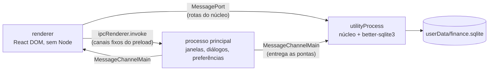
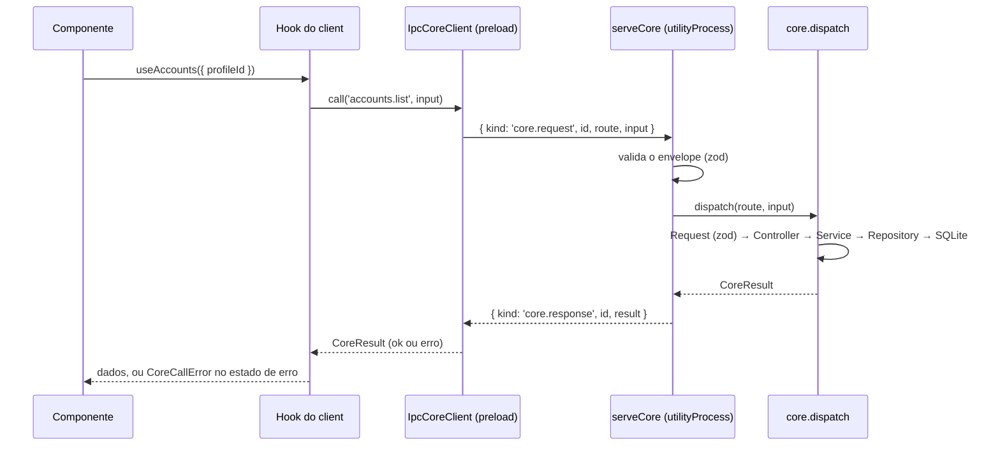

# Desktop

Como o app desktop (`apps/desktop`) é montado: os processos do Electron e o que cada um pode fazer,
a segurança do renderer, a fronteira entre a UI e o núcleo, a camada headless compartilhada com o
celular (`packages/client`), as bibliotecas do renderer, os tokens de design e o tema, o shell e a
navegação, a tela de Ajustes, o empacotamento e os testes. As convenções de interface que valem
para os dois apps estão na [§7](#7-convenções-de-ui-vigentes); a página do [celular](mobile.md)
remete a elas. As regras de negócio das telas estão nas páginas de
[regras de negócio](../regras-de-negocio/), e o núcleo em si, em [Núcleo](core.md).

## 1. Processos e responsabilidades

O desktop é o lugar do trabalho de análise — relatórios, tabelas densas, comparação entre meses —,
enquanto o uso diário fica no celular. É um app Electron com quatro alvos de build e um módulo de
tipos compartilhado. O shell é Electron, e não Tauri, porque o núcleo precisa de um runtime
JavaScript com SQLite síncrono num arquivo comum do disco (ver [decisões](../decisoes.md),
[ADR 8](../decisoes.md#adr-8)).



### 1.1 Os alvos de build

| Pasta | Processo | Responsabilidade |
|---|---|---|
| [`src/main`](../../../apps/desktop/src/main/index.ts) | Principal (Node) | Cria a janela e o `utilityProcess`, costura o canal entre eles, guarda as preferências do aparelho e a chave do aparelho (`safeStorage`), abre os diálogos do sistema (salvar, abrir), restaura backup e troca o banco. Não executa rota alguma. |
| [`src/preload`](../../../apps/desktop/src/preload/index.ts) | Preload (sandbox, mundo isolado) | Publica a ponte `window.finance` (`FinanceBridge`) por `contextBridge`. Guarda a ponta crua do `MessagePort` e expõe só `call`. |
| [`src/utility`](../../../apps/desktop/src/utility/index.ts) | `utilityProcess` (Node) | Dono da **única conexão** com o banco: roda a sequência de abertura, monta `createCore` com os adaptadores reais (relógio, ids, rede da sincronização) e atende as rotas pelo `MessagePort` de cada janela. |
| [`src/renderer`](../../../apps/desktop/src/renderer/src/App.tsx) | Renderer (Chromium) | React 19, roteador, cache de consultas e as telas. Só enxerga o `CoreClient` e a ponte. |
| [`src/shared`](../../../apps/desktop/src/shared/bridge.ts) | — (tipos e protocolo) | Contrato da ponte (`FinanceBridge`, `IPC_CHANNELS`) e o protocolo de requisição/resposta do canal do núcleo ([`coreProtocol.ts`](../../../apps/desktop/src/shared/coreProtocol.ts)). |

O núcleo roda fora do processo principal e da thread de UI porque a porta `Database` é síncrona
(ver [Núcleo](core.md)): uma consulta longa bloqueia só o `utilityProcess`, e a janela continua
respondendo.

### 1.2 Fluxo de uma chamada



O processo principal só cria a janela, o `utilityProcess` e o canal. Como a UI só enxerga o
`CoreClient`, o mesmo caminho (hook → `call` → `dispatch` → Controller) roda nos testes contra um
`DirectCoreClient` sobre SQLite em memória, sem abrir o Electron ([§3.1](#31-um-contrato-duas-implementações)).

### 1.3 Ciclo de vida do processo do núcleo

- [`CoreProcess`](../../../apps/desktop/src/main/CoreProcess.ts) cria o `utilityProcess` e, a cada
  carregamento de página (`did-finish-load`), entrega à janela uma ponta nova de
  `MessageChannelMain`: um recarregamento descarta o preload antigo junto com a ponta que ele tinha.
- Uma exceção não tratada no `utilityProcess` encerra o processo de propósito
  (`process.exit(1)`): continuar atendendo rotas a partir de um estado desconhecido poderia gravar
  no banco. O principal avisa as janelas pelo canal `core:closed`, e o renderer mostra a tela de
  erro ([§3.4](#34-falha-fatal)).
- Para restaurar backup ou importar uma cópia do banco, o principal pede ao núcleo que feche a
  conexão (prazo de 10 s) e, depois da troca do arquivo, **sobe um `utilityProcess` novo**
  (`restart`): repetir a sequência de abertura num processo novo é mais seguro que reabrir o banco
  num processo que já serviu outro.
- Com o banco bloqueado (schema mais novo, migration que falhou...), o `utilityProcess` atende
  qualquer rota com erro (`SCHEMA_NEWER_THAN_APP` ou `INTERNAL`) em vez de deixar a chamada sem
  resposta.

## 2. Segurança do renderer

O renderer é tratado como **entrada não confiável**: tudo que ele manda é validado do outro lado, e
ele não tem como pedir uma operação que não esteja na lista fechada da ponte.

### 2.1 Configuração da janela e travas globais

- `contextIsolation: true`, `sandbox: true`, `nodeIntegration: false`,
  `nodeIntegrationInWorker: false`, `webSecurity: true`
  ([`main/index.ts`](../../../apps/desktop/src/main/index.ts), `createWindow`).
- [`installSecurityGuards`](../../../apps/desktop/src/main/security.ts), ligado no evento
  `web-contents-created` para valer em qualquer janela futura sem ninguém lembrar de chamá-lo:
  bloqueia navegação e redirecionamento para fora do app, `<webview>` embutido e abertura de
  janelas novas, e **nega toda permissão** do navegador (câmera, notificação, área de
  transferência). Como o `navigator.clipboard` é negado, copiar o convite da sincronização passa
  por um canal próprio da ponte, só de escrita de texto.
- O fundo inicial da janela vem do token `bg` no tema que o sistema vai mostrar, para a janela não
  piscar em branco no tema escuro.

### 2.2 CSP

A CSP é injetada como `<meta>` no `index.html` (o app empacotado é servido de `file://`, que não
tem cabeçalhos) pelo plugin do [`electron.vite.config.ts`](../../../apps/desktop/electron.vite.config.ts):
`default-src 'self'`, `script-src 'self'`, sem conteúdo remoto, `object-src 'none'`,
`base-uri 'none'`, `form-action 'none'`. Estilo inline é permitido porque Radix, Recharts e o
Sonner posicionam e animam por estilo injetado; script inline continua proibido. Só o servidor de
desenvolvimento afrouxa a política (preâmbulo do React Refresh e WebSocket do HMR).

### 2.3 O que o preload expõe

A ponte ([`FinanceBridge`](../../../apps/desktop/src/shared/bridge.ts)) é a lista completa do que o
renderer alcança, e cada canal de `IPC_CHANNELS` valida a entrada no processo principal:

| Grupo | Para quê |
|---|---|
| `core` | O `CoreClient` (`call`) sobre o `MessagePort`. |
| `preferences` | Ler e gravar as preferências do aparelho ([§9](#9-preferências-do-aparelho)). |
| `startup` | Estado da abertura do banco e a única ação que as telas de bloqueio pedem: restaurar o backup da migration que falhou. |
| `failures` | Aviso de falha fatal (núcleo que caiu, exceção no principal). |
| `about` | Versões, caminho do banco e data da última cópia exportada (Ajustes). |
| `clipboard` | Copiar texto (o convite da sincronização). |
| `database` | Exportar e importar a cópia do banco e "mostrar na pasta". |
| `importFile` | Escolher e ler o arquivo da importação de transações; modelos de mapeamento salvos no aparelho. |
| `report` | Relato de problema ([§2.4](#24-relato-de-problema)). |

Nenhuma função genérica de IPC, nenhum `fs`, nenhum `shell`. **O renderer nunca escolhe um
caminho de arquivo nem um endereço**: os diálogos de salvar e de abrir rodam no principal, o
arquivo da importação chega como bytes e nome-base, e o caminho do banco é só leitura. A data da
última cópia exportada (`lastExportAt`) é gravada só pelo principal, depois de a cópia existir —
o pedido de preferências do renderer não a aceita.

### 2.4 Relato de problema

A tela de erro e as telas de bloqueio oferecem "relatar problema". O renderer manda só texto
(título, detalhes, descrição, incluir o log ou não); o principal valida com zod
([`problemReport.ts`](../../../apps/desktop/src/main/problemReport.ts)), lê o fim de `core.log` e
`main.log`, troca a pasta pessoal por `~` e abre com `shell.openExternal` um destino fixo: a issue
pré-preenchida no GitHub do projeto ou, para quem não tem conta, um `mailto:`. O log é cortado das
linhas antigas para caber no limite do endereço (~8 KB no GitHub, ~1,8 KB no `mailto:`). A issue
não é criada pela API porque isso exigiria um token com escrita no repositório dentro do app, que
qualquer um poderia extrair; sem servidor intermediário, quem envia é o usuário, pela própria
conta, depois de revisar o texto.

### 2.5 Sandbox de processo no devcontainer e no CI

Com `FINANCE_ELECTRON_NO_SANDBOX=1`, o
[`scripts/electron-vite.mjs`](../../../apps/desktop/scripts/electron-vite.mjs) e o
[`e2e/launchApp.ts`](../../../apps/desktop/e2e/launchApp.ts) desligam o sandbox **de processo** do
Chromium, porque o seccomp do Docker e o AppArmor do runner bloqueiam os namespaces de usuário que
ele exige. O `sandbox: true` das janelas continua valendo (renderer sem Node, preload restrito); no
computador do usuário o sandbox completo fica ligado.

## 3. Fronteira UI ↔ núcleo

### 3.1 Um contrato, duas implementações

O núcleo exporta o mapa de rotas ([`controllers/routes.ts`](../../../packages/core/src/controllers/routes.ts)):
para cada rota, o tipo da entrada e o do resultado. O `client` define sobre ele a interface
[`CoreClient`](../../../packages/client/src/core/CoreClient.ts):

```ts
interface CoreClient {
    call<R extends CoreRoute>(route: R, input: CoreInput<R>): Promise<CoreResult<CoreOutput<R>>>;
}
```

| Implementação | Onde | Como chega ao Controller |
|---|---|---|
| `IpcCoreClient` ([`coreProtocol.ts`](../../../apps/desktop/src/shared/coreProtocol.ts)) | Desktop | `MessagePort` do preload até o `utilityProcess`, com número de correlação por chamada (as respostas não têm ordem garantida); chamadas feitas antes de a ponta chegar ficam numa fila. |
| `DirectCoreClient` ([`CoreClient.ts`](../../../packages/client/src/core/CoreClient.ts)) | Celular e testes do `client` | Chamada direta no mesmo runtime, com um agendador opcional (no celular, depois do frame corrente — ver [celular §3.2](mobile.md#32-agendamento-pós-frame)). |

Hooks, view-models e telas só conhecem `CoreClient`, entregue por `CoreClientProvider`; trocar de
plataforma é trocar a implementação injetada na raiz do app. Por isso cada tela e cada hook pode
ser testado contra um `DirectCoreClient` sobre SQLite em memória, sem abrir o Electron.

### 3.2 O renderer fala direto com o núcleo

O principal cria um `MessageChannelMain` e entrega uma ponta ao `utilityProcess` e a outra ao
renderer, pelo preload. As chamadas de rota **não passam pelo processo principal**, que fica livre
para janelas e menus e não vira um gargalo nem um segundo lugar onde a validação poderia ser
esquecida. No `utilityProcess`, [`serveCore`](../../../apps/desktop/src/utility/serveCore.ts)
confere o envelope (`kind`, `id`, `route`) com zod e descarta para o log o que estiver fora do
protocolo; a entrada da rota é validada de novo dentro do núcleo.

### 3.3 Erros atravessam como resultado, não como exceção

O IPC do Electron serializa por *structured clone*: uma exceção lançada no `utilityProcess`
chegaria ao renderer sem a classe nem os campos próprios. Por isso toda rota devolve uma união
discriminada ([`CoreResult`](../../../packages/core/src/controllers/CoreResult.ts)):

```ts
type CoreResult<T> = { ok: true; data: T } | { ok: false; error: { code; message; details } };
```

- `code` é um conjunto fechado ([`ErrorCode`](../../../packages/core/src/domain/shared/errors.ts)):
  `VALIDATION_FAILED`, `NOT_FOUND`, `BUSINESS_RULE_VIOLATION`, `CONFLICT`,
  `SCHEMA_NEWER_THAN_APP`, `INTERNAL`. `details` só tem primitivos.
- As regras de `BUSINESS_RULE_VIOLATION` são uma união fechada (`BusinessRule`) no núcleo, com a
  mensagem de cada uma num `Record` exaustivo do `client`.
- Do lado da UI, [`CoreCallError`](../../../packages/client/src/errors/CoreCallError.ts) converte
  o `{ ok: false }` em exceção, porque o TanStack Query só entra no estado de erro quando a função
  da consulta rejeita; a exceção carrega o `CoreError` inteiro.
- [`describeError`](../../../packages/client/src/errors/describeError.ts) trata cada código num
  `switch` exaustivo: um código novo quebra a compilação ali, em vez de cair num `default`
  silencioso. As frases são as mesmas nos dois apps.
- Exceção inesperada dentro do núcleo vira `INTERNAL`, com log (`core.log`) no `utilityProcess`.

### 3.4 Falha fatal

No desktop, `INTERNAL` é **fatal**. O `CoreClient` entregue às telas é decorado por
[`FailFastCoreClient`](../../../apps/desktop/src/renderer/src/lib/failures.ts), que registra o erro
no `FailureStore`, e a raiz ([`FailureGate`](../../../apps/desktop/src/renderer/src/components/FailureGate.tsx))
troca o app inteiro por uma tela de erro com a opção de relatar o problema. O mesmo vale para
exceção na renderização (*error boundary*), promessa rejeitada sem tratamento, o `utilityProcess`
que termina e exceção não tratada no processo principal (canal `main:failed`). Só a primeira falha
fica: as seguintes costumam ser consequência dela. Seguir usando depois de um erro desconhecido
poderia mostrar número errado ou gravar dado pela metade; reabrir o app é o caminho de volta a um
estado conhecido.

### 3.5 Validação na fronteira

A camada Request do núcleo valida **toda** entrada, no `utilityProcess`, nunca só no renderer. Os
formulários reaproveitam os mesmos schemas zod (exportados por `@finance/core` e
`@finance/core/requests`) como resolver do react-hook-form, e
[`formIssues.ts`](../../../packages/client/src/forms/formIssues.ts) traduz o problema apontado pelo
schema na frase do campo. É conforto de UX, não garantia: a mensagem da tela e a recusa do núcleo
nunca discordam porque vêm da mesma regra, mas a recusa do núcleo continua sendo a que vale.

### 3.6 DTOs serializáveis

Entrada e resultado de toda rota são dados simples — objetos, arrays, strings, números, booleanos
e `null`; nada de instância de classe, `Date`, `Map` ou função
([`dto/index.ts`](../../../packages/core/src/dto/index.ts)). Sem isso, um DTO com um `Money`
funcionaria no celular, onde nada é serializado, e chegaria ao renderer sem os métodos. Um teste do
núcleo ([`rules.test.ts`](../../../packages/core/test/services/rules.test.ts), "todo DTO sobrevive
a structuredClone") passa o resultado de cada rota por `structuredClone` e compara.

## 4. `packages/client` — a camada headless compartilhada

React DOM e React Native não compartilham componentes visuais; o que se compartilha é tudo que fica
**acima** deles. O [`packages/client`](../../../packages/client/src/index.ts) reúne o contrato do
núcleo, os hooks de dados, os view-models, os formulários, os formatadores e a sequência de
abertura, e é usado igual pelo desktop e pelo celular. O que uma tela tem de regra de apresentação
mora aqui, para que o celular e o desktop mostrem os mesmos números com as mesmas frases.

### 4.1 Fronteira do pacote

O lint ([`eslint.config.js`](../../../eslint.config.js)) proíbe no `client`: `react-dom`,
`react-native`, `electron`, qualquer módulo do Node e o global `Intl`. React entra como dependência
par (`^19.2`), para os dois apps usarem uma cópia só. Subcaminhos exportados: `@finance/client`
(tudo), `@finance/client/startup` (abertura, sem React — o `utilityProcess` importa sem carregar
hooks) e `@finance/client/golden` (vetores de ouro).

### 4.2 Hooks e cache

- **TanStack Query**, que roda igual em React DOM e React Native.
  [`createQueryClient`](../../../packages/client/src/hooks/coreHooks.ts) desliga a retentativa para
  `CoreCallError` (erro do núcleo é determinístico: a mesma entrada falha igual) e só tenta de novo
  falha de transporte.
- `useCoreQuery(rota, entrada)` com chave `['core', rota, entrada]`; entrada `null` deixa a consulta
  parada (perfil ainda não escolhido) em vez de chamar o núcleo com lixo. Os hooks nomeados
  (`useAccounts`, `useInvoice`, `useStatement`...) ficam em
  [`routeHooks.ts`](../../../packages/client/src/hooks/routeHooks.ts).
- `useCoreQueries` para a mesma leitura numa lista só conhecida em tempo de execução (faturas de
  cada cartão do mês).
- `useCoreMutation(rota)` para as escritas: ao dar certo, aplica o mapa de invalidação e só então
  resolve, para quem espera o `mutateAsync` já encontrar as consultas marcadas como velhas.
- `useCoreRehearsal` para os ensaios do diálogo de revisão de recorrências: sem cache depois que o
  diálogo fecha, porque nenhuma escrita os invalida.
- `invalidateAllCoreQueries` para a troca de perfil e para os lotes da sincronização que chegam
  sem passar por mutação (`useSyncScreen`).

### 4.3 Mapa de invalidação

[`invalidation.ts`](../../../packages/client/src/queries/invalidation.ts) diz, para cada rota de
escrita, quais leituras ela pode tornar velhas. Três regras:

1. **Invalida por rota inteira, não pelo mês da escrita.** Uma transação em outubro muda o extrato
   de outubro e o saldo de abertura de todos os meses seguintes (a cadeia de fechamentos), as
   comparações com o mês anterior e os relatórios que olham para trás. Escopo "exato" é onde o
   saldo velho se esconde; refazer as poucas consultas ativas de uma tela custa milissegundos.
2. **Centralizado**, e não `invalidateQueries` espalhado pelas telas, e tipado como
   `Record<WriteRoute, ...>`: toda escrita nova é obrigada a declarar o que invalida.
3. **Testado contra o núcleo de verdade**: [`invalidation.test.ts`](../../../packages/client/test/invalidation.test.ts)
   executa cada escrita e confere que toda leitura cujo resultado mudou está na lista.

### 4.4 View-models

Funções puras em [`viewModels/`](../../../packages/client/src/viewModels/) que transformam o DTO
no que a tela mostra: tabela de transações (junção com nomes de conta, cartão e categoria, filtros
e resultado do filtro), lista de movimentos, extrato, fatura, Visão geral, metas, categorias,
relatórios, calendário, Ajustes. Os **filtros da tela de Transações rodam no view-model**, sobre a
lista do mês: um mês tem centenas de linhas, e filtrar no SQL só acrescentaria rotas sem ganho.
Ficam fora dos componentes para ter teste sem DOM.

### 4.5 Formulários

[`forms/`](../../../packages/client/src/forms/) tem, por formulário, os valores iniciais, a
conversão para a entrada da rota e o resolver sobre o schema do núcleo; os dois apps usam
**react-hook-form** com esses resolvers. `coreErrorField` leva a recusa do núcleo ao campo certo.

### 4.6 Formatadores

[`format/`](../../../packages/client/src/format/) formata dinheiro, datas, períodos e percentuais
**sem `Intl`** e sem `toLocale*`, porque o ICU do Chromium e o `Intl` do Hermes divergem em
detalhes (espaço não separável, símbolo da moeda), e o mesmo saldo nunca pode aparecer de dois
jeitos. `formatMoney` monta a string a partir do `Money` já arredondado pela mesma regra da
persistência (meio para longe do zero), então a tela nunca mostra um centavo diferente do banco.
`parseMoneyInput` lê o valor digitado em pt-BR (`1.234,56`) com o mesmo arredondamento. As saídas
são fixadas por vetores de ouro ([celular §8](mobile.md#8-paridade-entre-runtimes)).

### 4.7 Abertura e regras de shell compartilhadas

- [`openCoreSequence`](../../../packages/client/src/startup/openCoreSequence.ts), `StartupStatus`
  e os textos das telas de bloqueio (`blockingCopy`) são os mesmos nos dois shells; cada plataforma
  só fornece banco, pasta de backups, marcas em disco e log. A sequência em si está em
  [Banco de dados](banco-de-dados.md).
- `currentPeriod`, `shiftPeriod`, `isValidPeriod` e `pickActiveProfile`
  ([`shell/referenceMonth.ts`](../../../packages/client/src/shell/referenceMonth.ts)) decidem o mês
  de referência e o perfil ativo igual nos dois apps.
- Os tipos e as frases da cópia do banco e do tema ([`settingsView.ts`](../../../packages/client/src/viewModels/settingsView.ts)).

## 5. Bibliotecas do renderer

| Biblioteca | Uso | Por quê |
|---|---|---|
| React 19 + Vite (via electron-vite) | Renderer | Único framework de UI que o celular (React Native) também usa: hooks e estado compartilhados pelo `client` (ver [decisões](../decisoes.md), [ADR 9](../decisoes.md#adr-9)). |
| TanStack Router, histórico em hash | Rotas ([`router.tsx`](../../../apps/desktop/src/renderer/src/router.tsx)) | Rotas e *search params* tipados (mês de referência, filtros, drill-down). Hash porque o app é servido de `file://`: não há servidor para responder a `/transactions`. |
| TanStack Query | Dados | Dentro do `client` ([§4.2](#42-hooks-e-cache)). |
| TanStack Table | Tabelas densas | Headless: colunas, ordenação e agrupamento como dados; a renderização usa a tabela do shadcn/ui. |
| react-hook-form + zod | Formulários | Resolver sobre os schemas da camada Request ([§3.5](#35-validação-na-fronteira)). |
| Radix (pacote `radix-ui`) + shadcn/ui | Componentes ([`components/ui`](../../../apps/desktop/src/renderer/src/components/ui/)) | Diálogos, menus, menus de contexto, popovers, tooltips e navegação por teclado acessíveis; o código dos componentes é do repositório, com as classes traduzidas para os tokens (`bg-primary` → `bg-accent`, `text-muted-foreground` → `text-muted`). |
| Recharts, pelo `Chart` do shadcn/ui | Gráficos ([`chart.tsx`](../../../apps/desktop/src/renderer/src/components/ui/chart.tsx)) | O volume é de dezenas de pontos (SVG sobra), a cor de cada série é restrita a um token e lida de variável CSS (tema sem código), e o `Chart` foi reescrito sem `Intl`. Todo gráfico vem com a tabela equivalente. |
| sonner | Avisos (*toasts*) | Componente `Sonner` do shadcn/ui. |
| lucide-react | Ícones | — |
| Tailwind CSS v4 | Estilo | Mesmo vocabulário de classes do NativeWind do celular ([§6](#6-tokens-e-tema)). |

O TypeScript do desktop roda no mesmo modo estrito do núcleo. Duas decisões da mesma família ficam
em outras seções: as preferências do aparelho (tema, último perfil, último mês) num JSON fora do
banco ([§9](#9-preferências-do-aparelho)) e os filtros de Transações no view-model do `client`, e
não no SQL ([§4.4](#44-view-models)). A agregação dos relatórios, ao contrário, roda no SQL, num
Repository de relatórios ([Relatórios](../regras-de-negocio/relatorios.md)).

## 6. Tokens e tema

### 6.1 `packages/tokens`

[`packages/tokens`](../../../packages/tokens/src/tokens.ts) é a única fonte de cor, tipografia,
raio e espaçamento dos dois apps, **como dados** e sem dependências (o lint recusa qualquer import
fora da própria pasta). São dados, e não CSS, para que o mesmo conjunto alimente o Tailwind do
desktop, o NativeWind do celular e, se um dia preciso, um `StyleSheet` gerado.

- **Cores** (`colorTokens`): cada token tem valor claro, valor escuro e papel (`bg`, `surface`,
  `ink`, `muted`, `accent`, `in`, `out`, `warn-*`, `ok-*`, `danger`, `dot`, `scrim`, `qr-*`...). O
  tipo exige os dois temas em todo token novo.
- **Tipografia:** IBM Plex Sans (Mono só nos códigos de pareamento); pesos 400, 500 e 600.
- **Escalas fechadas nomeadas pelo px**: tamanho de fonte (`text-13`, `text-26`...) e raio
  (`rounded-8`...). Um tamanho fora da lista falha na compilação e não gera classe.
- **Espaçamento** na unidade de 4 px do Tailwind (`p-3` = 12 px).

### 6.2 CSS gerado para o Tailwind v4

No Tailwind v4 o "preset" é CSS: [`themeCss.ts`](../../../packages/tokens/src/themeCss.ts) gera
`theme.generated.css` (versionado; regenerado com `pnpm tokens:css`) com as variáveis de cada tema
(`:root` e `.dark`) e o bloco `@theme`, que **zera as escalas padrão do Tailwind** — uma classe fora
dos tokens simplesmente não tem estilo. O teste do pacote confere que todo token tem valor nos dois
temas e que o CSS versionado está em dia com os dados. O mesmo pacote gera o preset do NativeWind
4 do celular ([celular §6](mobile.md#6-estilo-nativewind-e-tokens)).

### 6.3 Troca de tema

- Preferência do aparelho com três valores: `system`, `light`, `dark` (`THEME_OPTIONS`).
- [`applyTheme`](../../../apps/desktop/src/renderer/src/lib/theme.ts) liga a classe `dark` na raiz
  do documento; as classes apontam para variáveis CSS, então **trocar de tema não re-renderiza a
  árvore**. Em `system`, o app acompanha a troca do sistema operacional com a janela aberta
  (`prefers-color-scheme`).
- O principal aplica a mesma preferência em `nativeTheme.themeSource` (diálogos nativos e cor
  inicial da janela).

### 6.4 Só tokens no renderer

[`tokensOnly.test.ts`](../../../apps/desktop/test/tokensOnly.test.ts) varre o renderer e acusa, com
arquivo e linha, cor literal (`#...`, `rgb(`, `oklch(`), cor arbitrária (`bg-[#...]`), paleta
padrão do Tailwind e a escala padrão de tamanho e raio. Transforma o "sem estilo, sem aviso" do CSS
zerado num erro.

## 7. Convenções de UI vigentes

Valem para o desktop e para o celular. Cada uma tem um porquê de exatidão ou de acessibilidade, e
está implementada no código indicado.

### 7.1 Tema claro e escuro

Toda tela funciona nos dois temas desde o início, pelas mesmas variáveis de cor
([§6.3](#63-troca-de-tema); no celular, [celular §6.2](mobile.md#62-tema)). O padrão é seguir o
sistema; o usuário escolhe entre "Seguir o sistema", "Tema claro" e "Tema escuro" — um menu de três
opções, e não um botão que só alterna claro/escuro, porque alternar não teria como voltar a seguir
o sistema.

### 7.2 Mês de referência fixo

Toda tela que depende de período mostra o mês de referência num lugar fixo: na barra superior do
desktop (‹ mês ›, "Voltar ao mês atual") e numa faixa abaixo do cabeçalho no celular. Ele **não
aparece** no formulário de lançamento nem nas telas de configuração e cadastro (Categorias, Sócios,
Tags, Anotações, Perfis, Dispositivos, Ajustes), cujos números não dependem do mês — regra em
[`navigation.ts`](../../../apps/desktop/src/renderer/src/shell/navigation.ts)
(`showsReferenceMonth`). Metas mantém a barra. No Extrato, a barra mostra o período de vários meses
escolhido nos filtros da tela, sem o ‹ ›.

### 7.3 Entrada e saída sem depender só da cor

Entrada e saída se distinguem por **sinal** (`+` e `−`), pelo símbolo `⇄` nas transferências e por
rótulos, nunca só pela cor (`in`/`out`) — quem não distingue as cores, ou lê em tela monocromática,
precisa ler o mesmo número. `formatMoney(..., 'always')` põe o sinal nos dois sentidos (o zero fica
sem sinal); `negative` põe só o `−` (saldos e totais); `absolute` mostra o módulo (valor de fatura,
gasto de relatório) ([`money.ts`](../../../packages/client/src/format/money.ts)).

### 7.4 Sinal tipográfico e algarismos tabulares

- O sinal de menos é o **tipográfico** `−` (U+2212, constante `MINUS`), e não o hífen, que é
  estreito e desalinha a coluna. Só o campo de edição usa o hífen, que é o que o usuário digita.
- Todo número usa **algarismos tabulares** (`font-variant-numeric: tabular-nums` na base do
  [`styles.css`](../../../apps/desktop/src/renderer/src/styles.css)), alinhados à direita nas
  tabelas: valores de linhas diferentes alinham sem classe por célula.
- Dinheiro no padrão pt-BR: `R$ 1.234,56`, `−R$ 1.234,56`, `+R$ 9.500,00`; datas `01/10`,
  `out/2026`, `Outubro de 2026`.

### 7.5 Consolidado e previsto juntos

Saldo consolidado (o que já foi pago) e previsto (com o que ainda vai vencer) aparecem sempre
juntos, com o previsto em peso menor. As regras dos dois números estão em
[Contas](../regras-de-negocio/contas.md).

### 7.6 Listas em vez de abas; Contas e Cartões separados

Entidades (contas, cartões, tags, metas, categorias) são escolhidas numa **lista** que abre o
detalhe, e não em abas no topo, que não comportam muitos itens. Contas e Cartões são seções
separadas, cada uma com item próprio no menu: lista com o resumo do mês (saldo da conta; total e
situação da fatura) → detalhe.

### 7.7 Outros

- Anotação é texto livre; a primeira linha é o título na lista.
- O app respeita `prefers-reduced-motion`: sem animações nem transições (`styles.css`). Os testes
  de ponta a ponta emulam movimento reduzido, porque na janela fora da tela a animação de saída de
  menus e painéis nunca termina.
- No celular: barra inferior com Início, Transações, Contas, Cartões e Mais; alvos de toque de pelo
  menos 44 px; escolhas em folhas inferiores ([celular §5](mobile.md#5-shell-e-navegação)).
- A importação de arquivos (CSV) existe só no desktop ([Importação](../regras-de-negocio/importacao.md)).

## 8. Shell e navegação

### 8.1 Layout e menu

[`AppShell`](../../../apps/desktop/src/renderer/src/shell/AppShell.tsx): barra lateral fixa (marca,
seletor de perfil, menu e rodapé com o estado da sincronização) e barra superior fixa; só a área de
conteúdo rola. O menu ([`navigation.ts`](../../../apps/desktop/src/renderer/src/shell/navigation.ts),
`MENU`) tem, nesta ordem: Visão geral, Transações, Extrato, Calendário, Contas, Cartões,
Relatórios, Metas, Categorias, Sócios (só em perfil empresarial), Tags, Anotações, Perfis,
Dispositivos e Ajustes. Os cadastros têm item próprio no menu. O tipo `AppPath` é o mesmo dos
caminhos do roteador, então um item do menu sem rota não compila. O rodapé diz "Dados só neste
aparelho" fora de um grupo de sincronização e, dentro, com quantos aparelhos os dados são
compartilhados ([Sincronização](sincronizacao.md)).

### 8.2 Mês de referência

O mês de referência é o *search param* tipado `period` (`YYYY-MM`), preservado ao navegar por
`retainSearchParams(['period'])` ([`router.tsx`](../../../apps/desktop/src/renderer/src/router.tsx),
[`useReferenceMonth.ts`](../../../apps/desktop/src/renderer/src/shell/useReferenceMonth.ts)). Sem
ele na URL, abre o último mês do aparelho (`lastPeriod`) ou o corrente. É estado da URL, e não de
contexto, para sobreviver ao recarregamento e para cada tela ler o mês do mesmo lugar.

### 8.3 Perfil ativo

O seletor de perfil troca o perfil ativo, grava `lastProfileId` nas preferências do aparelho e
**invalida todo o cache** (`invalidateAllCoreQueries`): toda consulta é de um perfil, e o mapa de
invalidação não se aplica a quem não escreveu nada. A escolha (`pickActiveProfile`, no `client`)
cai no primeiro perfil quando o último sumiu. Sem perfil no banco, o shell não monta e o primeiro
uso ocupa a janela ([Perfis](../regras-de-negocio/perfis.md)).

### 8.4 Lançamento global e atalhos

- "+ Lançamento" é do shell ([`TransactionPanel`](../../../apps/desktop/src/renderer/src/shell/TransactionPanel.tsx)),
  e abre o diálogo de lançamento de qualquer tela.
- Atalhos globais ([`shortcuts.ts`](../../../apps/desktop/src/renderer/src/shell/shortcuts.ts)):
  `N` novo lançamento, `[` e `]` mês anterior e seguinte. Não disparam em campo de texto, com
  modificador, com tecla segurada, em tecla já tratada nem dentro de menu ou diálogo; `[` `]` não
  valem nas telas sem mês. A tecla é lida pelo caractere produzido (`key`), não pela posição, porque
  no ABNT2 o `[` fica noutra tecla. A decisão é uma função pura testada sem DOM.
- Atalhos das telas: na tabela de Transações, ↑ ↓, `Enter`, `P`, `Del`; na fatura em Cartões,
  `Enter` e `Del`. A lista mostrada em Ajustes ([`settingsView.ts`](../../../apps/desktop/src/renderer/src/settings/settingsView.ts))
  é conferida por teste contra o `shortcutFor`.

### 8.5 Estados genéricos

[`states.tsx`](../../../apps/desktop/src/renderer/src/components/states.tsx): carregando
(esqueleto), erro com código (frase do `describeError` e "Tentar de novo") e vazio, e `QueryState`,
que escolhe entre eles para uma consulta.

## 9. Preferências do aparelho

[`DevicePreferencesStore`](../../../apps/desktop/src/main/DevicePreferencesStore.ts) grava
`userData/preferences.json`: tema, último perfil (`lastProfileId`), último mês (`lastPeriod`), data
da última cópia exportada (`lastExportAt`) e os modelos de mapeamento da importação. Regras:

1. **São do aparelho, não do perfil**: no banco, seriam replicadas pela sincronização, e dois
   aparelhos sincronizados podem estar em perfis e meses diferentes.
2. Leitura tolerante: arquivo ausente ou campo inválido volta ao padrão (`catch` no schema zod),
   sem impedir o app de abrir.
3. Só o processo principal grava; o pedido de mudança do renderer é validado lá e não aceita
   `lastExportAt`.

## 10. Abertura do banco e telas de bloqueio

O `utilityProcess` abre `userData/finance.sqlite` com o `better-sqlite3`, roda a sequência de
abertura compartilhada (`openCoreSequence`: pragmas, backup em `userData/backups`, migrations,
verificação de integridade, complemento das recorrências — detalhes em
[Banco de dados](banco-de-dados.md)) e registra desvios e erros inesperados em
`userData/logs/core.log` ([`openCore.ts`](../../../apps/desktop/src/utility/openCore.ts),
[`FileLog.ts`](../../../apps/desktop/src/utility/FileLog.ts)). O processo principal registra os
seus eventos em `logs/main.log`.

Se a abertura não termina em `ready`, o renderer mostra a tela de bloqueio
([`BlockingScreen`](../../../apps/desktop/src/renderer/src/screens/BlockingScreen.tsx)) com o texto
do `client` para cada `StartupStatus`: banco mais novo que o app; migration que falhou (com
"restaurar backup": o banco que falhou vai para `backups/falha-*.sqlite`); falha do backup; arquivo
que não abre; restauração interrompida; erro inesperado. Nenhuma rota é chamada nesse estado.

A troca do arquivo do banco — restaurar o backup ou importar uma cópia — segue uma ordem que nunca
deixa o app sem banco no lugar ([`replaceDatabase.ts`](../../../apps/desktop/src/main/replaceDatabase.ts)):
o arquivo que entra já está gravado ao lado; o banco que sai (com `-wal` e `-shm`) vai para a pasta
de backups, não é apagado; o novo entra por `rename`; uma falha desfaz as etapas anteriores; e uma
marca em disco faz a próxima abertura bloquear se o app cair no meio, em vez de criar um banco
vazio no lugar do que sumiu.

## 11. Ajustes

[`SettingsScreen`](../../../apps/desktop/src/renderer/src/settings/SettingsScreen.tsx), sem a barra
do mês. O perfil não se edita aqui: só em Perfis, num lugar só.

### 11.1 Aparência

Tema (seguir o sistema, claro, escuro), a mesma preferência do menu da barra superior.

### 11.2 Dados

- **Importar transações:** abre "Ajustes › Importar dados" (CSV de outro app ou planilha;
  [Importação](../regras-de-negocio/importacao.md)).
- **Exportar cópia do banco:** o principal pergunta o destino (nome sugerido
  `financas-AAAA-MM-DD.sqlite` em Documentos) e pede a cópia ao `utilityProcess`
  ([`exportDatabase.ts`](../../../apps/desktop/src/utility/exportDatabase.ts)), que usa o
  `copyDatabaseTo` do núcleo (`VACUUM INTO`, nunca o arquivo vivo em WAL) num temporário ao lado do
  destino e renomeia: o `VACUUM INTO` recusa arquivo existente, e a substituição confirmada no
  diálogo fica atômica. O próprio banco (ou o `-wal`/`-shm`), por qualquer caminho, inclusive link
  simbólico e `..`, é recusado como destino. A data da cópia vai para `lastExportAt`. Uma
  exportação por vez; cada falha diz o que fazer na própria linha; cancelar o diálogo não avisa
  nada.
- **Importar cópia do banco:** depois de uma confirmação, o principal pergunta o arquivo, confere a
  cópia (`inspectDatabaseCopy` do núcleo: arquivo legível, schema não mais novo que o app), fecha o
  banco, troca o arquivo ([§10](#10-abertura-do-banco-e-telas-de-bloqueio)) com o banco anterior
  guardado em `backups/`, sobe um `utilityProcess` novo e recarrega as janelas; o resultado chega à
  tela recarregada por `takeImportNotice`. A importação substitui o banco inteiro: não é
  sincronização.
- **Local do arquivo:** caminho do `finance.sqlite`, só leitura, com "mostrar na pasta"
  (`showItemInFolder` no principal).

### 11.3 Atalhos de teclado

A lista da [§8.4](#84-lançamento-global-e-atalhos).

### 11.4 Sobre

Versão do app (`app.getVersion()`) e do schema do banco (`user_version` depois de migrar, levado
pelo estado `ready` da abertura).

## 12. Build e empacotamento

### 12.1 electron-vite

[`electron.vite.config.ts`](../../../apps/desktop/electron.vite.config.ts) monta os quatro alvos num
build só, com HMR no desenvolvimento:

- `main` e `utility` no mesmo build do processo principal; só o `better-sqlite3` (único item de
  `dependencies`) fica externo, e o resto — inclusive os pacotes do monorepo, que exportam
  TypeScript — entra no bundle.
- `preload` em CommonJS (`index.cjs`) e com tudo no bundle, porque o preload em sandbox só pode
  exigir `electron`.
- `renderer` com React, Tailwind v4 e a CSP ([§2.2](#22-csp)).

Comandos: `pnpm dev:desktop`, `pnpm build:desktop`, `pnpm dist:desktop`.

### 12.2 electron-builder

[`electron-builder.yml`](../../../apps/desktop/electron-builder.yml): `.deb` (Ubuntu, x64) e
instalador NSIS (Windows, x64), gerados no Linux (o `.exe` exige o Wine, que o NSIS usa para montar
o desinstalador). Não há instalador de macOS.

- O `better-sqlite3` 13 é N-API e traz binários prontos de todas as plataformas: o mesmo `.node`
  carrega no Node e no Electron, então **não há recompilação** para o ABI do Electron
  (`npmRebuild: false`). Recompilar no lugar quebraria os testes do núcleo, que usam a mesma cópia
  no Node, e no `.exe` gerado no Linux produziria o binário errado.
- Do pacote nativo vão só os binários do sistema do instalador; o `.node` fica fora do `asar`
  (`asarUnpack`), porque o sistema precisa de um arquivo de verdade para carregá-lo.
- NSIS com escolha de pasta e `deleteAppDataOnUninstall: false`: desinstalar não apaga o banco, que
  fica em `%APPDATA%`.
- O ícone vem de [`packages/assets`](../../../packages/assets/README.md), o mesmo do celular: a
  pasta de tamanhos prontos (16 a 512 px) vira o tema de ícones do `.deb`; o Windows recebe o
  `.ico`. O `desktopName` do `package.json` casa com o `.desktop` (WM_CLASS) para a janela aparecer
  no dock com o ícone certo.

## 13. Testes

| Camada | Ferramenta | Onde |
|---|---|---|
| `client` (hooks, view-models, formatadores, invalidação, abertura) | Vitest, contra o núcleo real sobre SQLite em memória por `DirectCoreClient` | [`packages/client/test`](../../../packages/client/test/) |
| Lógica do desktop sem DOM (menu, atalhos, protocolo IPC, preferências, exportação, abertura, só-tokens) | Vitest | [`apps/desktop/test`](../../../apps/desktop/test/) |
| Ponta a ponta no Electron de verdade (`_electron`) | Playwright, projeto `e2e`, um app por teste com pasta de dados própria (`FINANCE_USER_DATA`), em série | [`apps/desktop/e2e`](../../../apps/desktop/e2e/) |
| Instalador gerado | Playwright, projeto `packaged` (`pnpm --filter @finance/desktop test:packaged`), fora do `pnpm check` | [`packaged.spec.ts`](../../../apps/desktop/e2e/packaged.spec.ts) |
| Memória e tempo de abertura | Playwright, projeto `measure` (`pnpm --filter @finance/desktop measure`), fora do `pnpm check` porque depende da máquina | [`measure.spec.ts`](../../../apps/desktop/e2e/measure.spec.ts) |

O teste de fumaça ([`smoke.spec.ts`](../../../apps/desktop/e2e/smoke.spec.ts)) percorre o caminho
inteiro pela tela (primeiro uso, despesa em Transações, extrato em Contas) e confere o isolamento do
renderer, a CSP e a tela de bloqueio. A estratégia geral de testes está em [Testes](testes.md).

**Medição registrada** (esqueleto, devcontainer Linux com GPU, sem o sandbox de processo): ~1,0 s
da chamada ao Electron até a primeira tela com dado do núcleo, e ~330 MB de memória (soma do PSS)
com a janela aberta — principal 125 MB, renderer 62 MB, GPU 61 MB, núcleo 54 MB, rede 28 MB.

## 14. Sincronização no desktop

O protocolo, a criptografia e as regras de sessão ficam no núcleo ([Sincronização](sincronizacao.md)).
O desktop fornece só os adaptadores das portas, no `utilityProcess`
([`syncAdapters.ts`](../../../apps/desktop/src/utility/syncAdapters.ts)): `Transport` sobre
`node:net`, `Discovery` sobre o `bonjour-service` (mDNS), `RandomSource` sobre o `crypto` do Node e
`KeyStore` que pede a chave ao processo principal, onde ela fica num arquivo de `userData` cifrado
pelo `safeStorage` (chaveiro do sistema operacional) ([`DeviceKeyFile.ts`](../../../apps/desktop/src/main/DeviceKeyFile.ts)),
fora do banco para que uma cópia do `.sqlite` não carregue a identidade do aparelho. A sincronização
só roda com a tela Dispositivos aberta.

## 15. Limitações conhecidas

- **`Ctrl K` (busca):** não implementado; falta decidir o que a busca abre (paleta de navegação,
  busca de lançamentos ou foco no filtro de Transações).
- **Lembrete de exportação da cópia:** não existe; falta decidir como e quando avisar.
- **Sem instalador de macOS.**
- O renderer não tem regra de lint de fronteira como a do celular: importa do `@finance/core`
  constantes e schemas puros (limites de campo, `LocalDate`, schemas de Request), que não tocam no
  banco. As rotas continuam passando só pelo `CoreClient`.
