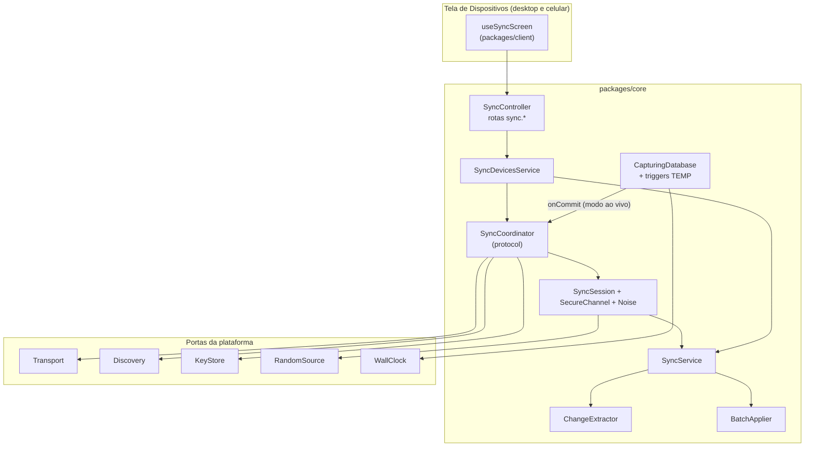
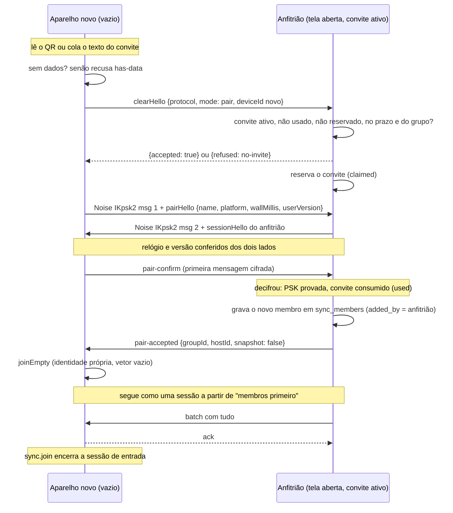

# Sincronização

Como os aparelhos de um mesmo usuário (desktop e celular) compartilham os dados: a topologia par a par, o modelo de replicação (merge por célula com relógio lógico híbrido), membros e pareamento, o transporte cifrado só na rede local, as peças concretas em cada plataforma e o fluxo das telas. A sincronização é uma camada fina do núcleo ([core](core.md)) sobre o schema descrito em [banco de dados](banco-de-dados.md); as alternativas descartadas estão nas [decisões](../decisoes.md).

## 1. Visão geral

### 1.1 O que a sincronização garante

1. **Todo aparelho guarda o conjunto completo de dados e escreve offline.** Não há servidor nem cliente fino ([§2](#2-topologia)).
2. **Os aparelhos só sincronizam na mesma rede local.** Não existe caminho pela internet, relay ou pasta na nuvem. É regra de produto, não limitação de versão: os dados nunca passam por rede que não seja do usuário ([§5.1](#51-só-a-rede-local)).
3. **Edições concorrentes são resolvidas por célula:** vence a escrita com o maior relógio em cada coluna de cada linha ([§3.1](#31-a-unidade-de-merge-é-a-célula)).
4. **Qualquer membro do grupo pode convidar ou remover aparelhos**, inclusive a si mesmo ([§4](#4-membros-e-pareamento)).
5. **Os dados nunca trafegam sem criptografia**, nem na rede de casa ([§5.5](#55-noise-kk-e-ikpsk2)).

Alternativas e raciocínio: ver [decisões](../decisoes.md) ([ADR 41](../decisoes.md#adr-41)).

### 1.2 Fora do escopo

- Sincronização pela internet, em segundo plano, ou por uma "caixa postal" para aparelhos que nunca estão online ao mesmo tempo.
- Purga física de linhas com soft delete ([§3.12](#312-o-que-a-sincronização-exige-do-schema)).
- Transferência dos arquivos de anexo ([§8](#8-anexos)), modo remoto e convite por código digitado ([§10](#10-limitações-conhecidas)).
- iOS: o protocolo e o núcleo são os mesmos, mas só há adaptadores para desktop (Linux e Windows) e Android.

### 1.3 Só sincroniza com a tela de Dispositivos aberta

**Regra:** um aparelho só escuta, se anuncia, disca e troca dados enquanto a tela de Dispositivos está aberta — e, no celular, em foco e com o app em primeiro plano. Fechar a tela (ou sair dela, ou o app ir para segundo plano) encerra as sessões, fecha o listener e para o anúncio e a busca. Não existe sincronização em segundo plano.

**Por quê:** nenhum dado muda por baixo de outra tela. Um editor aberto (uma anotação, um lançamento) nunca recebe uma alteração remota no meio da edição, porque enquanto ele está aberto não há sessão. Conflitos entre um editor aberto e uma edição vinda de outro aparelho, portanto, não são um caso a tratar — ao abrir de novo o editor depois de sincronizar, ele lê o valor já mesclado.

**Onde mora:** `SyncCoordinator.open`/`close` ([SyncCoordinator.ts](../../../packages/core/src/protocol/SyncCoordinator.ts)), acionados pelas rotas `sync.open`/`sync.close` que o hook `useSyncScreen` ([syncHooks.ts](../../../packages/client/src/hooks/syncHooks.ts)) chama ao montar e desmontar a tela. No celular, `useSyncScreen(focused && foreground)` usa `useIsFocused` e `useAppForeground` ([AppLifecycle.tsx](../../../apps/mobile/src/startup/AppLifecycle.tsx)).

Alternativas e raciocínio: ver [decisões](../decisoes.md) ([ADR 50](../decisoes.md#adr-50)).

### 1.4 Resumo das escolhas

| Pergunta | Escolha | Detalhe |
|---|---|---|
| Onde fica a verdade? | Em lugar nenhum: todo aparelho é réplica completa e igual | [§2](#2-topologia) |
| Como edições concorrentes se reconciliam? | Last-writer-wins por célula, ordenado por um HLC | [§3.1](#31-a-unidade-de-merge-é-a-célula), [§3.2](#32-relógio-lógico-híbrido-hlc) |
| Como as mudanças são capturadas? | Triggers `TEMP` marcam as células sujas; um decorator da porta `Database` carimba sequência e HLC antes do commit | [§3.4](#34-captura-triggers-temp-e-carimbo-na-porta) |
| Quando a sessão acontece? | Só com a tela de Dispositivos aberta nos dois aparelhos; o modo ao vivo dura enquanto ela estiver aberta | [§1.3](#13-só-sincroniza-com-a-tela-de-dispositivos-aberta) |
| O recálculo de saldos carimba `updated_at`? | Não: recalcular cache não é revisão do usuário | [§3.6](#36-colunas-que-não-sincronizam) |
| Onde a sessão roda no desktop? | No `utilityProcess`, dono da única conexão escritora | [§6.3](#63-desktop) |
| Padrões Noise | `KK` nas sessões; `IKpsk2` no pareamento, com a PSK derivada do segredo do QR | [§5.5](#55-noise-kk-e-ikpsk2) |
| Chave privada | Fora do banco: `safeStorage` do Electron no desktop, `expo-secure-store` (Keystore) no Android | [§4.1](#41-um-par-de-chaves-por-aparelho) |
| Como um aparelho entra? | Vazio, pelo convite em QR, recebendo um lote completo | [§4.3](#43-convite-por-qr-code), [§4.4](#44-entrada-no-grupo) |

### 1.5 Mapa das peças



A raiz de composição ([createCore.ts](../../../packages/core/src/composition/createCore.ts)) só monta a sincronização quando recebe `wallClock`; sem ele (ferramentas, benchmarks) nada é capturado e toda rota `sync.*` responde `sync-unavailable`. Sem `syncNetwork`, o núcleo ainda captura e aplica lotes (os testes fazem assim), mas a tela não conecta.

## 2. Topologia

### 2.1 Todo aparelho é um par igual

**Não existe fonte da verdade.** Todo aparelho guarda o conjunto completo, aceita escritas offline e pode sincronizar com qualquer outro membro do grupo — desktop↔celular e celular↔celular igualmente. Não há hub.

**Por quê:** o caso de uso principal — lançar despesas no celular, longe do computador — exige que o celular escreva offline, o que descarta um cliente fino. E as regras de merge ([§3](#3-modelo-de-replicação)) convergem para o mesmo estado independentemente da ordem em que as mudanças chegam, então nenhum aparelho precisa ser árbitro. Essa simetria permite que qualquer par sincronize e que um terceiro aparelho entre sem casos especiais. As alternativas (desktop como autoridade, um "dono" que vence conflitos) estão nas [decisões](../decisoes.md).

**Repasse:** quando o celular sincroniza com o desktop, o desktop entrega toda entrada de *qualquer* origem que falte ao celular, então as mudanças de um terceiro aparelho chegam por intermédio de quem as tem.

Alternativas e raciocínio: ver [decisões](../decisoes.md) ([ADR 42](../decisoes.md#adr-42)).

### 2.2 O primeiro aparelho e a entrada vazia

O primeiro aparelho tem um único papel especial: **cria o grupo** ([§4.2](#42-o-grupo-e-sync_members)); depois disso, é um membro como qualquer outro.

**Consequência:** um aparelho que entra num grupo **começa vazio** e recebe tudo do anfitrião ([§4.4](#44-entrada-no-grupo)). Dois bancos que cresceram de forma independente nunca são mesclados: sem o histórico de relógios de um deles, não há forma correta de decidir cada célula.

## 3. Modelo de replicação

### 3.1 A unidade de merge é a célula

Cada coluna de cada linha — uma **célula** — é resolvida de forma independente: vence a escrita com o maior relógio ([§3.2](#32-relógio-lógico-híbrido-hlc)).

- **Por coluna, e não por linha:** se o celular recategoriza um lançamento enquanto o desktop corrige o valor dele, as duas edições são intencionais; last-writer-wins por linha descartaria uma em silêncio.
- **Sem CRDT mais rico** (Automerge, Yjs): toda coluna é um escalar, e os únicos valores que se agregam — saldos — são derivados e não trafegam ([§3.6](#36-colunas-que-não-sincronizam)).
- **Exclusão é só uma coluna.** `deleted_at` (ou `removed_at` em `sync_members`) é mesclado como qualquer célula. Uma edição concorrente em *outra* coluna não desfaz uma exclusão; restaurar é gravar `deleted_at = NULL` com relógio mais novo.

**Onde mora:** `ApplyPass.mergeInto` em [BatchApplier.ts](../../../packages/core/src/services/sync/BatchApplier.ts). Testes: "edições concorrentes em colunas diferentes da mesma transação sobrevivem as duas" e "na mesma célula vence a escrita com o maior relógio" em [replication.test.ts](../../../packages/core/test/sync/replication.test.ts); "soft delete continua excluído quando o outro aparelho edita outra coluna" em [directed.test.ts](../../../packages/core/test/sync/directed.test.ts).

Alternativas e raciocínio: ver [decisões](../decisoes.md) ([ADR 43](../decisoes.md#adr-43)).

### 3.2 Relógio lógico híbrido (HLC)

Toda transação de escrita local é carimbada com um **HLC** ([HybridLogicalClock.ts](../../../packages/core/src/domain/sync/HybridLogicalClock.ts)): o relógio de parede em milissegundos, um contador que mantém o valor estritamente crescente quando o relógio de parede para ou volta, e o id do aparelho como desempate final. A forma serializada tem largura fixa (56 caracteres), para que a ordem dos relógios seja a ordem das strings e o SQL compare sem decodificar:

```
{milissegundos, 13 dígitos}.{contador, 5 dígitos}.{device_id}
```

- `tick(wall)`: carimba uma escrita local; usa o relógio de parede se ele estiver à frente, senão incrementa o contador.
- `receive(remote, wall)`: ao aplicar um lote, o HLC local avança para além do maior relógio recebido. **Causalidade:** uma edição feita depois de ver outra sempre fica ordenada depois dela, mesmo com o relógio de parede atrasado.
- Transbordo: mais de 99.999 carimbos no mesmo milissegundo adiantam o componente físico em 1 ms, em vez de quebrar a largura ou lançar erro no meio de uma escrita do usuário.
- `parse` valida o formato e exige o UUID na forma canônica: um relógio malformado vindo da rede compararia errado como string.
- O relógio de parede vem da porta `WallClock` ([WallClock.ts](../../../packages/core/src/ports/WallClock.ts)), separada da `Clock` porque esta entrega o instante no formato do schema, com precisão de segundo.

**Por que não `updated_at`:** tem precisão de segundo, confia cegamente no relógio de parede e não tem desempate. `updated_at` continua sendo o rastro legível de "última revisão" e sincroniza como coluna comum.

**Proteção contra divergência de relógio.** O HLC mantém a ordem consistente, mas "a mais recente vence" só significa o que o usuário espera se os relógios concordarem aproximadamente — um celular um dia adiantado venceria todo conflito durante um dia. **Regra:** os dois aparelhos trocam o relógio de parede no handshake e a sessão é recusada quando divergem mais de **2 minutos** (`MAX_CLOCK_SKEW_MS` em [messages.ts](../../../packages/core/src/protocol/messages.ts)), com uma mensagem que mostra a diferença ([§5.9](#59-recusas)). Nada é trocado até os relógios concordarem.

Testes: "divergência de relógio: uma réplica com o relógio de parede atrasado ainda ordena a edição dela depois da que recebeu" em [directed.test.ts](../../../packages/core/test/sync/directed.test.ts); "recusa a sessão quando os relógios divergem mais de 2 minutos" em [session.test.ts](../../../packages/core/test/protocol/session.test.ts).

### 3.3 Relógios de linha e de célula, não um log

O estado da sincronização vive em tabelas próprias, criadas pela migration [0009_sync_tables.sql](../../../db/migrations/0009_sync_tables.sql). **As tabelas de domínio não mudam.**

| Tabela | Escopo | Guarda |
|---|---|---|
| `sync_rows` | sincronizada | Uma entrada por linha: relógio, aparelho de origem e sequência de origem da criação |
| `sync_cells` | sincronizada | Uma entrada por célula alterada **depois** da criação: relógio, origem, sequência |
| `sync_members` | sincronizada | Os aparelhos do grupo ([§4.2](#42-o-grupo-e-sync_members)), replicados como dados de domínio |
| `sync_vector` | local | Por aparelho de origem, a maior sequência de origem que este aparelho possui |
| `sync_state` | local | Linha única: id deste aparelho, id do grupo, HLC e a próxima sequência |

- **Relógio efetivo** de uma célula: a entrada em `sync_cells`, se existir; senão a da linha em `sync_rows`. A maioria das linhas é escrita uma vez, então isso custa cerca de uma entrada por linha.
- **Não existe log de mudanças.** Sob last-writer-wins, um valor superado nunca mais é necessário; o vencedor atual já está na tabela de domínio. O que falta a um par é "toda entrada cuja sequência de origem é maior do que a que ele possui daquela origem", respondido pelos índices `(origin, seq)`. O histórico é compactado por construção.
- **Uma sequência por transação de escrita local.** Toda entrada escrita pela mesma transação de banco compartilha sequência e HLC, então uma unidade de trabalho — as duas pernas de uma transferência, a série completa de uma recorrência — trafega e é aplicada junta.
- **O vetor é prefixo-completo** ([VersionVector.ts](../../../packages/core/src/domain/sync/VersionVector.ts)): ter a sequência N de uma origem significa ter todas até N, porque cada lote é aplicado inteiro numa transação. Ele nunca recua.
- `sync_state` só existe enquanto o aparelho pertence a um grupo; sem ela, a captura não carimba nada.

Repositório: [SqliteSyncLedgerRepository.ts](../../../packages/core/src/infrastructure/sqlite/SqliteSyncLedgerRepository.ts) (porta [SyncLedgerRepository.ts](../../../packages/core/src/repositories/SyncLedgerRepository.ts)).

Alternativas e raciocínio: ver [decisões](../decisoes.md) ([ADR 44](../decisoes.md#adr-44)).

### 3.4 Captura: triggers TEMP e carimbo na porta

A captura acontece em dois tempos, **na mesma transação de banco** da escrita:

1. **Triggers `TEMP` marcam o que mudou** ([CaptureTriggers.ts](../../../packages/core/src/infrastructure/sync/CaptureTriggers.ts)). Ao abrir o núcleo com `wallClock`, a raiz de composição cria, só nesta conexão, a tabela `temp.sync_dirty`, a flag `temp.sync_control` e três triggers por tabela sincronizada, gerados do `PRAGMA table_info` a cada abertura:
   - `AFTER INSERT` marca a linha inteira (a criação recebe o relógio da linha);
   - `AFTER UPDATE` marca cada coluna sincronizada com `OLD.c IS NOT NEW.c` — gravar o mesmo valor (upserts reescrevem tudo) não gera mudança — e aborta se o `id` mudar;
   - `BEFORE DELETE` **sempre aborta**: hard delete em tabela sincronizada é proibido ([§3.12](#312-o-que-a-sincronização-exige-do-schema)).
2. **O decorator da porta carimba** ([CapturingDatabase.ts](../../../packages/core/src/infrastructure/sync/CapturingDatabase.ts)). Em `transaction()`, no fim da transação mais externa e antes do commit, se há células sujas, ele toma a próxima sequência e faz `tick` no HLC, grava `sync_rows` para cada linha inserida e `sync_cells` para cada coluna alterada (as colunas de uma linha criada na mesma transação ficam cobertas pela entrada da linha), limpa a tabela temporária e avança `sync_state` e o próprio `sync_vector`. Uma escrita fora de transação é embrulhada numa. Uma transação sem escrita capturada não consome sequência.

Detalhes que sustentam a regra:

- **Os triggers são criados depois das migrations** (`capturing` roda após `openDatabase`), então as migrations ficam fora da captura.
- **A captura nasce ligada só se o aparelho já está num grupo**; criar ou entrar num grupo a liga (`setCapture(true)`). Os triggers de insert/update respeitam a flag; o de delete não.
- **Durante a aplicação de um lote** a flag desliga a captura; ela volta a valer para as escritas locais da passada pós-aplicação (redirecionar filhos, reviver um pai, ajustar a perdedora de uma colisão), que precisam se propagar ([§3.11](#311-aplicação-e-pós-aplicação)).
- **Uma coluna nova de migration entra sozinha** (os triggers vêm do `PRAGMA`); **uma tabela nova precisa ser classificada** no catálogo ([§3.5](#35-catálogo-de-tabelas-sincronizadas)) — um teste falha se alguma ficar sem classificação.
- **Modo ao vivo:** depois de um commit que carimbou algo, o decorator avisa os ouvintes `onCommit`; a raiz de composição liga esse aviso a `SyncCoordinator.notifyLocalChange` ([§5.8](#58-modo-ao-vivo-e-controle-de-fluxo)).
- **Edições manuais contornam a sincronização.** Triggers `TEMP` não ficam gravados no arquivo: uma escrita feita num navegador de banco é invisível, fica local e pode ser sobrescrita por qualquer escrita sincronizada posterior na mesma célula. Aceito.

**Por que trigger, e não instrumentar cada Repository:** são cerca de 70 pontos de escrita em 14 repositórios, vários deles upserts `ON CONFLICT DO UPDATE` que não sabem quais colunas mudaram; uma escrita esquecida viraria divergência silenciosa. O trigger vê toda escrita da conexão, e o HLC é carimbado pela porta, não por ele. Ver [decisões](../decisoes.md) ([ADR 45](../decisoes.md#adr-45)).

Testes: [capture.test.ts](../../../packages/core/test/sync/capture.test.ts) — classificação de toda tabela do schema, "uma unidade de trabalho é uma sequência e um HLC", "uma edição registra só as colunas que mudaram", "o recálculo de saldos não gera entrada nem muda `updated_at`", "recusa hard delete em tabela sincronizada" e "cada operação das rotas que altera uma célula deixa nela um relógio efetivo novo".

### 3.5 Catálogo de tabelas sincronizadas

O catálogo ([SyncCatalog.ts](../../../packages/core/src/domain/sync/SyncCatalog.ts)) é explícito, e não deduzido do schema, porque classificar uma tabela — sincronizada ou local, quais colunas são caches, que chave natural pode colidir — é decisão de negócio.

- `SYNCED_TABLES`: `profiles`, `partners`, `notes`, `accounts`, `credit_cards`, `bank_statements`, `invoices`, `transaction_categories`, `transaction_sub_categories`, `tags`, `goals`, `recurrences`, `recurrences_tags`, `transactions`, `transactions_tags`, `attachments`, `report_definitions` e `sync_members`.
- `LOCAL_TABLES`: `sync_rows`, `sync_cells` (escritas pelo próprio carimbo), `sync_vector` e `sync_state` (descrevem só este aparelho).
- Cada `SyncedTable` declara a lápide (`deleted_at` ou `removed_at`), os caches derivados (`derived`), as colunas mescladas por máximo (`maxMerged`) e as chaves naturais com a estratégia de colisão (`naturalKeys`).
- A coluna `id` nunca sincroniza como célula: identifica a linha e nunca muda.
- Um lote que cite tabela fora do catálogo ou coluna não sincronizada é recusado inteiro.

### 3.6 Colunas que não sincronizam

| Coluna | Regra |
|---|---|
| `accounts.balance`, `accounts.projected_balance`, `bank_statements.opening_balance`, `closing_balance`, `projected_opening_balance`, `projected_closing_balance`, `invoices.balance` | **Não trafegam.** São caches derivados; uma linha recebida é gravada com `0` e recalculada na pós-aplicação. Mesclar dois caches seria mesclar duas respostas em vez dos fatos por trás delas. |
| `recurrences.materialized_count` | **Sincroniza, mesclada como máximo**, e não por last-writer-wins: a marca d'água só avança, e ficar com a maior nunca reemite uma ocorrência. |

Todo o resto — inclusive `created_at`, `updated_at` e `accounts.opening_balance`, que é dado do usuário e não cache — sincroniza como célula comum. **Um insert recebido traz o `created_at` da origem;** o receptor nunca deixa o próprio default preenchê-lo.

**Consequência — o recálculo de saldos não carimba `updated_at`.** Recalcular um cache não é uma revisão do usuário. Se carimbasse, cada recálculo viraria uma mudança sincronizada, e o receptor, que recalcula com a captura desligada, ficaria com outro `updated_at`, quebrando a convergência. Vale para `accounts`, `bank_statements` e `invoices` (ver [banco de dados](banco-de-dados.md)).

Alternativas e raciocínio: ver [decisões](../decisoes.md) ([ADR 46](../decisoes.md#adr-46)).

### 3.7 Ids determinísticos para linhas identificadas pelo conteúdo

UUIDs garantem que dois aparelhos nunca gerem o mesmo id para linhas diferentes. Mas algumas linhas são identificadas pelo **que são**, e um índice único parcial garante isso: dois aparelhos offline criariam, cada um, "o extrato de março da conta X" com UUIDs diferentes, e o merge violaria `uq_bank_statements_account_period`.

**Regra:** essas linhas recebem um **UUID v5** derivado de um namespace fixo da aplicação e da chave natural, para que todo aparelho derive o mesmo id de forma independente e o merge veja uma linha editada duas vezes em vez de duas linhas colidindo.

| Tabela | Chave natural no hash | Função |
|---|---|---|
| `bank_statements` | `account_id`, ano-mês | `bankStatementIdFor` |
| `invoices` | `credit_card_id`, ano-mês | `invoiceIdFor` |
| `transactions` emitidas por recorrência | `recurrence_id`, número da ocorrência | `occurrenceIdFor` |
| `recurrences_tags` | `recurrence_id`, `tag_id` | `recurrenceTagIdFor` |
| `transactions_tags` | `transaction_id`, `tag_id` | `transactionTagIdFor` |

Toda outra linha mantém UUID v4 aleatório. As funções e o namespace `APP_UUID_NAMESPACE` estão em [DeterministicIds.ts](../../../packages/core/src/domain/shared/DeterministicIds.ts); **o namespace nunca pode mudar** — todo id determinístico já gravado em qualquer aparelho foi derivado dele.

Consequências:

- Um UUID v5 continua tendo 36 caracteres; o `CHECK (length(id) = 36)` se mantém.
- **Recriar uma linha com soft delete significa revivê-la:** recriar o extrato de março deriva o id antigo, então o Service limpa `deleted_at` na linha existente em vez de inserir.
- **O id de uma ocorrência vem do número dela na série, não da data.** A data muda ("esta e as futuras" troca o dia âncora), e dois aparelhos — um trocando o dia, outro completando a série offline — gerariam a mesma ocorrência com datas diferentes. Mover uma ocorrência de data não muda sua identidade: um id nunca é recalculado. Dois aparelhos completando a série offline emitem as **mesmas** ocorrências com os mesmos ids, que são mescladas (ver [recorrências](../regras-de-negocio/recorrencias.md)).
- **A regra vale desde a primeira linha gravada**, com ou sem grupo: adotá-la depois exigiria reescrever ids e toda chave estrangeira que aponta para eles.

Teste: "a mesma ocorrência gerada nos dois aparelhos, com o dia da série trocado em um deles, vira uma linha só" em [directed.test.ts](../../../packages/core/test/sync/directed.test.ts).

Alternativas e raciocínio: ver [decisões](../decisoes.md) ([ADR 31](../decisoes.md#adr-31)).

### 3.8 Colisões de chave natural

Categorias, subcategorias, tags e anexos são únicos por nome entre as linhas vivas, mas o nome é digitado pelo usuário, então nenhum id determinístico é possível (uma renomeação o mudaria). Dois aparelhos que criam "Mercado" offline produzem dois ids e uma colisão.

**Regra (estratégia `merge`):** quando uma linha recebida colidiria com uma linha local viva na mesma chave natural, **sobrevive a de menor id**. A outra é gravada com soft delete — o índice único nunca é violado — e todo filho que apontava para ela é redirecionado para a sobrevivente. Como a escolha depende só dos ids, todo aparelho chega à mesma sobrevivente sozinho, e as correções convergem. Renomeações que colidem seguem a mesma regra.

| Tabela | Chave | Estratégia |
|---|---|---|
| `transaction_categories` | `profile_id`, `name` (sem diferenciar maiúsculas) | `merge` |
| `transaction_sub_categories` | `category_id`, `name` (sem diferenciar maiúsculas) | `merge` |
| `tags` | `profile_id`, `name` (sem diferenciar maiúsculas) | `merge` |
| `attachments` | `transaction_id`, `name` (sem diferenciar maiúsculas) | `merge` |
| `bank_statements` | `account_id`, `year`, `month` | `merge` |
| `invoices` | `credit_card_id`, `year`, `month` | `merge` |
| `recurrences_tags` | `recurrence_id`, `tag_id` | `merge` |
| `transactions_tags` | `transaction_id`, `tag_id` | `merge` |
| `transactions` | `recurrence_id`, `occurrence` | `unlink` |

- As tabelas com id determinístico ([§3.7](#37-ids-determinísticos-para-linhas-identificadas-pelo-conteúdo)) só colidiriam por defeito, mas estão no catálogo para que um defeito não aborte a sessão inteira.
- **`unlink` para ocorrências:** a mesma `(recurrence_id, occurrence)` deriva o mesmo id e é mesclada numa linha; só colidiria se a ocorrência mudasse de série. Nesse caso a perdedora perde `recurrence_id`/`occurrence` e **continua viva**, porque é dado financeiro.
- **A resolução acontece antes da escrita**, porque o índice único não é adiável como as chaves estrangeiras. Quando a perdedora é a linha recebida, ela é gravada já ajustada e o ajuste é marcado como escrita local (`markDirty`), para se propagar com relógio próprio.
- O redirecionamento dos filhos pode criar novas colisões (a mesma tag duas vezes num lançamento), resolvidas pela mesma regra em fila.

**Onde mora:** `ApplyPass.resolveCollisions` e `redirectMerged` em [BatchApplier.ts](../../../packages/core/src/services/sync/BatchApplier.ts); `findLiveTwin` em [SqliteReplicaRepository.ts](../../../packages/core/src/infrastructure/sqlite/SqliteReplicaRepository.ts). Teste: "colisão de nomes: categoria e subcategoria criadas offline nos dois mesclam no menor id, levando os lançamentos".

Alternativas e raciocínio: ver [decisões](../decisoes.md) ([ADR 47](../decisoes.md#adr-47)).

### 3.9 Filhos vivos sob pais excluídos

O merge por célula não enxerga relações entre linhas. O celular adiciona um lançamento a uma conta que o desktop excluiu nesse meio-tempo: depois do merge, um lançamento vivo fica numa conta com soft delete.

**Regra:** a passada pós-aplicação encontra linhas vivas cujo **pai dono** está com soft delete, **revive o pai** e o reporta (`ApplyReport.revived`, contado em `revivedRows` no estado da tela). Reviver é uma escrita local com relógio novo, então se propaga. Dado financeiro nunca é excluído por um merge que o usuário não viu; excluir a conta de novo está a uma ação deliberada de distância.

- **Pai dono** é toda chave estrangeira `CASCADE` ou `NO ACTION` (vocabulário obrigatório); referências `SET NULL` podem apontar para excluídos.
- Se o pai morto tem uma **gêmea viva** pela chave natural (perdeu uma colisão), o filho é redirecionado para ela em vez de reviver o perdedor.
- O pai revivido entra na fila, para conferir os avós.

**Onde mora:** `ApplyPass.reviveOwners` e `rescueChild` em [BatchApplier.ts](../../../packages/core/src/services/sync/BatchApplier.ts). Teste: "filho órfão: lançamento novo numa conta excluída no outro aparelho revive a conta, com aviso".

Alternativas e raciocínio: ver [decisões](../decisoes.md) ([ADR 48](../decisoes.md#adr-48)).

### 3.10 Extração

`ChangeExtractor` ([ChangeExtractor.ts](../../../packages/core/src/services/sync/ChangeExtractor.ts)) monta o lote do que falta a um par:

1. Lê as entradas de `sync_rows` e `sync_cells` com sequência maior que a do vetor do par, **em ordem de HLC** (a ordem causal).
2. Agrupa por transação de origem (`origin/seq`); entradas de uma mesma transação compartilham o HLC e chegam contíguas.
3. Preenche com os valores **atuais** das células, já sem os caches. Uma criação leva a linha inteira (para o receptor conseguir inserir com toda coluna `NOT NULL`); células alteradas depois vão como `CellChange`.
4. Anexa `through`, o vetor de quem envia: o receptor passa a possuir esse vetor ao aplicar o lote inteiro. Não é "a maior sequência vista no lote", porque sequências compactadas (células sobrescritas depois) não aparecem nele.

O escopo `members` extrai só `sync_members`, para o passo "membros primeiro" da sessão; esse lote não carrega vetor, porque não é completo.

O lote viaja como DTO ([SyncBatchDto.ts](../../../packages/core/src/dto/sync/SyncBatchDto.ts)) e é validado na entrada por `syncBatchRequest` ([syncRequests.ts](../../../packages/core/src/requests/syncRequests.ts)), que o converte no `SyncBatch` do domínio ([SyncBatch.ts](../../../packages/core/src/domain/sync/SyncBatch.ts)).

### 3.11 Aplicação e pós-aplicação

`BatchApplier.apply` aplica um lote recebido **numa transação de banco só**, com `PRAGMA defer_foreign_keys = ON`, para que a ordem das linhas dentro do lote não importe.

**Células, com a captura desligada.** Cada criação é inserida se a linha não existe (com o `created_at` da origem e caches em `0`) ou mesclada célula a célula se já existe (id determinístico criado nos dois, ou lote repetido). Cada célula só é gravada se o relógio recebido for maior que o efetivo local; `materialized_count` fica com o máximo. As colisões são resolvidas antes de cada escrita ([§3.8](#38-colisões-de-chave-natural)). Em seguida o HLC local avança para além do maior relógio recebido, para que as escritas da passada seguinte fiquem depois de tudo o que chegou.

**Pós-aplicação**, ainda na mesma transação:

1. **Colisões, séries e órfãos, com a captura ligada:** redirecionar os filhos das perdedoras ([§3.8](#38-colisões-de-chave-natural)); excluir ocorrências além do término de séries encerradas; reviver pais donos ([§3.9](#39-filhos-vivos-sob-pais-excluídos)). São escritas locais, que se propagam.
2. **Recalcular os saldos** de toda conta afetada — lida antes e depois da aplicação, para que um lançamento que mudou de lugar recalcule o contêiner **antigo** e o **novo**. O recálculo é completo por conta (`recalculateAccountFully`).
3. **Avançar `sync_vector`** com o `through` do lote.

**Ocorrências além do término.** Mudar a periodicidade ou o tipo de uma série encerra a regra e cria outra, com id aleatório (ver [recorrências](../regras-de-negocio/recorrencias.md)). Um aparelho que completou a regra antiga offline traz, ao sincronizar, ocorrências dela além do novo término. **Regra:** a pós-aplicação exclui (soft delete) as ocorrências vivas com número além da última ocorrência da série (`trimEndedSeries`). Teste: "série recomeçada num aparelho e a regra antiga completada offline no outro: as ocorrências além do término saem".

**Falha e idempotência.** Se algo falhar, a transação sofre rollback, o vetor não se move e a próxima sessão tenta de novo do mesmo ponto. Aplicar é idempotente: receber de novo uma célula que já se possui não muda nada. Testes: "reaplicar um lote não muda nada" e "um lote que falha não move o vetor nem deixa escrita pela metade" em [replication.test.ts](../../../packages/core/test/sync/replication.test.ts). A verificação de saldos (`integrity.verifyBalances`) é conferida depois das trocas nos testes de convergência ([§9](#9-testes)).

### 3.12 O que a sincronização exige do schema

- **As tabelas de domínio não são tocadas;** o estado vive nas tabelas `sync_*` ([§3.3](#33-relógios-de-linha-e-de-célula-não-um-log)).
- **Ids:** a regra de UUID v5 da [§3.7](#37-ids-determinísticos-para-linhas-identificadas-pelo-conteúdo) vale para todo o schema; nenhuma DDL mudou por ela.
- **`updated_at` não é o relógio da sincronização** — o HLC é.
- **Sem hard delete em tabela sincronizada.** Um hard delete não deixa nada para replicar, e um par que nunca viu a lápide manteria a linha viva; o trigger `BEFORE DELETE` aborta toda tentativa (com o núcleo montado com `wallClock`, mesmo fora de um grupo). Uma purga futura só poderia remover linhas cuja exclusão todos os membros atuais já confirmaram.
- **Tabela nova precisa entrar no catálogo** ([§3.5](#35-catálogo-de-tabelas-sincronizadas)); coluna nova entra sozinha.
- **Edições manuais contornam a sincronização** ([§3.4](#34-captura-triggers-temp-e-carimbo-na-porta)).

## 4. Membros e pareamento

### 4.1 Um par de chaves por aparelho

Cada aparelho tem um par de chaves X25519, gerado no primeiro uso por `deviceKeys` ([SyncCoordinator.ts](../../../packages/core/src/protocol/SyncCoordinator.ts)) a partir da porta `RandomSource`. **A chave privada fica no armazenamento seguro da plataforma (porta `KeyStore`), nunca no arquivo SQLite**, para que uma cópia ou backup do banco não carregue a capacidade de se passar pelo aparelho. A chave pública vai em `sync_members.public_key` (hexadecimal, 64 caracteres).

- Desktop: arquivo `userData/sync/device-key.bin` cifrado pelo `safeStorage` do Electron ([§6.3](#63-desktop)).
- Android: `expo-secure-store` (Keystore), com acesso `WHEN_UNLOCKED_THIS_DEVICE_ONLY` ([§6.4](#64-mobile-android)).

**Por que uma chave por aparelho, e não uma do grupo:** remover um celular perdido é retirar a chave pública dele da lista de membros; com uma chave compartilhada, todos os outros teriam de receber chaves novas.

O **id do aparelho** (UUID v4) é gerado ao criar o grupo ou, para quem entra, antes de parear (`SyncService.newDeviceId`); é ele que vai no handshake e em `sync_members`.

Alternativas e raciocínio: ver [decisões](../decisoes.md) ([ADR 51](../decisoes.md#adr-51)).

### 4.2 O grupo e `sync_members`

Criar o grupo (`SyncService.createGroup`, rota `sync.createGroup`) gera o id do grupo e o do aparelho, grava `sync_state`, faz o backfill de `sync_rows` ([§4.6](#46-ativação-em-quem-já-tem-dados)), liga a captura e insere este aparelho como primeiro membro.

`sync_members` guarda, por aparelho: id, nome de exibição (1 a 60 caracteres), plataforma (`1` desktop, `2` Android, `3` iOS), chave pública, quem o adicionou (`added_by`) e `removed_at`. Ela é replicada exatamente como dado de domínio, então todo membro converge para a mesma lista. A lápide é `removed_at`, sem `deleted_at` que uma escrita mais nova pudesse desfazer. Domínio: [SyncMember.ts](../../../packages/core/src/domain/sync/SyncMember.ts).

### 4.3 Convite por QR code

Qualquer membro com a tela de Dispositivos aberta e endereço local conhecido pode abrir um convite ("Adicionar dispositivo", rota `sync.createInvite`):

- **Conteúdo** (`InvitePayload` em [messages.ts](../../../packages/core/src/protocol/messages.ts)): versão do protocolo, id do grupo, id e chave pública do anfitrião, até 8 endereços IPv4 locais, a porta do listener, um **segredo de 128 bits** aleatório e a validade.
- **Validade de 5 minutos** (`INVITE_TTL_MS`) e **uso único.**
- **Uso único sem queimar à toa.** O convite tem dois estados: `claimed` (reservado por um pareamento em andamento) e `used` (consumido). Ele só é consumido quando a primeira mensagem cifrada do convidado (`pair-confirm`) decifra — é ali que a PSK fica provada. Uma conexão qualquer da rede, uma queda ou uma recusa por relógio libera a reserva, e o mesmo QR volta a valer.
- **Texto compacto:** binário em base32 com prefixo `FINANCAS1:` (`encodeInvite`/`decodeInvite`), ~160 caracteres no modo alfanumérico do QR, um código de ~45×45 módulos. JSON dava ~330 caracteres e ~69×69 módulos, denso demais para a câmera ler com folga na tela do computador. Layout: versão (1) · grupo (16) · anfitrião (16) · chave (32) · segredo (16) · porta (2) · validade em ms (6) · quantidade de endereços (1) · IPv4 (4 cada). `decodeInvite` tolera espaços e minúsculas, para o texto colado.
- O mesmo texto serve para **"Copiar convite"**, que é como o desktop sem câmera entra.
- **O celular não convida:** nenhuma biblioteca instalada informa o IP do Wi-Fi para ir no QR (`mobileLocalAddresses` devolve vazio), e no uso real o grupo nasce no computador.

O convite em aberto vive só na memória do coordenador e é descartado quando a tela fecha. Testes: [invite.test.ts](../../../packages/core/test/protocol/invite.test.ts); "o convite é de uso único", "uma conexão que não prova o segredo não queima o convite" e "uma recusa por relógio no pareamento deixa o mesmo convite valer depois de corrigido" em [session.test.ts](../../../packages/core/test/protocol/session.test.ts).

Alternativas e raciocínio: ver [decisões](../decisoes.md) ([ADR 54](../decisoes.md#adr-54)).

### 4.4 Entrada no grupo

**Regra:** um aparelho só entra num grupo se não tiver **nenhum dado** em tabela sincronizada (`hasDomainData`). Se tiver, a entrada é recusada (`sync-device-has-data` no núcleo, `has-data` na sessão) — dois históricos independentes não podem ser mesclados ([§2.2](#22-o-primeiro-aparelho-e-a-entrada-vazia)). Também é recusado entrar estando já num grupo (`sync-already-in-group`).

O aparelho novo lê o convite (câmera ou texto colado), disca para cada endereço do QR até um responder, faz o pareamento ([§5.7](#57-pareamento-passo-a-passo)) e recebe os dados. Há dois caminhos no núcleo:

- **Lote completo (o que os apps usam).** O anfitrião responde `pair-accepted` com `snapshot: false`; o aparelho novo grava a própria identidade com vetor vazio (`SyncService.joinEmpty`) e a sessão segue como qualquer outra, recebendo tudo num lote. Os dois apps montam o núcleo com `snapshots: null`: no uso real o desktop cria o grupo e o celular entra vazio, e o lote evita trocar o arquivo do banco no meio da sessão. Na tela aparece "Recebendo dados…", sem porcentagem, porque a entrada é um lote só.
- **Snapshot (pronto no núcleo, desligado nos apps).** Com a porta `SnapshotPort`, o anfitrião envia uma cópia consistente do banco (`VACUUM INTO`); o convidado a instala, reabre e assume a própria identidade com `SyncService.adoptSnapshot`, que troca o `sync_state` do anfitrião pelo seu e faz o HLC partir do relógio do anfitrião. As tabelas de relógio, os membros e o vetor vêm no snapshot. Ligar esse caminho num app é fornecer a porta. Teste: "entra por snapshot" em [membership.test.ts](../../../packages/core/test/sync/membership.test.ts).

Depois de entrar, a rota `sync.join` encerra a sessão de entrada (`coordinator.close()`): a sincronização só continua com a tela de Dispositivos aberta.

**Celular com dados locais.** Para entrar, o banco atual é movido para `backups/antes-de-entrar-no-grupo-{instante}.sqlite`, fora da rotação automática, com confirmação; o app reabre vazio, pronto para ler o QR ([discardDatabase.ts](../../../apps/mobile/src/startup/discardDatabase.ts), [DiscardForJoinSheet.tsx](../../../apps/mobile/src/sync/DiscardForJoinSheet.tsx)).

Alternativas e raciocínio: ver [decisões](../decisoes.md) ([ADR 53](../decisoes.md#adr-53)).

### 4.5 Remoção e "sair do grupo"

Qualquer membro pode remover qualquer outro (`sync.removeMember`), inclusive a si mesmo (`sync.leave`). A remoção carimba `removed_at` na linha do membro e se propaga como qualquer escrita. **A remoção é permanente para aquele id de aparelho:** voltar é parear de novo como novo membro, com o banco vazio.

- **Os membros recusam sessão com aparelho removido.** Quem atende só aceita o `KK` de um membro ativo (`activeMember`); depois da troca de membros ([§5.6](#56-a-sessão-passo-a-passo)), qualquer lado que descubra que ele ou o par foi removido envia `refuse: removed` antes de qualquer dado.
- **Quem disca usa a lista de membros conhecidos, não só os ativos** (`knownMember`): a troca de membros vem primeiro, e é por ela que o removido aprende a remoção antes de a sessão ser recusada.
- **"Sair do grupo" mantém a identidade** (`sync_state` fica), para que a próxima sessão leve a remoção aos outros; depois dela o aparelho é recusado.

Limites, ditos com clareza:

- Um aparelho removido **mantém a cópia local**; a remoção interrompe sincronizações futuras, não apaga dados já entregues.
- A remoção chega a cada membro na próxima sessão dele. Até lá, um membro que não soube dela aceitaria o removido — o que exige que este esteja na mesma rede local.

Testes: "sair do grupo se propaga como remoção, e o aparelho passa a ser recusado" em [membership.test.ts](../../../packages/core/test/sync/membership.test.ts); "um membro removido é recusado depois da troca de membros" em [session.test.ts](../../../packages/core/test/protocol/session.test.ts).

### 4.6 Ativação em quem já tem dados

**Regra:** ao criar o grupo, **toda linha existente** de toda tabela sincronizada ganha uma entrada em `sync_rows` com origem neste aparelho, sequência 1 e o relógio do momento (`SyncLedgerRepository.backfill`); o vetor começa em `{este aparelho: 1}` e a próxima sequência é 2. É assim que um aparelho com histórico passa a sincronizar: tudo o que ele tem vira "criado por ele agora". O aparelho que entrar depois chega vazio e recebe tudo ([§4.4](#44-entrada-no-grupo)).

Na prática: o desktop cria o grupo com o banco real; o banco de teste do celular é descartado ao entrar. Teste: "ao criar o grupo, toda linha existente ganha entrada com origem neste aparelho" em [capture.test.ts](../../../packages/core/test/sync/capture.test.ts).

## 5. Transporte e sessão

### 5.1 Só a rede local

Dois aparelhos só sincronizam quando estão na **mesma rede local**, com a **tela de Dispositivos aberta** nos dois ([§1.3](#13-só-sincroniza-com-a-tela-de-dispositivos-aberta)): só então há listener, anúncio e discagem. Nenhum servidor é necessário, nenhum terceiro transporta os dados, e o acesso remoto não está apenas não implementado — é recusado.

**Regra:** um aparelho só aceita conexões de, e só disca para, endereços locais ([LocalAddress.ts](../../../packages/core/src/domain/sync/LocalAddress.ts), `isLocalAddress`):

- IPv4 privados `10/8`, `172.16/12`, `192.168/16` e link-local `169.254/16`;
- IPv6 link-local `fe80::/10` e unique-local `fc00::/7` (aceitando zona `%eth0` e IPv4 mapeado `::ffff:`);
- **loopback** `127/8` e `::1` — é o próprio aparelho, nunca chega à rede, e é o que permite rodar dois apps no mesmo computador no teste de fumaça;
- recusados: endereços públicos e a faixa de carrier-grade NAT `100.64/10`, usada por VPNs overlay como o Tailscale.

A regra fica no núcleo para que desktop e celular recusem exatamente o mesmo conjunto. Ela é aplicada ao aceitar (o listener fecha conexões de fora), ao discar (`sync-address-not-local`), ao montar o convite e ao filtrar o que a descoberta encontra.

**O que isto é e o que não é:** uma forte redução de exposição, não prova de presença física — quem interliga redes com uma VPN consegue fazer um aparelho remoto parecer local. A segurança se apoia nas chaves dos aparelhos e no canal cifrado; a localidade é a segunda camada.

Alternativas e raciocínio: ver [decisões](../decisoes.md) ([ADR 49](../decisoes.md#adr-49)).

### 5.2 Descoberta

Com a tela aberta e o aparelho num grupo, cada aparelho se anuncia via **mDNS / DNS-SD** com o tipo de serviço `financas-sync`, nome `financas-{8 primeiros caracteres do id}` e, no TXT, `device` (id do aparelho) e `group` (`groupHash`: 16 caracteres hex de um BLAKE2s do id do grupo). Vizinhos na rede veem que um aparelho existe, não a qual grupo pertence; membros do mesmo grupo se reconhecem pelo hash. Ao mesmo tempo, procura o mesmo tipo e ignora serviços de outro grupo ou sem o TXT.

**Endereço digitado.** Redes que bloqueiam multicast (convidados, isolamento de clientes) impedem a descoberta. O celular tem "Digitar endereço manualmente": o usuário informa `endereço:porta` (ou `[ipv6]:porta`) que o desktop mostra no convite e escolhe qual membro está lá (rota `sync.connect`, [manualAddress.ts](../../../apps/mobile/src/sync/manualAddress.ts)). O endereço passa pela mesma regra de endereços locais. O convite por QR já carrega o endereço de quem convida.

### 5.3 Quem disca para quem

Com a tela aberta, todo aparelho escuta e se anuncia. **Regra:** para evitar duas conexões por par, **o aparelho com o menor id disca** para os pares encontrados pela descoberta, e o outro só atende (`SyncCoordinator.onPeer`). Também não disca para quem já tem sessão em andamento. Na discagem manual e no pareamento, quem age é quem tem o endereço.

### 5.4 Enquadramento e canal cifrado

- **Quadros** ([SecureChannel.ts](../../../packages/core/src/protocol/SecureChannel.ts), `FrameConnection`): prefixo de 2 bytes big-endian, até 65.535 bytes (o máximo de uma mensagem Noise). O TCP entrega bytes em pedaços arbitrários; remontar quadros no núcleo faz desktop e celular cortarem igual.
- **Canal** (`SecureChannel`): depois do handshake, cada mensagem é fatiada em pedaços que cabem numa mensagem Noise, cada um cifrado com a cifra da direção e marcado com o bit de "último pedaço"; o primeiro byte diz se é JSON ou bytes crus (o snapshot). Teto de uma mensagem remontada: 512 MiB. As escritas são serializadas, porque a ordem dos pedaços cifrados precisa ser a dos nonces e o modo ao vivo e uma confirmação poderiam se intercalar.
- A porta `Connection` ([SyncNetwork.ts](../../../packages/core/src/ports/SyncNetwork.ts)) só entrega bytes em ordem; o protocolo inteiro é do núcleo.

### 5.5 Noise: KK e IKpsk2

O handshake e a cifra são o protocolo **Noise**, implementado no núcleo em TypeScript puro sobre `@noble/curves`, `@noble/ciphers` e `@noble/hashes` ([Noise.ts](../../../packages/core/src/protocol/noise/Noise.ts)), para que desktop e celular rodem exatamente o mesmo protocolo sem módulo nativo. O nome completo é `Noise_{padrão}_25519_ChaChaPoly_BLAKE2s`.

- **`KK` nas sessões:** os dois lados já conhecem a chave pública do outro, gravada em `sync_members` no pareamento. Autenticação mútua e canal cifrado num só handshake.
- **`IKpsk2` no pareamento:** o aparelho novo só conhece a chave do anfitrião (do QR) e prova que leu o segredo pela PSK; o anfitrião aprende a chave do novo no handshake. **PSK** = BLAKE2s(`financas-sync-invite` ‖ segredo ‖ id do grupo) (`invitePsk`): o segredo tem 16 bytes e o Noise pede 32, e o id do grupo impede que um segredo de outro grupo sirva.
- **Mensagem em claro antes do handshake** (`clearHello`: versão do protocolo, modo `session`/`pair` e id de quem liga). No `KK`, quem atende precisa da chave pública de quem liga antes do handshake e a acha pelo id. A mensagem entra no **prólogo** junto com `financas-sync/{versão}`, então adulterá-la derruba o handshake; versões diferentes do protocolo nem completam o handshake. Quem atende pode recusar em claro (`not-member`, `no-invite`).
- O nonce de cada direção é contado e nunca se repete; uma sessão que esgotasse 2^64 mensagens é recusada.

A conformidade é verificada contra os vetores públicos do Noise ([noise.test.ts](../../../packages/core/test/protocol/noise.test.ts)). A vazão da cifra no Hermes é medida pelo app de contrato ([cryptoBenchmark.ts](../../../apps/mobile-contract/src/cryptoBenchmark.ts)); se não bastar, a primitiva pode vir de um módulo nativo por trás de uma porta. Ver [decisões](../decisoes.md) ([ADR 52](../decisoes.md#adr-52)).

### 5.6 A sessão passo a passo

1. **Mensagem em claro e handshake `KK`.** Quem atende confere que quem liga é membro ativo; o handshake leva, cifrado, o `sessionHello` de cada lado (id, relógio de parede em ms e `user_version`). Um par cujo id não bate com o esperado é recusado.
2. **Compatibilidade:** recusa se os `user_version` diferem (um lote citaria colunas que o outro não tem; ver [banco de dados](banco-de-dados.md)) ou se os relógios divergem mais de 2 minutos ([§3.2](#32-relógio-lógico-híbrido-hlc)).
3. **Membros primeiro:** cada lado envia `members` (o lote só de `sync_members`) e aplica o do outro; se este aparelho ou o par aparece removido, envia `refuse: removed` e encerra. Uma remoção aprendida tem efeito antes de qualquer dado.
4. **Vetores:** cada lado envia o próprio `sync_vector`.
5. **Lotes:** cada lado envia o que falta ao vetor do outro (mesmo vazio, na primeira vez), em ordem de HLC e agrupado por transação de origem.
6. **Aplicar e confirmar:** cada lote recebido é aplicado ([§3.11](#311-aplicação-e-pós-aplicação)) e respondido com `ack` levando o vetor atualizado; quem recebeu passa a considerar que o par tem tudo do `through`.
7. **Anexos:** etapa reservada para os arquivos, ainda não implementada ([§8](#8-anexos)).
8. **Modo ao vivo:** quando os dois lotes iniciais foram aplicados e confirmados, a sessão entra em `live` e continua até a conexão fechar ([§5.8](#58-modo-ao-vivo-e-controle-de-fluxo)).

```mermaid
sequenceDiagram
    participant A as Aparelho de menor id (disca)
    participant B as Par (atende)
    A->>B: clearHello {protocol, mode: session, deviceId}
    B->>B: membro ativo?
    B-->>A: {accepted: true} ou {refused: not-member}
    A->>B: Noise KK msg 1 + sessionHello {deviceId, wallMillis, userVersion}
    B->>A: Noise KK msg 2 + sessionHello
    Note over A,B: cada lado recusa sozinho se user_version difere<br/>ou o relógio diverge mais de 2 min
    A->>B: members (lote de sync_members)
    B->>A: members
    Note over A,B: aplica membros; removido? envia refuse: removed
    A->>B: vector
    B->>A: vector
    A->>B: batch (o que falta a B)
    B->>A: batch (o que falta a A)
    B-->>A: ack {vetor de B}
    A-->>B: ack {vetor de A}
    Note over A,B: modo ao vivo (live)
    loop enquanto a tela estiver aberta nos dois
        A->>B: batch (commit local)
        B-->>A: ack
    end
```

Uma queda de conexão em qualquer passo encerra a sessão como `closed`; nada fica pela metade, porque cada lote é aplicado numa transação, e a próxima sessão converge. Uma falha fora do protocolo (lote inválido, bug) também encerra só aquela sessão. Testes: [session.test.ts](../../../packages/core/test/protocol/session.test.ts), sobre um `Transport` em memória ([memoryNetwork.ts](../../../packages/core/test/support/memoryNetwork.ts)), inclusive "queda de conexão em qualquer passo não deixa nada pela metade, e a próxima sessão converge".

Máquina de estados: `dialSession`, `acceptSession` e `exchange` em [SyncSession.ts](../../../packages/core/src/protocol/SyncSession.ts); mensagens validadas por zod em [messages.ts](../../../packages/core/src/protocol/messages.ts).

### 5.7 Pareamento passo a passo



Qualquer falha antes do `pair-confirm` — conexão derrubada, relógio ou versão incompatível, mensagem fora de ordem — libera a reserva (`provePairing`). O membro novo é gravado por uma escrita comum do anfitrião e se propaga para os demais. Código: `joinWithInvite`, `acceptPairing` e `provePairing` em [SyncSession.ts](../../../packages/core/src/protocol/SyncSession.ts); `SyncCoordinator.join` tenta cada endereço do convite.

### 5.8 Modo ao vivo e controle de fluxo

Enquanto a sessão está aberta, **cada escrita local confirmada é enviada imediatamente**: o commit que carimba aciona `onCommit` → `SyncCoordinator.notifyLocalChange` → cada sessão extrai o que falta ao vetor do par e envia. Nenhum caso de uso precisa saber que há uma sessão.

- **Um lote por vez:** enquanto espera o `ack`, novas escritas só marcam `pending`; ao chegar o `ack`, um novo empurrão leva tudo o que acumulou.
- **Sem eco:** ao aplicar um lote recebido, o vetor que se atribui ao par é avançado com o `through` dele, para que o próximo empurrão não devolva o que acabou de chegar. Teste: "no modo ao vivo não devolve ao par o lote que acabou de receber dele".
- **A pós-aplicação também se propaga:** depois de aplicar um lote, a sessão empurra as escritas locais da passada (reviver um pai, ajustar uma colisão).
- A sessão termina quando qualquer lado sai da tela ou do primeiro plano (o coordenador fecha as conexões).

### 5.9 Recusas

| Motivo | Quando | O que a tela diz |
|---|---|---|
| `clock` | Relógios divergem mais de 2 minutos | A diferença em minutos e "acerte a data e a hora automáticas no que estiver errado" — não dá para saber qual dos dois está errado |
| `version` | `user_version` diferentes | Qual aparelho atualizar (o de versão menor) |
| `not-member` | Quem liga não é membro ativo, ou o id do handshake não bate | O outro aparelho não reconhece este como membro |
| `removed` | A troca de membros revelou um dos dois removido | Este aparelho foi removido, ou falou com um removido |
| `no-invite` | Pareamento sem convite ativo, usado, reservado, expirado ou de outro grupo | O convite expirou ou já foi usado |
| `has-data` | O aparelho que tenta entrar tem dados | Precisa descartar os dados antes |

O coordenador guarda o último fim de sessão (`lastEnd`), e a tela mostra a última recusa (`lastRefusal`) junto do membro. Textos em `describeSyncRefusal` ([format/sync.ts](../../../packages/client/src/format/sync.ts)).

## 6. Peças por plataforma

### 6.1 Portas e raiz de composição

As portas de rede ([SyncNetwork.ts](../../../packages/core/src/ports/SyncNetwork.ts)) isolam o que depende da plataforma; protocolo, criptografia e máquina de estados ficam no núcleo.

| Porta | Papel | Desktop | Android |
|---|---|---|---|
| `Transport` | Listener e cliente TCP | `node:net` | `react-native-tcp-socket` |
| `Discovery` | Anúncio e busca mDNS | `bonjour-service` | `react-native-zeroconf` (NSD) |
| `KeyStore` | Chave privada do aparelho | `safeStorage` no processo principal | `expo-secure-store` |
| `RandomSource` | Aleatoriedade criptográfica | `node:crypto` | `expo-crypto` |
| `SnapshotPort` | Snapshot de entrada | `null` | `null` |
| `WallClock` | Relógio de parede em ms | `SystemWallClock` | `SystemWallClock` |

`SyncNetworkPorts` (em [createCore.ts](../../../packages/core/src/composition/createCore.ts)) junta essas portas com `platform` e `localAddresses()`. A raiz monta `CapturingDatabase` sobre a conexão migrada, `SyncService` sobre ela e, com a rede, o `SyncCoordinator`, cujo `notifyLocalChange` é ligado ao `onCommit` da porta decorada.

### 6.2 Rotas e casos de uso da tela

`SyncController` ([SyncController.ts](../../../packages/core/src/controllers/SyncController.ts)) expõe as rotas da tela de Dispositivos, validadas por [syncRequests.ts](../../../packages/core/src/requests/syncRequests.ts):

| Rota | O que faz |
|---|---|
| `sync.status` | Estado da tela: identidade, membros com a etapa da sessão, se há dados, convite ativo, porta, última recusa, lotes aplicados e pais revividos |
| `sync.createGroup` | Cria o grupo com a chave deste aparelho |
| `sync.open` / `sync.close` | Abre/fecha o coordenador (escuta, anúncio, busca, sessões) |
| `sync.createInvite` / `sync.cancelInvite` | Abre (e abre o coordenador, se preciso) ou descarta o convite |
| `sync.join` | Entra pelo texto do convite; responde se entrou, se precisa reiniciar (snapshot) ou a recusa |
| `sync.connect` | Disca para um endereço digitado; responde assim que a conexão abre, com erro de regra se não puder discar (`sync-address-not-local`, `sync-not-a-member`, `sync-peer-unreachable`) |
| `sync.removeMember` / `sync.leave` | Remove um membro ou este aparelho |

Os casos de uso ficam em `SyncDevicesService` ([SyncDevicesService.ts](../../../packages/core/src/services/sync/SyncDevicesService.ts)), no núcleo, para que desktop e celular sigam a mesma regra e a tela só mostre.

**Estado por consulta.** `useSyncScreen` ([syncHooks.ts](../../../packages/client/src/hooks/syncHooks.ts)) consulta `sync.status` a cada segundo enquanto a tela está ativa, chama `sync.open` ao montar (e de novo quando o grupo passa a existir) e `sync.close` ao desmontar, e **invalida todas as consultas do núcleo** quando o contador de lotes aplicados sobe. `sync.join` invalida tudo, porque o banco inteiro mudou. Teste: [routes.test.ts](../../../packages/core/test/sync/routes.test.ts).

### 6.3 Desktop

- **A sessão roda no `utilityProcess`**, dono da única conexão escritora ([utility/index.ts](../../../apps/desktop/src/utility/index.ts)): aplicar um lote é uma transação de banco como qualquer rota.
- **Adaptadores** ([syncAdapters.ts](../../../apps/desktop/src/utility/syncAdapters.ts)): `nodeTransport` (escuta em todas as interfaces numa porta livre; discagem com timeout de 5 s), `bonjourDiscovery` (`bonjour-service`, JavaScript puro, sem módulo nativo novo; uma instância por chamada para que parar o anúncio não derrube a busca), `nodeRandom` e `localAddresses` (IPv4 locais não internos das interfaces, que vão no convite).
- **Chave do aparelho:** `safeStorage` só existe no processo principal, então o `MainProcessKeyStore` do `utilityProcess` pede e grava a chave por mensagem; o principal a cifra em `userData/sync/device-key.bin` ([DeviceKeyFile.ts](../../../apps/desktop/src/main/DeviceKeyFile.ts), [CoreProcess.ts](../../../apps/desktop/src/main/CoreProcess.ts)), gravando num temporário e renomeando. **Linux sem chaveiro** (backend `basic_text`): usa o modo de texto simples do Electron, com o arquivo em `0600` — a chave continua fora do banco e dos backups.
- **"Copiar convite"** passa pelo processo principal, porque o renderer não tem permissão de área de transferência. O QR é desenhado com `qrcode`.
- **Firewall:** o sistema operacional pode pedir permissão na primeira vez que o app escuta.
- **Teste de fumaça** ([sync.spec.ts](../../../apps/desktop/e2e/sync.spec.ts)): dois apps desktop no mesmo host pareiam pelo convite colado no primeiro uso e trocam um lançamento; a segunda sessão é discada pelo endereço do convite (loopback), e não por mDNS, que nem toda rede de CI deixa passar.

Mais sobre os processos do desktop em [desktop](desktop.md).

### 6.4 Mobile (Android)

- **Adaptadores** ([syncAdapters.ts](../../../apps/mobile/src/platform/syncAdapters.ts)), montados em [openMobileCore.ts](../../../apps/mobile/src/startup/openMobileCore.ts):
  - `tcpTransport` sobre `react-native-tcp-socket`; os pedaços recebidos passam por uma `ChunkQueue` que não perde nem reordena e devolve `null` a quem espera depois do fim.
  - `zeroconfDiscovery` sobre `react-native-zeroconf` com a implementação `NSD` (o `NsdManager` do Android): o mDNS roda no serviço do sistema, que cuida do multicast, e o app não segura o *multicast lock*. Falha de descoberta não derruba a tela; o endereço digitado continua funcionando.
  - `secureStoreKeyStore` sobre `expo-secure-store` (Keystore), com `WHEN_UNLOCKED_THIS_DEVICE_ONLY`, para que a chave não saia num backup ou numa transferência de aparelho.
  - `expoRandom` sobre `expo-crypto`: o Hermes não tem `crypto.getRandomValues`.
  - `mobileLocalAddresses` devolve vazio ([§4.3](#43-convite-por-qr-code)).
- **Permissões** ([syncPermissions.ts](../../../apps/mobile/config/syncPermissions.ts), aplicadas por *config plugin* no `app.config.ts`): `INTERNET`, `ACCESS_NETWORK_STATE`, `ACCESS_WIFI_STATE`, `CHANGE_WIFI_MULTICAST_STATE` e `ACCESS_LOCAL_NETWORK`. Esta última é a permissão de rede local do Android 17 (API 37); o projeto mira a API 36, mas a declara e a confere em tempo de execução (`localNetworkAccess`), para que subir o `targetSdk` não quebre a sincronização em silêncio.
- **Leitura do QR** pelo `expo-camera` (sem microfone), com o campo para colar o convite abaixo da câmera, para quando ela é negada. **`expo-camera` ≥ 58.0.13:** até a 58.0.12, o R8 do build de release apagava os construtores dos registradores do ML Kit (criados por reflexão), e a câmera mostrava a imagem sem nunca ler o QR — no build de depuração funcionava. Teste: [cameraR8Rules.test.ts](../../../apps/mobile/test/cameraR8Rules.test.ts).
- **Ciclo de vida:** a tela só sincroniza em foco e com o app em primeiro plano ([§1.3](#13-só-sincroniza-com-a-tela-de-dispositivos-aberta)); sair dela ou ir para segundo plano encerra a sessão, fecha o listener e para o anúncio, sem esperar o sistema cortar os sockets.
- **Risco aceito:** `react-native-tcp-socket` e `react-native-zeroconf` não declaram `codegenConfig` e rodam na Nova Arquitetura pela camada de compatibilidade; se ela sair, o plano B é um módulo Expo próprio (sobre o `NsdManager`, no caso da descoberta), sem mudar as portas.

Testes: [syncAdapters.test.ts](../../../apps/mobile/test/syncAdapters.test.ts) e [devices.test.tsx](../../../apps/mobile/test/devices.test.tsx). Mais sobre o app em [mobile](mobile.md).

### 6.5 Restrições de plataforma

| Plataforma | Restrição |
|---|---|
| iOS (sem adaptadores hoje) | Escuta só em primeiro plano; pedido de permissão de Rede Local no primeiro uso e tipo de serviço declarado no manifesto |
| Android | Descoberta pelo NSD da plataforma; permissão de rede local a partir da API 37 |
| Desktop | O firewall do sistema pode pedir permissão na primeira vez que o app escuta |

O requisito para qualquer stack mobile — listener e cliente TCP, mDNS, câmera para QR, cofre de chaves e a criptografia em JavaScript — foi um dos critérios que levaram ao React Native/Expo (ver [tecnologias](../tecnologias.md)).

## 7. Interface e fluxo das telas

### 7.1 Tela de Dispositivos

Desktop: [DevicesScreen.tsx](../../../apps/desktop/src/renderer/src/devices/DevicesScreen.tsx). Celular: [DevicesScreen.tsx](../../../apps/mobile/src/screens/DevicesScreen.tsx). Os dois usam `useSyncScreen` e `syncMemberViews` ([format/sync.ts](../../../packages/client/src/format/sync.ts)), então mostram o mesmo texto.

- **Fora de um grupo:** o desktop oferece criar o grupo; o celular oferece entrar num grupo (com o descarte dos dados locais, se houver — [§4.4](#44-entrada-no-grupo)).
- **No grupo:** a lista de membros, cada um com o selo do estado **da sessão agora** — "Sincronizado" (`live`), "Sincronizando…" (`handshake`/`syncing`), "Versão diferente" ou "Relógio divergente" (da última recusa) e "Aguardando". **Não há "último sync"**: o estado é o da sessão aberta, não um histórico.
- Remover um membro e "sair do grupo", com confirmação.
- **Desktop:** "Adicionar dispositivo" abre o convite com o QR (tokens próprios `qr-ink`/`qr-bg`, escuro sobre claro nos dois temas, porque nem todo leitor lê o código invertido; margem de 4 módulos da norma), o endereço e a porta, a contagem regressiva da validade (`inviteCountdown`) e "Copiar convite".
- **Celular:** sem "Adicionar dispositivo" ([§4.3](#43-convite-por-qr-code)); tem "Digitar endereço manualmente" ([§5.2](#52-descoberta)).
- **Só QR code e endereço digitado:** não há código de 8 caracteres nem limite de tentativas, que dependem do convite por código ([§10.2](#102-convite-por-código-digitado)).

### 7.2 Primeiro uso: entrar num grupo

- **Desktop** ([FirstUseScreen.tsx](../../../apps/desktop/src/renderer/src/firstUse/FirstUseScreen.tsx)): "Já usa em outro aparelho?" — como o computador não tem câmera, o usuário cola o convite copiado no outro aparelho e informa o nome deste; o botão mostra "Recebendo dados…" enquanto o lote chega.
- **Celular** ([FirstUseScreen.tsx](../../../apps/mobile/src/screens/FirstUseScreen.tsx), [JoinGroupScreen.tsx](../../../apps/mobile/src/sync/JoinGroupScreen.tsx)): lê o QR pela câmera (ou cola o texto) e mostra "Recebendo dados…" sem porcentagem, porque a entrada é um lote só.
- Recusas aparecem com o texto de `describeSyncRefusal` ([§5.9](#59-recusas)).

### 7.3 Indicador na barra lateral do desktop

O rodapé da barra lateral ([Sidebar.tsx](../../../apps/desktop/src/renderer/src/shell/Sidebar.tsx)) diz "Dados só neste aparelho" fora de um grupo ou depois de sair dele; dentro, "Dados neste aparelho e em mais N do grupo". Ele **não promete "sincronizado agora"**, porque a sincronização só roda com a tela de Dispositivos aberta.

## 8. Anexos

A tabela `attachments` sincroniza como qualquer outra (com a chave natural `transaction_id`, `name`; [§3.8](#38-colisões-de-chave-natural)), mas os **arquivos** ficam fora do banco e **ainda não trafegam**: não há anexos nas telas, e a sessão não tem a etapa de arquivos.

Regra prevista para quando houver: a transferência é uma etapa separada no mesmo canal cifrado, depois da aplicação dos dados; o receptor pede os arquivos das linhas vivas cujo arquivo falta no caminho derivado, e cada transferência leva tamanho e SHA-256, para que um arquivo truncado seja rejeitado. Anexos são gravados uma vez só (um recibo substituído é um anexo novo), então nunca há conflito de arquivo.

## 9. Testes

| Arquivo | O que cobre |
|---|---|
| [capture.test.ts](../../../packages/core/test/sync/capture.test.ts) | Catálogo completo, carimbo por transação, células alteradas, recálculo sem entrada, hard delete recusado, backfill |
| [replication.test.ts](../../../packages/core/test/sync/replication.test.ts) | Extração e aplicação: entrada vazia, troca nos dois sentidos, merge por coluna, LWW, idempotência, lote inválido, rollback |
| [convergence.property.test.ts](../../../packages/core/test/sync/convergence.property.test.ts) | Propriedade (`fast-check`): réplicas em memória dirigidas pelas rotas do núcleo, com operações e trocas aleatórias em partições aleatórias, terminam idênticas nas tabelas de domínio e com `integrity.verifyBalances` sem divergência |
| [directed.test.ts](../../../packages/core/test/sync/directed.test.ts) | Casos direcionados: colisão de nomes, filho órfão, mesma ocorrência nos dois aparelhos, série recomeçada, soft delete mantido, transferência entre perfis, divergência de relógio |
| [membership.test.ts](../../../packages/core/test/sync/membership.test.ts) | Entrada recusada com dados, snapshot, saída do grupo |
| [routes.test.ts](../../../packages/core/test/sync/routes.test.ts) | Rotas da tela: criar, convidar, entrar pelo texto do QR, modo ao vivo, discagem recusada, núcleo sem `wallClock` |
| [noise.test.ts](../../../packages/core/test/protocol/noise.test.ts) | Noise contra os vetores públicos; mensagem adulterada e chave errada |
| [session.test.ts](../../../packages/core/test/protocol/session.test.ts) | Sessão sobre `Transport` em memória: pareamento, recusas, convite de uso único, modo ao vivo sem eco, queda em cada passo |
| [invite.test.ts](../../../packages/core/test/protocol/invite.test.ts) | Texto do QR: alfabeto, tamanho e ida e volta |
| [sync.spec.ts](../../../apps/desktop/e2e/sync.spec.ts) | Fumaça com dois apps desktop no mesmo host |

O critério de pronto da sincronização é: uma despesa lançada offline num aparelho aparece no outro na próxima vez que os dois abrem Dispositivos na mesma rede; edições concorrentes em colunas diferentes sobrevivem as duas; a verificação de saldos passa nos dois bancos; e `pnpm check` está verde. Mais em [testes](testes.md).

## 10. Limitações conhecidas

### 10.1 Modo remoto não implementado

Foi desenhado, mas não existe no código, um modo opcional em que o celular, com o desktop na rede, executaria as rotas no núcleo do desktop (trocando `DirectCoreClient` por um `RemoteCoreClient` pelo canal Noise já aberto) e receberia cada escrita de volta pelo modo ao vivo. Ele não muda a topologia — o celular continuaria réplica completa — e exigiria escritas determinísticas por id de pedido para que uma escrita em dúvida, reexecutada localmente depois de uma queda, se mesclasse em vez de duplicar. Hoje, nenhuma parte disso está implementada.

### 10.2 Convite por código digitado

Só há convite por QR (ou o texto dele colado). Um código curto digitado exigiria uma troca de chaves autenticada por senha (CPace, por exemplo), para que quem escuta não obtenha nada contra o que tentar adivinhar offline. O handshake de pareamento já recebe a PSK como entrada, então o código entraria só como uma segunda fonte de segredo.

### 10.3 Outras limitações

- **Sem "último endereço lembrado":** o endereço digitado vale para aquela discagem, e o listener usa uma porta livre diferente a cada abertura da tela; em rede sem mDNS, é preciso ler o endereço e a porta atuais no convite do desktop.
- **Um aparelho removido que tem o menor id** disca para os outros e é recusado em claro como `not-member`, sem passar pela troca de membros; ele só aprende a própria remoção quando um membro ativo que ainda o considera membro disca para ele, ou quando ele próprio "sai do grupo".
- **Arquivos de anexo não trafegam** ([§8](#8-anexos)).
- **iOS** sem adaptadores.
- **O snapshot de entrada** existe no núcleo, mas nenhum app fornece a `SnapshotPort`; um banco de anfitrião muito grande entra por um lote só.
- **A verificação de integridade não roda a cada aplicação** de lote; ela é conferida nos testes de convergência e pela rota de integridade.
- **Validação em aparelhos reais:** a cobertura automatizada é a das seções acima; a troca entre um desktop e um Android físicos no mesmo Wi-Fi (incluindo remoção e recusas por relógio e versão) é verificação manual.
- **Bibliotecas de rede do mobile** dependem da camada de compatibilidade da Nova Arquitetura ([§6.4](#64-mobile-android)).
