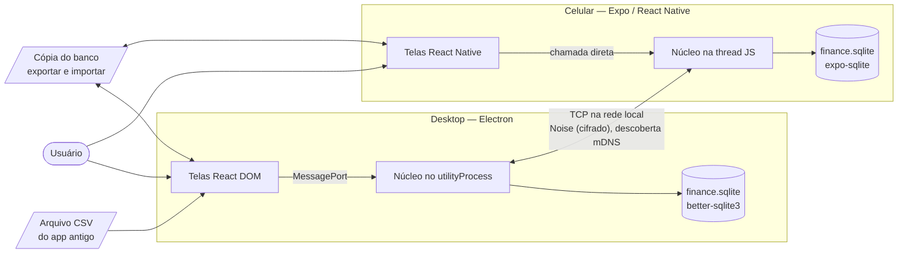
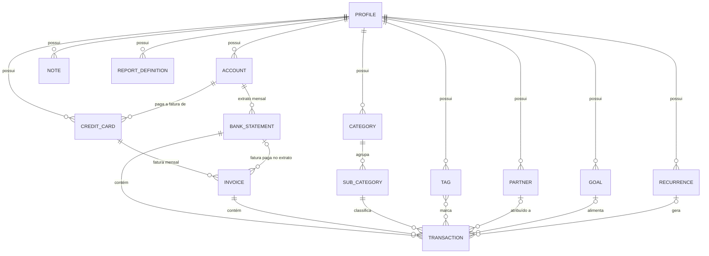

# Visão geral

Porta de entrada da wiki para quem chega ao projeto: o que o sistema é e o que ele deliberadamente não é, a forma geral da solução (núcleo compartilhado, dois shells, banco embarcado, sincronização na rede local), os pacotes do monorepo, as camadas em alto nível, o modelo de domínio resumido e por onde começar. O detalhe de cada assunto fica nas páginas citadas em cada seção.

## 1. O que é o sistema

Finanças é um sistema de finanças pessoais **local-first**, de uso pessoal e sem monetização. Existe para responder perguntas que os relatórios dos aplicativos comerciais não respondem — detalhamento por categoria e subcategoria, visões entre contas, o impacto da fatura do cartão no saldo do mês — sendo dono dos dados e da camada de relatórios.

### 1.1 Objetivos

1. Controle preciso do dia a dia de contas, cartões e transações.
2. Relatórios pessoais flexíveis, sem as limitações da interface de um app de terceiros (ver [relatórios](../regras-de-negocio/relatorios.md)).
3. Propriedade dos dados: tudo fica nos dispositivos do usuário, num arquivo SQLite que ele pode copiar, inspecionar e guardar por décadas.
4. Importar o histórico já acumulado em outro app (ver [importação](../regras-de-negocio/importacao.md)).

### 1.2 Foco de uso

- **Celular** (Android): uso diário — lançar transações, consultar saldos e faturas.
- **Desktop** (Linux e Windows): análise mais pesada, relatórios, importação e cadastros.
- **Custo recorrente zero**: nada de banco gerenciado, hospedagem ou assinatura. Tudo precisa rodar de graça, indefinidamente.

### 1.3 Fora do escopo

- Implantação multiusuário ou SaaS.
- Integração com bancos ou open finance, e importação automática de transações das instituições.
- Qualquer coisa que dependa de um servidor sempre ligado para o uso do dia a dia.
- Sincronização fora da rede local: é recusada por design, não é uma pendência (ver [sincronização](sincronizacao.md)).

Essas restrições explicam a maior parte das escolhas técnicas desta wiki; o raciocínio está em [decisões](../decisoes.md) ([ADR 1](../decisoes.md#adr-1)).

## 2. Forma geral da solução

Três ideias definem a arquitetura:

1. **Um núcleo TypeScript compartilhado** (`@finance/core`) concentra toda a regra de negócio e roda igual no Electron (Node) e no Hermes (React Native). Os apps são shells finos: telas e adaptadores sem regra. Assim nenhuma regra de negócio — nem a convergência da sincronização — existe duas vezes.
2. **Banco SQLite embarcado** em cada dispositivo, com o mesmo schema e as mesmas migrations; só o driver muda por plataforma (`better-sqlite3` no desktop, `expo-sqlite` no celular), atrás de uma porta síncrona estreita (`Database`). Ver [banco de dados](banco-de-dados.md).
3. **Sincronização par a par na rede local**: os dispositivos são pares iguais, cada um com o conjunto completo dos dados e escrevendo offline. Pareados por QR code, trocam alterações diretamente, cifradas, sem servidor, enquanto a tela de dispositivos está aberta nos dois. Conflitos são resolvidos por campo, com a edição mais recente vencendo. Ver [sincronização](sincronizacao.md).

O diagrama mostra o contexto: não há nenhum sistema externo além dos arquivos que o próprio usuário traz (planilha de importação, cópia do banco) e do outro dispositivo dele na mesma rede.

### 2.1 Desktop

O app Electron tem três processos: o **principal** (janelas, diálogos de arquivo, cofre da chave do aparelho via `safeStorage`), o **renderer** (React, sem Node, isolado por `contextIsolation`, `sandbox` e CSP) e um **`utilityProcess`** dono da única conexão com o banco, onde roda o núcleo e o transporte da sincronização. O renderer fala com o núcleo por um `MessagePort` direto, sem passar pelo processo principal. Detalhes em [desktop](desktop.md).

### 2.2 Celular

O app Expo roda o núcleo na própria thread JavaScript e chama o SQLite pela API síncrona do `expo-sqlite` (JSI), sem servidor local nem segundo runtime. Cada chamada é adiada para depois do frame corrente, para o toque desenhar o retorno visual antes de a thread parar no banco. Detalhes em [mobile](mobile.md).

## 3. Pacotes do monorepo

Monorepo pnpm (`pnpm-workspace.yaml` com `packages/*` e `apps/*`), TypeScript estrito, Node 24. Os pacotes exportam o código-fonte `.ts` diretamente (sem etapa de build própria): quem os consome — Vite, Metro, Vitest, Jest — compila ([ADR 6](../decisoes.md#adr-6)). O grafo de dependências e as fronteiras estão em [mapa do sistema §1](../mapa-do-sistema.md).

| Pacote | Caminho | Responsabilidade |
|---|---|---|
| `@finance/core` | [packages/core](../../../packages/core) | Núcleo: domínio, Requests (zod), Controllers, Services, Repositories, portas, migrations embutidas, protocolo e criptografia da sincronização. Sem Node e sem plataforma. Ver [core](core.md). |
| `@finance/client` | [packages/client](../../../packages/client) | Camada de apresentação headless compartilhada pelos dois apps: `CoreClient`, hooks do TanStack Query, mapa de invalidação, view-models, formulários, formatadores e a sequência de abertura. Sem React DOM, React Native, Electron ou Node. |
| `@finance/sqlite-better` | [packages/sqlite-better](../../../packages/sqlite-better) | Adaptador da porta `Database` sobre `better-sqlite3` (desktop e todos os testes no Node). |
| `@finance/sqlite-expo` | [packages/sqlite-expo](../../../packages/sqlite-expo) | Adaptador da porta `Database` sobre `expo-sqlite` (celular), e abertura do arquivo. |
| `@finance/tokens` | [packages/tokens](../../../packages/tokens) | Tokens de design (cores, tipografia, espaçamentos, temas claro e escuro) como dados sem dependências; gera o CSS de tema do desktop e o preset do NativeWind do celular. |
| `@finance/assets` | [packages/assets](../../../packages/assets) | Ícone do app em todos os formatos, compartilhado pelo instalador do desktop e pelo APK. |
| `@finance/desktop` | [apps/desktop](../../../apps/desktop) | Shell Electron: processos, IPC, telas React com Tailwind e shadcn/ui, empacotamento `.deb` e `.exe`. |
| `@finance/mobile` | [apps/mobile](../../../apps/mobile) | Shell Expo/React Native (Android): rotas do Expo Router, telas com NativeWind, adaptadores de plataforma e da sincronização. |
| `@finance/mobile-contract` | [apps/mobile-contract](../../../apps/mobile-contract) | App Android mínimo que roda, no Hermes e com o `expo-sqlite` real, a suíte de contrato da porta `Database` e os vetores de ouro do núcleo e do `client`. Ver [testes](testes.md). |

Fora dos pacotes:

- [db/migrations](../../../db/migrations) — migrations SQL numeradas, imutáveis depois de publicadas (`checksums.lock`), embutidas no núcleo por `pnpm embed:migrations`.
- [scripts](../../../scripts) — geração das migrations embutidas e scripts do Android (emulador, medição, APK distribuído). Ver [tecnologias §8](../tecnologias.md).
- [.devcontainer](../../../.devcontainer) — ambiente de desenvolvimento em Docker, com o toolchain do Android. Ver [tecnologias §9](../tecnologias.md).
- [.github/workflows](../../../.github/workflows) — CI: `check` (lint, tipos e testes em dois fusos horários) e `mobile` (contrato e teste de fumaça no emulador).

## 4. Camadas em alto nível

O núcleo segue uma divisão em camadas no estilo MVC, escolhida por ser a mais fácil de raciocinar para um app de CRUD e relatórios ([ADR 2](../decisoes.md#adr-2)):

| Camada | Onde | Responsabilidade |
|---|---|---|
| Request | `core/src/requests` | Schemas zod que validam a entrada de cada rota antes da regra de negócio. |
| Controller | `core/src/controllers` | Recebe a rota, valida pelo Request, delega ao Service e converte o resultado em DTO (`core/src/dto`) ou em erro `{ ok: false }`. |
| Service | `core/src/services` | Toda a regra de negócio e as transações de banco (`UnitOfWork`). |
| Repository | `core/src/repositories` (interfaces) e `core/src/infrastructure/sqlite` (SQL) | Único acesso a dados; fala com o banco só pela porta `Database`. |
| Model | `core/src/domain` | Entidades e Value Objects imutáveis (`Money`, `LocalDate`, `YearMonth`, ids marcados). |

Tudo que é da plataforma — driver SQLite, relógio, geração de ids, pasta de backups, rede da sincronização — entra por **portas** (`core/src/ports`) com um adaptador por plataforma, ligados num único lugar: a raiz de composição [`createCore`](../../../packages/core/src/composition/createCore.ts). As fronteiras são verificadas pelo [eslint.config.js](../../../eslint.config.js), não por disciplina ([ADR 5](../decisoes.md#adr-5)). O detalhe das camadas, das portas e do despacho de rotas está em [core](core.md); o caminho completo de uma chamada, em [mapa do sistema §2](../mapa-do-sistema.md).

## 5. Domínio em alto nível

1. **Perfil** (`Profile`) é a raiz de tudo: um conjunto separado de finanças, pessoal ou empresarial, com moeda própria. Contas, cartões, categorias, tags, sócios, metas, recorrências, anotações e relatórios salvos pertencem a um perfil. Ver [perfis](../regras-de-negocio/perfis.md).
2. **Conta** (`Account`) tem um **extrato** mensal (`BankStatement`) por mês com movimento; o saldo é sempre recalculado a partir das transações, nunca digitado. Ver [contas](../regras-de-negocio/contas.md).
3. **Cartão de crédito** (`CreditCard`) é vinculado à conta que paga a fatura; cada ciclo é uma **fatura** (`Invoice`) que, ao ser paga, entra no extrato do mês do pagamento. Ver [cartões e faturas](../regras-de-negocio/cartoes-e-faturas.md).
4. **Transação** (`Transaction`) — receita, despesa, transferência ou investimento — pertence a exatamente um contêiner mensal: o extrato de uma conta ou a fatura de um cartão. Transferências e investimentos têm conta de destino. Ver [transações](../regras-de-negocio/transacoes.md).
5. **Categoria** e **subcategoria** classificam transações; **tags** as marcam livremente. Ver [categorias e tags](../regras-de-negocio/categorias-e-tags.md).
6. **Recorrência** (`Recurrence`) gera parcelamentos e lançamentos fixos. Ver [recorrências](../regras-de-negocio/recorrencias.md).
7. **Meta** (`Goal`) é um objetivo de guardar um valor, alimentado por lançamentos vinculados ou pelo saldo de uma conta. Ver [metas](../regras-de-negocio/metas.md).
8. **Sócio** (`Partner`) é uma pessoa com participação percentual num perfil empresarial; os lançamentos podem ser atribuídos a um sócio. Ver [sócios](../regras-de-negocio/socios.md).
9. **Anotação** (`Note`) e **definição de relatório** (`ReportDefinition`) completam o perfil. Ver [anotações](../regras-de-negocio/anotacoes.md) e [relatórios](../regras-de-negocio/relatorios.md).

A visão consolidada do mês (saldos, pendências, próximas faturas) é descrita em [visão do mês](../regras-de-negocio/visao-do-mes.md); o schema completo, em [banco de dados](banco-de-dados.md). O mapa de módulos do núcleo e suas dependências está em [mapa do sistema §3](../mapa-do-sistema.md).

## 6. Por onde começar

### 6.1 Ambiente

O ambiente roda em Docker (devcontainer), sem Node nem pnpm na máquina: no VS Code, **Reopen in Container**; fora dele, `docker compose -f .devcontainer/compose.yaml run --rm dev <comando>`. Fora do Docker o requisito é Node 24 e pnpm 12. As instruções de instalação e build ficam no [README](../../../README.md).

### 6.2 Comandos da raiz

Definidos no [package.json](../../../package.json) da raiz:

| Comando | Para quê |
|---|---|
| `pnpm check` | Lint, typecheck e testes de todos os pacotes; rodar antes de concluir uma entrega. |
| `pnpm lint` / `pnpm typecheck` / `pnpm test` | Cada etapa do `check` isolada. |
| `pnpm embed:migrations` | Regera `embedded.generated.ts` e o `checksums.lock` depois de criar uma migration. |
| `pnpm golden:generate` | Regera os vetores de ouro do `core` e do `client` (só quando a mudança de valor é intencional). |
| `pnpm tokens:css` | Regera o CSS de tema e o preset do NativeWind a partir de `packages/tokens`. |
| `pnpm dev:desktop` / `pnpm build:desktop` / `pnpm dist:desktop` | Desktop com recarga, build e instaladores. |
| `pnpm dev:mobile` / `pnpm build:mobile` / `pnpm dist:mobile` | Metro, development build e APK distribuído do celular. |
| `pnpm build:mobile-contract` | APK do app de contrato. |
| `pnpm emulator:android` | Abre o emulador Android do devcontainer. |
| `pnpm db:history <arquivo>` | Gera um banco sintético de dez anos para medição. |
| `pnpm bench:core <arquivo>` / `pnpm bench:android <arquivo>` | Medição de desempenho no Node e no aparelho. |

### 6.3 Onde cada coisa mora

- Regra de negócio: `packages/core/src/services` e `packages/core/src/domain`; a página de [regras de negócio](../regras-de-negocio/transacoes.md) correspondente diz o arquivo.
- Contrato de rotas (entrada e saída de cada chamada): [routes.ts](../../../packages/core/src/controllers/routes.ts).
- Schema do banco: [db/migrations](../../../db/migrations).
- Hooks, view-models e formatadores das telas: `packages/client/src`.
- Telas do desktop: `apps/desktop/src/renderer/src`; do celular: `apps/mobile/app` (rotas) e `apps/mobile/src` (telas e componentes).
- Testes: `packages/<pacote>/test`, `apps/desktop/test` e `apps/desktop/e2e`, `apps/mobile/test`. Ver [testes](testes.md).

A tabela "quero mudar X, mexo em Y" está em [mapa do sistema §5](../mapa-do-sistema.md). As regras de trabalho (padrão de código, docblocks, versionamento por pacote) ficam no [CLAUDE.md](../../../CLAUDE.md).

## 7. Limitações conhecidas

- O app do celular é gerado e distribuído só para Android; o iOS não tem configuração de build nem distribuição definida.
- A distribuição é por instalação direta (APK assinado com a chave do usuário e instaladores `.deb` e `.exe`), sem loja.
