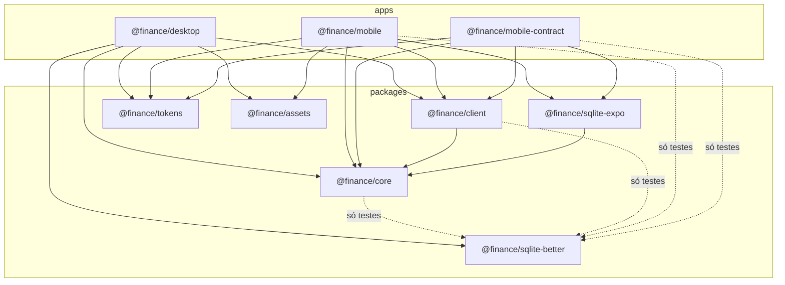
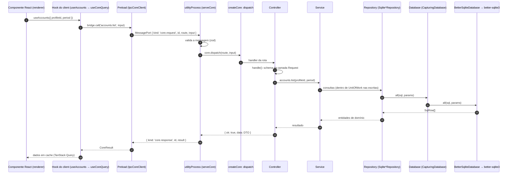
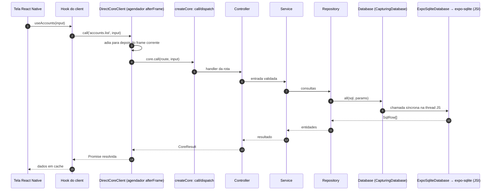
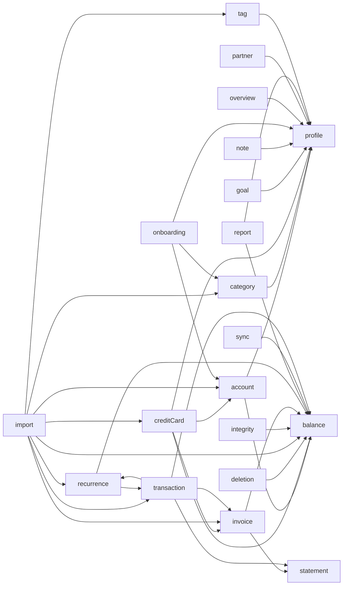
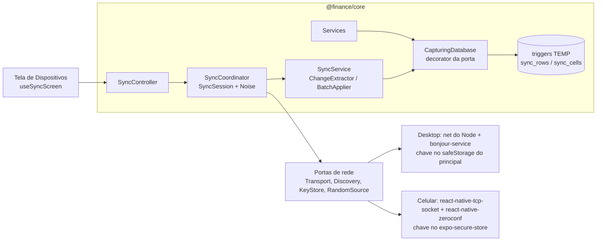

# Mapa do sistema

Mapa simplificado das peças do sistema e de como se relacionam: o grafo de dependências entre os pacotes e as fronteiras que o lint impõe, o caminho de uma chamada da tela ao banco no desktop e no celular, os módulos de domínio do núcleo e suas dependências, onde a sincronização se encaixa e uma tabela de "quero mudar X, mexo em Y". O que cada pacote faz está em [visão geral §3](arquitetura/visao-geral.md); o detalhe de cada camada, em [core](arquitetura/core.md).

## 1. Dependências entre pacotes

### 1.1 Grafo

A direção é sempre **app → `client` → `core`**, e os adaptadores de banco dependem do núcleo, nunca o contrário. Regras que o grafo esconde:

1. `@finance/core` não depende de nenhum outro pacote do monorepo em produção. Nos testes usa `@finance/sqlite-better` para rodar sobre SQLite real em memória.
2. `@finance/sqlite-better` **não** importa `@finance/core`: espelha os tipos da porta `Database` para não criar ciclo com o uso acima. Quem garante que a forma bate é a suíte de contrato do núcleo, que atribui o adaptador a uma variável do tipo `Database`.
3. `@finance/sqlite-expo` importa só `@finance/core` e `@finance/core/contract`.
4. `@finance/tokens` e `@finance/assets` não dependem de nada.
5. No celular, `@finance/assets` e `@finance/sqlite-better` são dependências de desenvolvimento (ícone no `app.config.ts` e núcleo dos testes de tela); no desktop, todos os pacotes internos são `devDependencies` porque o Vite os empacota (ver [tecnologias §5.8](tecnologias.md)).

### 1.2 Fronteiras verificadas pelo lint

As regras abaixo moram no [eslint.config.js](../../eslint.config.js) e falham o `pnpm lint`; a arquitetura não depende de disciplina (ver [decisões](decisoes.md), [ADR 5](decisoes.md#adr-5)).

| Escopo | Proibido | Motivo |
|---|---|---|
| `packages/core/src/**` | `node:*`, `fs`, `path`, `crypto`, `os`, `electron`, `react-native`, `expo-*`, `better-sqlite3`; `new Date`, `Date.now`, `Math.random`, `crypto.*`, `Intl`, `localeCompare`, `toLocale*` | O núcleo roda igual no Node, no Hermes e num futuro servidor; relógio e aleatoriedade entram pelas portas `Clock` e `IdGenerator`; `Intl` e afins dependem do ICU de cada runtime e dariam resultados diferentes no Chromium e no Hermes (ordenação por `domain/shared/textOrder.ts`). |
| `packages/client/src/**` | `react-dom`, `react-native`, `electron`, Node; `Intl` | É compartilhado pelos dois apps; formatação de números e datas é feita pelos formatadores próprios do `client`. |
| `packages/sqlite-expo/src/**` | Node, `better-sqlite3`, qualquer `@finance/*` exceto `@finance/core` e `@finance/core/contract`, `react`, `react-native` | Adaptador fino, sem regra e sem tela; roda no Hermes. |
| `packages/tokens/src/**` | Qualquer import que não seja relativo | Dados sem dependências, lidos por desktop, celular e gerador. |
| `apps/mobile/app/**`, `apps/mobile/src/**` | `@finance/core` (exceto `import type`), `@finance/sqlite-expo`, `expo-sqlite`, Node, `@finance/sqlite-better`; `Intl` | Telas falam só com o `client`; uma tela que chamasse o núcleo direto pularia o agendamento pós-frame e o cache de consultas. |
| `apps/mobile/src/startup/openMobileCore.ts`, `benchmark.ts`, `src/platform/systemAdapters.ts`, `apps/mobile-contract/**` | Node, `better-sqlite3`, `@finance/sqlite-better` | Raízes de composição: os únicos arquivos do app que conhecem núcleo e banco; continuam sem Node. |

O desktop não tem regra de fronteira própria no lint: o isolamento vem dos processos do Electron (o renderer não tem Node e só chega ao núcleo pelo `MessagePort`). O renderer importa do núcleo apenas tipos e funções puras — constantes de domínio e a análise prévia da importação (`analyzeImport`, `importRowSchema`).

## 2. Fluxo de uma chamada, da tela ao banco

Toda interação passa pelo mesmo contrato tipado: o mapa de rotas [`CoreRoutes`](../../packages/core/src/controllers/routes.ts) (`'accounts.list'`, `'transactions.create'`...), com a entrada de cada rota derivada do schema zod da camada Request e a saída de um DTO. O `client` só conhece a interface [`CoreClient`](../../packages/client/src/core/CoreClient.ts); cada plataforma injeta a sua implementação. Falha esperada volta como `{ ok: false, error }`, nunca como exceção, porque o IPC perderia a classe do erro.

### 2.1 Desktop

Pontos de referência no código:

- Hook e cache: [routeHooks.ts](../../packages/client/src/hooks/routeHooks.ts), [coreHooks.ts](../../packages/client/src/hooks/coreHooks.ts).
- Ponte: o preload ([index.ts](../../apps/desktop/src/preload/index.ts)) guarda o `MessagePort` no mundo isolado e expõe ao renderer só a função `call`; o protocolo e a correlação por `id` estão em [coreProtocol.ts](../../apps/desktop/src/shared/coreProtocol.ts).
- Processo do núcleo: [utility/index.ts](../../apps/desktop/src/utility/index.ts), [serveCore.ts](../../apps/desktop/src/utility/serveCore.ts), [openCore.ts](../../apps/desktop/src/utility/openCore.ts); o processo principal cria o canal em [CoreProcess.ts](../../apps/desktop/src/main/CoreProcess.ts).
- Núcleo: [createCore.ts](../../packages/core/src/composition/createCore.ts) (despacho), [CoreResult.ts](../../packages/core/src/controllers/CoreResult.ts) (`handle`), adaptador em [sqlite-better](../../packages/sqlite-better/src/index.ts).

### 2.2 Celular

Não há IPC: o núcleo roda na mesma thread JavaScript e o `DirectCoreClient` só adia a chamada para o toque desenhar o retorno visual antes de a thread parar no banco. A raiz de composição é [openMobileCore.ts](../../apps/mobile/src/startup/openMobileCore.ts); o adaptador, [ExpoSqliteDatabase.ts](../../packages/sqlite-expo/src/ExpoSqliteDatabase.ts). Os testes do `client` e das telas do celular usam o mesmo `DirectCoreClient`, sem agendamento, sobre `better-sqlite3` em memória.

### 2.3 Escritas e invalidação

1. A tela chama `useCoreMutation(rota)`; o Controller valida e o Service executa dentro de uma [`UnitOfWork`](../../packages/core/src/services/UnitOfWork.ts), que abre uma transação síncrona: as duas pontas de uma transferência e o recálculo de saldos confirmam juntos ou não confirmam.
2. Se o aparelho pertence a um grupo de sincronização, o `CapturingDatabase` carimba as células alteradas no fim da transação (§4).
3. No sucesso, o `client` invalida as leituras afetadas pelo mapa de [invalidation.ts](../../packages/client/src/queries/invalidation.ts); toda rota precisa estar classificada como leitura ou escrita em [queries/routes.ts](../../packages/client/src/queries/routes.ts), senão o typecheck falha.

## 3. Módulos de domínio do núcleo

### 3.1 Os módulos

O domínio fica em [packages/core/src/domain](../../packages/core/src/domain), em 18 módulos. A coluna "importa" lista os outros módulos de domínio dos quais o módulo depende (imports reais).

| Módulo | Conteúdo principal | Importa |
|---|---|---|
| `shared` | `Money`, `Currency`, `LocalDate`, `YearMonth`, ids marcados, erros de negócio, ids determinísticos (UUID v5), ordenação de nomes | — |
| `profile` | `Profile` | `shared` |
| `account` | `Account` | `balance`, `shared` |
| `creditCard` | `CreditCard`, `BillingCycle` | `shared` |
| `invoice` | `Invoice` | `shared` |
| `transaction` | `Transaction`, `TransactionType`, `TransactionContainer`, sugestão de nome | `shared` |
| `statement` | `BankStatement`, fluxos do extrato | `balance`, `invoice`, `transaction`, `shared` |
| `balance` | `BalancePair` (consolidado e previsto), movimento mensal, cadeia de extratos | `creditCard`, `statement`, `transaction`, `shared` |
| `category` | `Category`, `SubCategory`, categorias sugeridas | `shared` |
| `tag` | `Tag` | `shared` |
| `partner` | `Partner`, `PartnerShares` | `shared` |
| `goal` | `Goal`, `GoalProgress` | `shared` |
| `recurrence` | `Recurrence`, `RecurrenceSchedule` | `transaction`, `shared` |
| `note` | `Note` | `shared` |
| `report` | definição, filtro, layout, resultado e totais de relatório; projeção de saldo; relatório por sócio | `balance`, `partner`, `transaction`, `shared` |
| `overview` | pendências e resumo de gastos da visão do mês | `creditCard`, `invoice`, `report`, `shared` |
| `import` | linha e análise da importação | `recurrence`, `shared` |
| `sync` | relógio lógico híbrido, vetor de versões, lote, catálogo de tabelas sincronizadas, membro, estado | `shared` |

`balance` e `statement` se importam mutuamente: a cadeia de extratos e o saldo do extrato são o mesmo assunto visto de dois lados, e só tipos e funções puras cruzam entre eles.

### 3.2 Dependências entre Services

Os Services (em [packages/core/src/services](../../packages/core/src/services)) seguem os mesmos módulos, mais `deletion` (exclusão em cascata), `integrity` (verificação de saldos na abertura) e `onboarding` (primeiro uso). O grafo abaixo mostra quais Services usam outros (imports reais entre pastas de `services/`):

Leitura do grafo:

1. **`balance` é o centro**: toda escrita que muda dinheiro passa pelo cálculo de impacto e pelo recálculo de saldos (`ImpactCalculator`, `BalanceRecalculationService`). Por isso `sync`, `deletion` e `integrity` também dependem dele — aplicar um lote, excluir em cascata e verificar na abertura recalculam os mesmos saldos.
2. **`profile`** é consultado por quase todos para validar a moeda e o tipo do perfil dono do cadastro.
3. **`transaction` ↔ `recurrence`** se referenciam só por tipo: `TransactionService` delega a série ao `RecurrenceService`, e o `SeriesPlanner` usa o `TransactionService` e o `TransactionComposer`. O ciclo é resolvido na raiz de composição, que constrói o `TransactionComposer`, depois o `RecurrenceService`, depois o `TransactionService` ([createCore.ts](../../packages/core/src/composition/createCore.ts)).
4. **`import`** é o maior consumidor: uma importação grava cadastros, lançamentos, séries e pagamentos de fatura numa única unidade de trabalho, passando pelos mesmos Services e pelo mesmo `TransactionComposer` do uso normal, para que nenhuma regra seja contornada.

Os Services dependem de interfaces de Repository ([repositories](../../packages/core/src/repositories)) e de portas ([ports](../../packages/core/src/ports)); as implementações SQLite ficam em [infrastructure/sqlite](../../packages/core/src/infrastructure/sqlite) e só a raiz de composição as conhece.

## 4. Onde entra a sincronização

1. **Captura**: quando o núcleo é montado com `wallClock`, `createCore` instala triggers `TEMP` e embrulha a porta `Database` no decorator [`CapturingDatabase`](../../packages/core/src/infrastructure/sync/CapturingDatabase.ts), que carimba cada célula escrita com o relógio lógico híbrido no fim da transação mais externa. Nenhum Service sabe da sincronização.
2. **Troca**: o [`SyncCoordinator`](../../packages/core/src/protocol/SyncCoordinator.ts) abre sessões cifradas (Noise `KK` entre membros, `IKpsk2` no pareamento) e troca lotes extraídos e aplicados pelos Services de [services/sync](../../packages/core/src/services/sync); a aplicação recalcula os saldos afetados.
3. **Plataforma**: só o transporte de bytes, a descoberta, o cofre da chave e a aleatoriedade são da plataforma ([SyncNetwork.ts](../../packages/core/src/ports/SyncNetwork.ts)); protocolo, criptografia e convergência são do núcleo.
4. **Quando**: só com a tela de Dispositivos aberta nos dois aparelhos ([syncHooks.ts](../../packages/client/src/hooks/syncHooks.ts)). Ao chegar um lote, todas as consultas são invalidadas; nenhuma outra tela recebe alteração remota por baixo.

O desenho completo — modelo de dados da sincronização, convergência, pareamento e segurança — está em [sincronização](arquitetura/sincronizacao.md).

## 5. Quero mudar X, mexo em Y

| Quero... | Mexo em... |
|---|---|
| Criar uma rota nova no núcleo | Schema em `core/src/requests`; DTO em `core/src/dto`; método no Controller; regra no Service; entrada em `CoreRoutes` de [routes.ts](../../packages/core/src/controllers/routes.ts) e handler no mapa `handlers` de [createCore.ts](../../packages/core/src/composition/createCore.ts) (o tipo `RouteHandlers` obriga a ter um por rota); classificação leitura/escrita em [queries/routes.ts](../../packages/client/src/queries/routes.ts); invalidação em [invalidation.ts](../../packages/client/src/queries/invalidation.ts); hook em [routeHooks.ts](../../packages/client/src/hooks/routeHooks.ts). Ver [core](arquitetura/core.md). |
| Mudar uma regra de negócio | O Service ou a entidade do domínio indicados na página de [regras de negócio](regras-de-negocio/transacoes.md) correspondente, com teste em `packages/core/test`. |
| Alterar o schema do banco | Nova migration `NNNN_nome.sql` em [db/migrations](../../db/migrations) (nunca editar uma publicada), `pnpm embed:migrations`, classificar tabela nova em [SyncCatalog.ts](../../packages/core/src/domain/sync/SyncCatalog.ts) (um teste falha se faltar), Repository em `infrastructure/sqlite`. Ver [banco de dados](arquitetura/banco-de-dados.md). |
| Criar ou alterar uma tela do desktop | `apps/desktop/src/renderer/src/<área>`, rota em [router.tsx](../../apps/desktop/src/renderer/src/router.tsx); dados só pelos hooks do `client`; lógica de apresentação compartilhável em `client/src/viewModels`. Ver [desktop](arquitetura/desktop.md). |
| Criar ou alterar uma tela do celular | Rota em `apps/mobile/app/(tabs)/<aba>/`, tela em `apps/mobile/src/screens`, caminhos em `src/shell/routes.ts`. Ver [mobile](arquitetura/mobile.md). |
| Formatar um valor, data ou percentual | `packages/client/src/format`, nunca `Intl` nem `toLocale*`; se mudar a saída, `pnpm golden:generate` e revisar o diff dos vetores. |
| Validar um formulário | `packages/client/src/forms` (compartilhado pelas duas telas). |
| Mudar cores, tipografia ou espaçamento | [tokens.ts](../../packages/tokens/src/tokens.ts) e `pnpm tokens:css`; nunca valor literal nas telas. |
| Trocar ou ajustar o driver SQLite | `packages/sqlite-better` ou `packages/sqlite-expo`; a suíte de contrato ([databaseContract.ts](../../packages/core/src/contract/databaseContract.ts)) precisa passar no Node e no app de contrato. |
| Adicionar um adaptador de plataforma (relógio, ids, rede) | Porta em `core/src/ports`; adaptadores em `apps/desktop/src/utility` e `apps/mobile/src/platform`; ligação na raiz de composição de cada app. |
| Mudar o protocolo da sincronização | `core/src/protocol` e `core/src/services/sync`; testes de propriedade em `core/test/sync`. Ver [sincronização](arquitetura/sincronizacao.md). |
| Mudar o ícone | [packages/assets](../../packages/assets/README.md). |
| Mudar empacotamento | [electron-builder.yml](../../apps/desktop/electron-builder.yml) no desktop; [app.config.ts](../../apps/mobile/app.config.ts) e [android-dist.sh](../../scripts/android-dist.sh) no celular. |

Toda alteração de código ajusta a versão de cada pacote tocado, conforme a tabela do [CLAUDE.md](../../CLAUDE.md).
