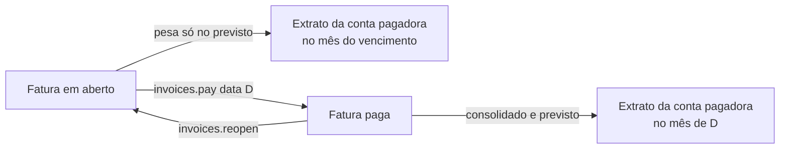

# Cartões e faturas

Regras do cartão de crédito e da fatura: o ciclo de fechamento e vencimento, a fatura sugerida
para cada compra, o pagamento total e parcial, a reabertura, o dia do pagamento, o limite usado,
a linha da fatura que agrupa as compras na lista de Transações e o que acontece ao desativar ou
excluir um cartão. Os saldos da conta pagadora estão em [contas](contas.md).

## 1. Cartão de crédito

### 1.1 Cadastro

Um cartão pertence a um perfil e é quitado por uma conta
([`CreditCard.ts`](../../../packages/core/src/domain/creditCard/CreditCard.ts),
[`CreditCardService`](../../../packages/core/src/services/creditCard/CreditCardService.ts)):

1. **Conta pagadora do mesmo perfil** (`reference-outside-profile`) e, quando escolhida agora,
   **ativa** (`account-disabled`). O cartão que já usa uma conta depois desativada continua
   editável com ela; o formulário oferece só as ativas, mais a atual na edição
   (`creditCardForm` do `client`).
2. **Limite** maior ou igual a zero; limite zero não tem proporção na barra (a tela mostra `—`).
3. **Dia de fechamento e dia de vencimento** entre 1 e 31 — números de dia, não datas. O
   formulário explica o ajuste quando o dia é 29, 30 ou 31.
4. Nome de 1 a 45 caracteres.

Rotas: `creditCards.list`, `creditCards.create`, `creditCards.update`, `creditCards.disable`,
`creditCards.enable`, `creditCards.deletionImpact`, `creditCards.delete`.

### 1.2 Ciclo de faturamento

Regras de negócio (Cartão de crédito), no Value Object
[`BillingCycle`](../../../packages/core/src/domain/creditCard/BillingCycle.ts):

1. **Dia inexistente vira o último dia do mês**: o cartão que fecha no dia 31 fecha em 30/04 e
   em 28 ou 29/02; o dia guardado continua 31, e maio volta a fechar no 31.
2. A fatura de um mês (competência) **fecha** no dia de fechamento daquele mês e reúne as compras
   feitas depois do fechamento anterior e antes do seu — **a compra feita no dia do fechamento
   entra na fatura seguinte**.
3. A fatura **vence** no primeiro dia de vencimento (com o mesmo ajuste de fim de mês) **depois**
   do fechamento dela — no mesmo mês ou no seguinte.

### 1.3 Editar o ciclo não move lançamentos

Regra de negócio (Cartão de crédito): mudar o dia de fechamento **não** move lançamentos
existentes — a fatura gravada em cada lançamento é a verdade
([§2.2](#22-fatura-sugerida-e-fatura-escolhida)). Mas o ciclo decide o mês do vencimento, em que
a fatura em aberto pesa no previsto, e a conta pagadora decide em que conta ela pesa; mudar
qualquer um dos dois recalcula a conta antiga e a nova (`CreditCardService.update`).

## 2. Fatura

### 2.1 Uma fatura por cartão por mês

Regra de negócio (Fatura): a fatura (`invoices`,
[`Invoice.ts`](../../../packages/core/src/domain/invoice/Invoice.ts)) é o contêiner mensal do
cartão — **uma linha por cartão por competência**, com id derivado da chave natural, criada
sob demanda quando algo cai nela. A "fatura do mês" na lista de cartões é a da competência do
mês de referência — a que fecha naquele mês. A competência existe com fechamento e vencimento
mesmo sem linha (`InvoiceCycle`), e a tela mostra "Sem lançamentos".

### 2.2 Fatura sugerida e fatura escolhida

Regra de negócio (Cartão de crédito): ao lançar uma compra no cartão, o app **sugere** a fatura
pela data da compra e pelo ciclo (`invoices.suggest`, que já devolve fechamento e vencimento da
competência sugerida, mesmo antes de a fatura existir). O usuário pode escolher outra fatura do
mesmo cartão — o banco às vezes lança a compra num ciclo diferente —, e **a fatura escolhida é a
verdade**:

1. a sugestão **nunca é recalculada** depois, nem quando a data da compra é editada; numa edição
   no mesmo cartão, a fatura atual é mantida (`TransactionComposer.resolveContainer`);
2. a troca oferece a anterior, a sugerida e as duas seguintes, mais a atual na edição
   (`invoiceChoices` do `client`);
3. **escolher uma fatura já paga a reabre** ([§3.4](#34-reabrir)), e o formulário avisa antes de
   salvar de qual extrato o pagamento sai (`invoiceReopenWarning`); a edição que mantém a fatura
   atual não reabre nada.

Ver [decisões](../decisoes.md) ([ADR 60](../decisoes.md#adr-60)).

### 2.3 Total e valor a pagar

Regra de negócio (Fatura): o total (`balance`) é a soma dos efeitos de **todas** as transações
vivas da fatura, pagas ou não, com o **sinal do efeito na conta que a quita**: negativo quando há
valor a pagar, positivo quando os estornos superam as compras (`invoiceBalance`). Assim o extrato
soma faturas como soma transações. Os pagamentos parciais, transferências de valor negativo,
abatem o total pela própria regra de sinal.

- O **valor a pagar** é o total em módulo; **fatura credora conta zero** (`amountDue`) — crédito
  não paga outra fatura nem libera limite de outro mês.
- Na tabela da fatura, cada linha mostra **quanto soma à fatura** (o oposto do efeito na conta):
  compra positiva, estorno e pagamento parcial negativos, com etiqueta e `⇄`; a soma fecha com o
  valor a pagar (`buildInvoiceTable`). A situação de pago de cada compra não aparece: é a da
  fatura.

### 2.4 Fases e próximas faturas

Na tela, uma fatura não paga está **aberta** (recebe as compras de hoje), **fechada** ("fechada ·
vence dd/mm") ou **futura** (ainda não começou), além de **paga** (`invoiceStage`, pelo dia de
fechamento com o ajuste de fim de mês). "Próximas faturas" (`invoices.listByCard`) traz a
competência pedida, sempre, e as faturas existentes depois dela (parcelas e compras já lançadas).
A situação na lista é "Em aberto · vence 10/10", "Paga em 07/10" ou, sem o dia gravado, "Paga no
extrato de out" (`formatInvoiceSituation`).

## 3. Pagamento da fatura

### 3.1 Pagar a fatura inteira

Regra de negócio (Fatura): uma fatura está **paga** ou **em aberto**, nunca paga pela metade.
Pagar (`invoices.pay`, com a data) **vincula a fatura ao extrato do mês do pagamento da conta
pagadora do cartão**: ela sai do previsto do vencimento e entra, no consolidado e no previsto, no
mês em que o pagamento aconteceu
([`InvoiceService.pay`](../../../packages/core/src/services/invoice/InvoiceService.ts)).

1. A data é obrigatória (sugerida: hoje) e decide o extrato.
2. **A conta não se escolhe no pagamento**: o vínculo é com o extrato da conta pagadora do
   cartão; pagar por outra mudaria o modelo. Trocar a pagadora é editar o cartão.
3. Pagar uma fatura já paga é recusado (`invoice-already-paid`): mudar o mês do pagamento é
   reabrir e pagar de novo.
4. A confirmação mostra o extrato que recebe a fatura e o consolidado da conta antes → depois
   (`describeInvoicePayment`), conforme [perfis §5.3](perfis.md#53-confirmações-dizem-o-que-muda).

Ver [decisões](../decisoes.md) ([ADR 59](../decisoes.md#adr-59)).

### 3.2 O dia do pagamento

Regra de negócio (Fatura): o vínculo com o extrato guarda só o **mês**, que decide a situação e
onde a fatura pesa. O **dia** fica em `invoices.payment_date` (migration
[`0003_invoice_payment_date.sql`](../../../db/migrations/0003_invoice_payment_date.sql)), gravado na
mesma escrita do vínculo e apagado junto ao reabrir; o extrato o usa para mostrar a fatura paga
na data em que o dinheiro saiu. Ele **não decide nada**: uma fatura sem vínculo vivo está em
aberto mesmo com um dia sobrando, e nas faturas pagas antes da migration o dia é nulo — inventá-lo
mostraria uma data que não aconteceu. O DTO o expõe como `paymentDate`. Ver
[decisões](../decisoes.md) ([ADR 69](../decisoes.md#adr-69)).

Testes: "Dia do pagamento da fatura" em
[`balances.table.test.ts`](../../../packages/core/test/services/balances.table.test.ts).

### 3.3 Pagamento parcial

Regra de negócio (Fatura): pagar só uma parte é **lançar uma transferência na fatura**, com a
conta que pagou como **destino** e valor **negativo**: pela regra de sinal, o dinheiro sai da
conta e abate a fatura. Não há rota própria — é `transactions.create` —, e a transferência
**nasce paga**, porque registra um pagamento já feito (`readPartialPaymentForm` do `client`).

1. A conta sugerida é a pagadora do cartão, mas **qualquer conta ativa** pode ter pago: é um
   lançamento comum, não o vínculo da fatura.
2. O formulário pede a subcategoria, porque toda transação tem uma.
3. O valor é maior que zero e **menor que o valor a pagar**: igual ou maior deixaria a fatura
   zerada ou credora e ainda em aberto; quitar tudo é "Pagar fatura". Sem valor a pagar, o botão
   fica desabilitado.
4. Excluir o pagamento parcial devolve o valor à conta e à fatura.
5. Quando a fatura for paga por inteiro, o total vinculado ao extrato já está líquido dos
   parciais, sem contar nada duas vezes.

A transferência que sai de uma fatura não pode ter destino em outro perfil
([contas §4.2](contas.md#42-transferência-entre-perfis)).

### 3.4 Reabrir

Regra de negócio (Fatura): reabrir (`invoices.reopen`) **desfaz o pagamento** — limpa o vínculo e
o dia, o valor sai do extrato onde tinha sido pago e o saldo da conta volta como se o pagamento
não tivesse acontecido, até o usuário pagar de novo. Reabrir uma fatura em aberto é recusado
(`invoice-not-paid`). A confirmação diz de qual extrato o pagamento sai e em que mês e dia a
fatura volta a pesar no previsto (`describeInvoiceReopening`). Lançar numa fatura paga também a
reabre ([§2.2](#22-fatura-sugerida-e-fatura-escolhida)).

### 3.5 Onde a fatura pesa

Regra de negócio (Extrato): a fatura paga entra no extrato em que foi paga, no dia do pagamento;
a em aberto, só no previsto do mês do vencimento
([`ImpactCalculator`](../../../packages/core/src/services/balance/ImpactCalculator.ts),
[`StatementConsolidationService`](../../../packages/core/src/services/statement/StatementConsolidationService.ts)).
Por isso pagar e reabrir recalculam a conta pagadora a partir do mês do vencimento e do mês do
pagamento. A fatura sobrevive à exclusão do extrato que a absorveu e volta a ficar em aberto.

Testes: "Testes de mesa 2, 4 e 12 — cartão de crédito" em
[`balances.table.test.ts`](../../../packages/core/test/services/balances.table.test.ts),
[`invoiceView.test.ts`](../../../packages/client/test/invoiceView.test.ts),
[`invoiceForms.test.ts`](../../../packages/client/test/invoiceForms.test.ts).

## 4. Limite usado

Regra de negócio (Cartão de crédito): o limite usado (`limitUsed` em `creditCards.list`) é o que
o banco já reservou do limite (`CreditCardService.limitUsed`):

1. faturas pagas não usam limite;
2. das faturas em aberto **até a fatura aberta hoje** (a que recebe uma compra feita hoje),
   conta o valor a pagar inteiro, séries fixas incluídas — aquela cobrança já entrou;
3. das faturas **depois** da aberta hoje, conta só o **comprometido**: compras avulsas lançadas
   adiante e parcelas. As ocorrências futuras de **séries fixas ficam fora**: a série é gravada
   12 meses à frente, e somá-la reservaria do limite um ano de assinatura ainda não cobrada;
4. fatura credora conta zero.

A tela mostra o percentual, a barra (limitada a 100%) e o valor usado "de" o limite
(`describeLimitUsage`). Ver [decisões](../decisoes.md) ([ADR 70](../decisoes.md#adr-70)).

A lista também traz os totais do mês: "Em aberto no mês" (valor a pagar das faturas do mês ainda
em aberto) e "Total das faturas" (de todas as faturas do mês).

## 5. Compras agrupadas na linha da fatura

Regra de negócio (Transações): na lista de Transações do mês **sem nenhum filtro**, as compras e
os estornos do cartão não aparecem um a um — cada fatura que pesa no mês vira **uma linha**
([`transactionTable.ts`](../../../packages/client/src/viewModels/transactionTable.ts)):

1. **data** do pagamento quando paga, senão do vencimento — a mesma regra do extrato;
2. **valor**: o que falta pagar, líquido dos pagamentos parciais;
3. a linha abre a fatura; `P` e `Del` nela explicam onde agir;
4. o **pagamento parcial** continua como linha própria, porque saiu da conta noutro dia, com a
   situação dele, e conta no resultado pelo efeito na conta pagadora (a linha da fatura vem
   líquida dele);
5. a compra de um cartão cuja conta pagadora não está entre as contas do perfil continua uma a
   uma, para o gasto não sumir;
6. **com qualquer filtro** (busca, conta ou cartão, categoria, tag, situação), quem filtra procura
   um item, e as compras voltam uma a uma.

As faturas da linha vêm de `statements.profileInvoices`, que usa a mesma consulta do extrato
(`StatementConsolidationService.monthInvoices`), para que Transações e extrato concordem por
construção sobre mês, dia e valor. O celular aplica as mesmas regras, pelos mesmos view-models do
`client` — o celular não tem regra própria. Ver [decisões](../decisoes.md) ([ADR 67](../decisoes.md#adr-67)).

Testes: [`transactionGrouping.test.ts`](../../../packages/client/test/transactionGrouping.test.ts),
[`profileInvoices.test.ts`](../../../packages/core/test/services/profileInvoices.test.ts),
[`transactions.test.tsx`](../../../apps/mobile/test/transactions.test.tsx).

## 6. Desativar e excluir cartão

Regra de negócio (Cartões): como na conta ([contas §5.1](contas.md#51-desativar)),
**desativar** é o padrão. O cartão desativado some das escolhas de novos lançamentos e do cartão
padrão (`credit-card-disabled`), continua em faturas, saldos e relatórios, pode ser reativado, e
as séries que o usam continuam emitindo. Lançamentos que já estão nele continuam editáveis.

**Excluir** (`creditCards.delete`) apaga em cadeia as **faturas e os lançamentos delas, incluindo
os pagamentos parciais**, e as **recorrências** com o cartão como origem; depois recalcula a
conta pagadora e as contas que fizeram pagamentos parciais. O alerta
(`creditCards.deletionImpact`, `describeCreditCardDeletion`) cita os pagamentos parciais à parte,
porque são eles que devolvem dinheiro à conta que pagou — o motivo de ela aparecer como afetada.
A mecânica (escopo único, soft delete, digitar o nome) é a de [contas §5.2](contas.md#52-excluir-em-cadeia-o-que-é-apagado-junto).
Excluir a conta pagadora exclui o cartão junto.

Testes: "excluir cartão em cadeia" em
[`deletion.test.ts`](../../../packages/core/test/services/deletion.test.ts) e
[`creditCards.test.ts`](../../../packages/core/test/services/creditCards.test.ts).

## 7. Telas de cartões

- **Lista:** cartões ativos com a situação e o valor da fatura do mês, selo "Padrão", desativados
  à parte, e os totais do mês. Sem conta ativa, criar cartão explica que é preciso uma conta
  para pagá-lo.
- **Fatura:** valor a pagar (em módulo), situação, fechamento, vencimento com a nota de onde a
  fatura pesa, limite usado, lançamentos (editáveis pela própria fatura), próximas faturas e as
  ações pagar, parcial e reabrir. Uma fatura de outro mês que não o de referência mostra um aviso
  com o link para a do mês.
- **Ações do cartão:** editar, usar como padrão, desativar/reativar e excluir.

Testes de tela: [`cards.spec.ts`](../../../apps/desktop/e2e/cards.spec.ts),
[`cards.test.tsx`](../../../apps/mobile/test/cards.test.tsx).

## 8. Limitações conhecidas

- **Pagamento total só pela conta pagadora:** a fatura inteira é sempre paga pela conta
  pagadora do cartão ([§3.1](#31-pagar-a-fatura-inteira)). Quem pagou por outra conta registra
  um pagamento parcial ou troca a pagadora no cadastro do cartão.
- **Pagadora desativada:** `invoices.pay` não confere se a conta pagadora está desativada. Pagar
  a fatura de um cartão cuja pagadora foi desativada é aceito e pesa no extrato dela, coerente
  com "desativar não muda saldo".
- **Faturas antigas sem dia:** as faturas pagas antes da migration `0003` não têm o dia do
  pagamento. Elas aparecem como "Paga no extrato de mês" e vão para o fim do mês no extrato
  ([§3.2](#32-o-dia-do-pagamento)).
- **Fatura credora:** o crédito de uma fatura credora não abate outra fatura nem libera limite
  de outro mês ([§2.3](#23-total-e-valor-a-pagar)). Ele fica parado na própria fatura.
