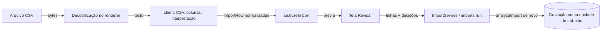

# Importação de transações

Esta página descreve a importação do histórico de outro app ou de uma planilha: como o arquivo é
lido, como as colunas se ligam aos campos, as regras de negócio que decidem contas, cartões,
categorias, faturas e séries, a prévia da revisão e a segurança da gravação. Diz também em que
camada mora cada regra (núcleo, `client` ou desktop).

## 1. Escopo

Trazer o histórico para o app **um arquivo por vez**, só no desktop. O caso que motivou a
importação é o export de outro app de finanças: três CSVs (Despesas, Receitas e Transferências),
com séries fixas até alguns anos à frente, parcelamentos e compras em cartões.

| Entra | Não entra |
|---|---|
| CSV em UTF-8 ou Latin-1 (windows-1252), separador `,` `;` ou tabulação, decimal com ponto ou vírgula | XLSX e a escolha de aba |
| Arquivo de um tipo (despesas, receitas, transferências) ou com coluna de tipo | Investimento: nenhum export conhecido o distingue de uma transferência, e adivinhar mudaria quem alimenta uma meta |
| Contas e cartões novos ou ligados a existentes, em qualquer perfil já criado | Criar perfil dentro do assistente |
| Séries fixas e parceladas agrupadas numa recorrência do app | Sócio e meta (o arquivo não traz) |
| Faturas pagas pela data de pagamento das compras | Proveniência: reimportar o mesmo arquivo duplica (§7) |
| Modelo de mapeamento salvo no aparelho | |

Até 50.000 linhas por arquivo (`IMPORT_MAX_ROWS`) e 20 MB (`IMPORT_FILE_MAX_BYTES`): os tetos só
impedem que um arquivo errado (um log, uma planilha de outra coisa) prenda o núcleo numa transação
enorme.

## 2. Onde cada regra mora

| Peça | Onde | Papel |
|---|---|---|
| Arquivo | [`apps/desktop/src/main/importFiles.ts`](../../../apps/desktop/src/main/importFiles.ts) | Diálogo de abrir no processo principal (devolve nome e bytes, nunca o caminho) e os modelos de mapeamento no `preferences.json` |
| Decodificação | [`importView.ts`](../../../apps/desktop/src/renderer/src/import/importView.ts) (renderer) | Bytes → texto. Fica no renderer porque o `client` não tem `TextDecoder` (roda sem DOM) e a importação é só do desktop |
| Leitura | [`packages/client/src/import/`](../../../packages/client/src/import) | CSV, detecção de separador, decimal, data e tipo, ligação de colunas, interpretação das linhas, revisão e modelos: **só formato**, nenhuma regra de negócio |
| Análise | [`domain/import/`](../../../packages/core/src/domain/import) (`analyzeImport`) | Função pura: problemas por linha, séries, números das ocorrências, fim da fixa, data gravada, sugestões de cartão, categorias e `#palavras` |
| Escrita | [`ImportService.ts`](../../../packages/core/src/services/import/ImportService.ts) (rota `imports.run`) | Cria cadastros, grava avulsos e séries, paga faturas e recalcula uma vez, numa unidade de trabalho |
| Telas | [`apps/desktop/src/renderer/src/import/`](../../../apps/desktop/src/renderer/src/import) | Assistente Arquivo → Colunas → Revisar → confirmação |

O `client` entrega ao núcleo **linhas normalizadas** (`ImportRow`: datas `YYYY-MM-DD`, números,
textos aparados, contas e categorias ainda como **nomes do arquivo**), nunca o arquivo: o núcleo
não sabe nada de CSV, e o formato não chega às regras. A tela de revisão chama a **mesma**
`analyzeImport` do núcleo sobre as mesmas linhas, para que a prévia nunca discorde do que é gravado
(§6). Ver [decisões](../decisoes.md), [ADR 85](../decisoes.md#adr-85).

## 3. Leitura do arquivo

Regras de formato, todas no `client` e no renderer:

- **Codificação:** UTF-8 quando o arquivo decodifica sem erro; senão windows-1252 (o "Latin-1" que
  o Excel grava, que cobre aspas tipográficas e travessão). O BOM é descartado.
- **Separador de colunas:** o que dá o mesmo número de colunas (maior que 1) no maior número das
  primeiras linhas, entre `,`, `;` e tabulação ([`csv.ts`](../../../packages/client/src/import/csv.ts)).
  Campos entre aspas podem ter separador, aspas dobradas e quebras de linha. O leitor é escrito à
  mão, sem biblioteca.
- **Separador decimal e formato de data:** detectados pelas amostras e ajustáveis na tela
  ([`cellFormats.ts`](../../../packages/client/src/import/cellFormats.ts)). O número aceita símbolo de
  moeda, espaços e separador de milhar; três casas depois do separador não votam no decimal
  (`1.234` pode ser milhar). A data descarta a hora quando há. `-`, `—`, `–` ou vazio numa data =
  sem data.
- **Tipo do arquivo** ([`importTable.ts`](../../../packages/client/src/import/importTable.ts)): coluna
  "Tipo" = vários tipos; senão, pelo nome (transferência, receita/entrada, despesa/gasto/saída); sem
  nome que decida, pelas colunas (origem e destino = transferências; Cartão ou Encargos = despesas).
  O usuário confirma.
- **Linha com problema de formato** (data ou valor ilegível, campo obrigatório vazio, tipo não
  reconhecido) não chega ao núcleo ([`interpretRows.ts`](../../../packages/client/src/import/interpretRows.ts));
  aparece listada na revisão junto com os problemas de conteúdo (§6) e **não é importada**.

## 4. Ligação de colunas

Cada campo liga a **uma** coluna, e cada coluna a um campo só; colunas sem campo são ignoradas. A
sugestão automática compara o cabeçalho normalizado (sem acento, minúsculo) com uma lista de
sinônimos por campo ([`importFields.ts`](../../../packages/client/src/import/importFields.ts)).
"Efetivação" e "Lançamento" ficam só como **dica** na coluna ("Parece ser: Data de pagamento",
"Parece ser: Data da compra"), sem ligar sozinhos, porque cada app usa esses nomes para coisas
diferentes.

| Campo | Tipos de arquivo | Obrigatório |
|---|---|---|
| Nome, Valor, Vencimento | todos | sim |
| Tipo | vários tipos | sim |
| Conta | despesas, receitas, vários tipos | sim |
| Categoria, Subcategoria | despesas, receitas, vários tipos | sim |
| Conta de origem | transferências | sim |
| Conta de destino | transferências; vários tipos | sim nas transferências; em vários tipos, só as linhas de transferência precisam dela (§5.1) |
| Cartão de crédito, Encargos | despesas, vários tipos | não |
| Data da compra | despesas, receitas, vários tipos | não |
| Observação, Tags, Data de pagamento, Recorrência, Nº da parcela, Total de parcelas | todos | não |

- **Recorrência:** texto com "fix" = fixa, "parcel" = parcelada, o resto ("Nenhuma", vazio) =
  avulsa; "diária", "semanal" e "anual" dão a frequência, e mensal é o padrão. Sem coluna de
  recorrência, parcela e total válidos (total > 1) bastam para o parcelamento. O "0" das linhas
  avulsas na coluna de parcela vale vazio.
- **Tipo** (vários tipos): "receita"/"entrada"/"crédito" = receita, "despesa"/"saída"/"débito"/"gasto"
  = despesa, "transf…" = transferência; outro texto é problema da linha.
- **Tags:** separadas por vírgula, ponto e vírgula ou `#`.
- **Modelo de mapeamento:** o mapeamento pode ser salvo com um nome nas preferências do
  **aparelho** (`preferences.json`, até 30 modelos, validados no processo principal), como o tema:
  não é dado financeiro, e no banco seria replicado pela sincronização. Um arquivo cujos cabeçalhos
  são os mesmos de um modelo, em qualquer ordem, é ligado pelo modelo mais recente
  ([`mappingTemplates.ts`](../../../packages/client/src/import/mappingTemplates.ts)). Salvar com um nome
  já usado substitui o modelo. Ver [decisões](../decisoes.md), [ADR 90](../decisoes.md#adr-90).

## 5. Regras de negócio da importação

Toda linha gravada passa pelo `TransactionComposer`, com as mesmas regras do lançamento manual
(ver [Transações](transacoes.md)); a importação só acrescenta as regras abaixo.

### 5.1 Perfil, contas e cartões

- Regra de negócio (Importação): **o lançamento vai para o perfil da sua conta de origem**; a
  compra no cartão, para o perfil do cartão, que é o da conta que paga a fatura. O perfil é
  escolhido **por conta** na revisão, entre os perfis existentes, com um padrão (o ativo) e
  "aplicar a todas" (`ImportService.inputOf`, `cardProfileId`).
- Cada conta do arquivo é **criada** (corrente ou investimentos, "considerar no saldo" escolhido na
  revisão — por padrão corrente e ligado —, saldo inicial zero) ou **ligada** a uma conta do perfil
  escolhido. A revisão sugere ligar à conta ativa de mesmo nome. Conta ligada **desativada** ou **de
  outro perfil** é recusada (`account-disabled`, `reference-outside-profile`) e nada fica gravado:
  conta desativada não recebe lançamento novo (ver [Contas](contas.md)).
- Cada cartão é criado ou ligado a um cartão ativo (o desativado é recusado com
  `credit-card-disabled`). Para o cartão novo:
  - o **dia de vencimento** sugerido é o dia mais comum nos vencimentos das compras dele;
  - o **dia de fechamento é obrigatório** e não vem no arquivo: a revisão sugere o provável pelas
    datas de compra ("provável: dia 8"), mas o usuário confirma (§6);
  - a **conta pagadora** sugerida é a conta mais comum nas linhas do cartão, e precisa ser uma conta
    do arquivo; o cartão fica no perfil dela.
- Nas linhas de cartão, a coluna Conta é a conta que paga a fatura e não decide nada além da
  sugestão acima. O cartão só vale em **despesa**; numa receita ou transferência a coluna é ignorada.
- Origem e destino iguais numa transferência são problema da linha (`destination-equals-origin`).
  Transferência para conta de outro perfil é aceita nas mesmas condições do lançamento manual: sai
  de uma conta e os perfis têm a mesma moeda.

### 5.2 Categorias e tags

- Categoria e subcategoria são procuradas **pelo nome no perfil da linha** (mesma comparação do
  cadastro: sem diferença de caixa, acento composto igual — "Saude" e "Saúde" são diferentes) e
  **criadas quando faltam**, pelos Services do cadastro, que aplicam a mesma unicidade por nome. A
  mesma categoria usada em perfis diferentes é criada em cada um (`ImportVocabulary`).
- Transferência não tem categoria no arquivo: usa a categoria e a subcategoria padrão escolhidas na
  revisão (sugestão "Transferências › Entre contas"), criadas no perfil da linha.
- Tags vêm da coluna Tags e, com a opção marcada (padrão), das `#palavras` da Observação; a mesma
  tag escrita duas vezes conta uma. São procuradas pelo nome e criadas no perfil da linha. A
  Observação entra inteira na descrição.
- Nome, conta, cartão, categoria ou tag vazios ou acima do limite do cadastro tornam a linha um
  problema (§6), em vez de desfazer a importação inteira na gravação.

### 5.3 Datas, pagamento e valor

- **Conta:** vencimento = Vencimento; pagamento = Data de pagamento. Sem data de pagamento, a
  linha fica **em aberto**.
- **Sem a coluna de pagamento**, a revisão oferece "considerar pagas as que vencem até hoje":
  cada uma é paga no próprio vencimento. Sem a opção, todo o histórico ficaria em aberto e só
  pesaria no previsto.
- **Valor:** como no lançamento manual, positivo, e o negativo é estorno ou devolução. Encargos
  entram em `charges`.
- **Nome:** o sufixo " 3/10" sai do nome quando a linha entra numa série parcelada, porque o número
  da parcela passa a ser a ocorrência. Na linha avulsa o nome fica como está.

### 5.4 Compras no cartão e faturas

Nos exports conhecidos, numa compra no cartão **Vencimento é o vencimento da fatura** e
**Efetivação é o dia em que a fatura foi paga** — igual em todas as compras da mesma fatura.

- Regra de negócio (Importação): **a fatura da compra é a que vence no mês do Vencimento da linha**
  (`BillingCycle.invoicePeriodDueIn`), e não a sugerida pela data da compra: o arquivo diz em que
  fatura a compra de fato caiu, e a fatura escolhida é a verdade (ver
  [Cartões e faturas](cartoes-e-faturas.md)). O ciclo do cartão só converte o mês do vencimento na
  competência da fatura.
- A data gravada da compra (o `due_date` da compra no cartão) é a Data da compra da linha; na
  parcela *n* de um parcelamento, a data da compra mais *n* − 1 meses, como o app de origem gera.
  Sem data da compra, e nas fixas (cuja coluna "Lançamento" é a data em que a série foi criada), é o
  Vencimento. A mesma regra vale para a linha que entrou numa série e para a que ficou avulsa
  (`recordedDateOf`): agrupar ou não nunca muda a data gravada.
- Regra de negócio (Importação): **a fatura com alguma compra paga é paga na maior data de pagamento
  entre as compras importadas nela**, contra a conta pagadora do cartão (`InvoiceService.markPaid`).
  A fatura sem nenhuma compra paga fica em aberto. Uma fatura que já existia paga e recebe compras é
  reaberta pelo lançamento e paga de novo pela mesma regra.

### 5.5 Séries

Com "Agrupar numa recorrência do app" (padrão), as linhas da mesma série viram **uma recorrência e
as ocorrências dela**; sem a opção, cada linha é um lançamento avulso. Ver
[Recorrências](recorrencias.md) para a recorrência em si.

- **Mesma série** (`seriesKeyOf`): mesmo tipo, nome (sem o sufixo de parcela), conta ou cartão,
  conta de destino e frequência; no parcelamento, também o total de parcelas e a data da compra —
  duas compras "Mouse" em 10x em datas diferentes são duas séries.
- **Número da ocorrência:** no parcelamento, o Nº da parcela (de 1 ao total, com total de 2 a 360;
  fora disso a linha é avulsa). Na fixa, a distância em períodos do Vencimento da linha até o da
  primeira linha da série, mais um — então o mês que falta no arquivo é uma ocorrência pulada, que
  o complemento não recria (marca d'água).
- Linha que repete um número já ocupado na série é importada como **avulsa**: não há como saber
  qual das duas é a ocorrência.
- **Calendário e modelo:** a referência é a última ocorrência da série (`startsAt` = o número dela,
  dia âncora = o dia dela, ou o dia original quando ela caiu no último dia de um mês curto — o
  aluguel do dia 31 que termina em 30/09 continua no dia 31, `anchorDayFromHistory`). O modelo da
  regra é essa linha — nome, valor, encargos, subcategoria, tags, descrição e a fatura. É o que o app
  gera daqui para a frente; as ocorrências importadas guardam cada uma o próprio conteúdo.
- **Parcelamento:** valor por parcela (`perInstallment`), porque o arquivo já traz o valor de cada
  parcela, inclusive o ajuste do arredondamento que o app de origem põe na última. O parcelamento
  incompleto ganha as parcelas que faltam pelas regras de sempre (`RecurrenceService.importSeries`).
- Regra de negócio (Importação): **a fixa termina na última ocorrência do arquivo quando ela vence
  antes do horizonte de 12 meses** (`endAt` = essa data, `fixedSeriesHorizon`); quando passa do
  horizonte, a fixa continua sem fim. Um export traz as fixas vivas até bem à frente, então a que
  para antes do horizonte foi encerrada na origem — e continuá-la criaria lançamentos que o usuário
  não tem. O horizonte é a mesma função do complemento das recorrências.
- **Ocorrências futuras:** "Manter as ocorrências futuras do arquivo" (padrão) grava todas;
  desmarcado, as das fixas que vencem depois do horizonte são descartadas, e o complemento do app
  segue gerando 12 meses à frente.
- Marca d'água = o maior número gravado.

## 6. Prévia e números da revisão

`analyzeImport` (domínio, pura) devolve tudo o que a revisão mostra — avulsos, séries fixas e
parceladas com as ocorrências, linhas pagas e pendentes, linhas por conta e por cartão, dia de
vencimento e fechamento provável de cada cartão, categorias usadas por conta ou cartão, as
`#palavras` encontradas, as ocorrências futuras descartadas e as linhas com problema de conteúdo
(`ImportIssueReason`). O `ImportService` a chama **de novo** sobre a mesma entrada e com as mesmas
opções, e só grava o que ela planejou; as linhas recusadas entram na contagem `skipped` do resultado.

- **Fechamento provável:** só com ao menos três compras avulsas com Data da compra; escolhe o dia
  que separa as compras em duas faturas consecutivas com menos exceções, porque o banco às vezes
  lança uma compra num ciclo diferente. Fixas ficam fora da amostra (gravam o vencimento).
- **O que impede importar** ([`importReview.ts`](../../../packages/client/src/import/importReview.ts),
  `reviewPending`): o botão fica desabilitado, com o "Falta:" ao lado, enquanto faltar uma decisão
  (por exemplo, o fechamento de um cartão novo). O cartão "Linhas que ficam de fora" lista as linhas
  com problema e quantas são.
- **Decisões mantidas:** voltar às colunas e avançar de novo refaz a análise, mas mantém as decisões
  já tomadas (`carryOverReview`). Trocar o perfil de uma conta desfaz a ligação a uma conta do
  perfil antigo.
- O "hoje" da prévia é a data local do renderer; o da gravação é o `Clock` do núcleo.

O resultado de `imports.run` (`ImportResponse`) traz quantos lançamentos, séries fixas e parceladas,
faturas pagas, contas, cartões, categorias, subcategorias e tags foram criados e quantas linhas
ficaram de fora — a tela de confirmação mostra esse resumo.

## 7. Segurança da escrita

- A importação inteira é **uma unidade de trabalho**: ou tudo entra, ou nada. Qualquer recusa —
  decisão faltando, conta de outro perfil, cartão desativado, transferência entre moedas — desfaz
  tudo.
- O recálculo dos saldos roda **uma vez, no fim**, sobre o impacto acumulado (`BalanceImpact`),
  como nas recorrências: um recálculo por lançamento tornaria quadrática a importação de milhares de
  linhas. Por isso `RecurrenceService.importSeries` e `InvoiceService.markPaid` devolvem o impacto
  em vez de recalcular. Ver [Banco de dados](../arquitetura/banco-de-dados.md) para a rotina única
  de recálculo.
- "Exportar uma cópia do banco antes de importar" vem marcado e usa a exportação de Ajustes:
  cancelar o diálogo ou falhar a cópia **não** importa nada.
- Reimportar o mesmo arquivo **duplica** os lançamentos: a proveniência não foi modelada, e a cópia
  é o caminho de volta. Ver [decisões](../decisoes.md), [ADR 86](../decisoes.md#adr-86).
- No `client`, `imports.run` invalida **todas** as consultas (`EVERYTHING`), porque a importação
  toca cadastros, lançamentos, faturas e saldos de uma vez.

## 8. Telas

- Rota `/settings/import`, sem a barra do mês e com "Ajustes › Importar dados" no lugar dela. Entra
  por "Importar…" no cartão "Dados" de Ajustes e por "Importar arquivo…" em Transações.
- Etapas: **Arquivo** (escolher pelo diálogo ou arrastar; o conteúdo vem do próprio arrastar, sem
  caminho), **Colunas** (ligação, dicas, modelo), **Revisar** (perfis, contas, cartões, categoria das
  transferências, opções, cópia do banco) e a confirmação com o resumo.
- O indicador das etapas fica no topo da tela, e não na barra superior, que é do shell e mantém o
  "+ Lançamento" de toda tela.
- Ponte do processo principal: `importFile.open()`, `importFile.templates()` e
  `importFile.saveTemplate()` ([`importFiles.ts`](../../../apps/desktop/src/main/importFiles.ts)). Ver
  [Desktop](../arquitetura/desktop.md).

## 9. Testes

| Arquivo | Cobre |
|---|---|
| [`packages/core/test/domain/importAnalysis.test.ts`](../../../packages/core/test/domain/importAnalysis.test.ts) | Séries, números, repetidas e fora da faixa como avulsas, fim da fixa pelo horizonte, futuras, data da compra no cartão, sugestões de cartão, problemas por linha |
| [`packages/core/test/services/imports.test.ts`](../../../packages/core/test/services/imports.test.ts) | Criar e ligar cadastros, pagar a fatura pela maior data, reabrir e pagar de novo, transferência para outro perfil, "pagas até hoje", fixa com fim e sem fim, dia âncora 31, parcelamento completado, recusas sem nada gravado |
| [`packages/client/test/importFile.test.ts`](../../../packages/client/test/importFile.test.ts), [`importReview.test.ts`](../../../packages/client/test/importReview.test.ts) | CSV, detecções, campos e sugestão, interpretação das linhas, modelos; decisões da revisão e a entrada da rota |
| [`apps/desktop/test/import.test.ts`](../../../apps/desktop/test/import.test.ts), [`apps/desktop/e2e/import.spec.ts`](../../../apps/desktop/e2e/import.spec.ts) | Arquivo escolhido no processo principal e modelos; o assistente inteiro no app empacotado |

## 10. Limitações conhecidas

- Só CSV; XLSX e a escolha de aba não existem.
- Sem proveniência: reimportar duplica (§7).
- Só desktop; o celular não importa.
- O "hoje" da prévia (data local do renderer) e o da gravação (`Clock` do núcleo) são lidos em
  momentos diferentes; perto da meia-noite, o horizonte das fixas e o "pagas até hoje" podem diferir
  em um dia entre a revisão e a gravação.
