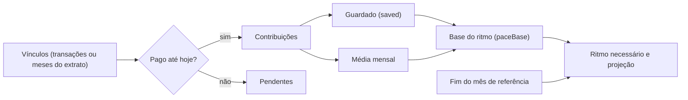

# Metas

Regras de negócio das metas de economia: o cadastro, os dois tipos de meta (por lançamentos e vinculada a uma conta de investimento), o vínculo e a retirada nos lançamentos, o cálculo do progresso e do ritmo, o arquivamento e as visualizações da lista. A tabela `goals` e as migrations estão em [Banco de dados](../arquitetura/banco-de-dados.md); aqui fica o comportamento.

## 1. O que é uma meta

### 1.1 Meta é um alvo de economia

Regra 1. A meta é um objetivo de **guardar** um valor, de um perfil. Não há meta de gasto.

Regra 2. O nome tem de 1 a 45 caracteres, aparado (`requireName`, o mesmo limite dos demais cadastros; ver [Categorias e tags §1.1](categorias-e-tags.md#11-nome-de-cadastro)). Nomes de meta **podem repetir**: não há índice único nem conferência no service.

Regra 3. O valor-alvo é **maior que zero**, na moeda do perfil. Com alvo zero ou negativo não há o que juntar, e o percentual dividiria por zero. O schema da rota já recusa (`moneyField.positive()` em `goalContentShape`), e o domínio confere de novo em `Goal.validated`.

Regra 4. A data-alvo é **opcional**: `null` é a meta sem prazo (a reserva de emergência). Sem prazo não há ritmo necessário nem projeção, mas há média mensal.

Onde mora: [`Goal.ts`](../../../packages/core/src/domain/goal/Goal.ts), [`goalRequests.ts`](../../../packages/core/src/requests/goalRequests.ts). Testes: [`domain/goal.test.ts`](../../../packages/core/test/domain/goal.test.ts) ("apara o nome e recusa valor-alvo zero ou negativo"), [`services/goals.test.ts`](../../../packages/core/test/services/goals.test.ts).

### 1.2 O progresso é calculado, nunca gravado

`goals` guarda só o alvo (`value`, `target_date`) e de onde vem o progresso (`kind`, `account_id`). Quanto já foi guardado é derivado a cada leitura das transações vinculadas ou dos extratos da conta — a única fonte da verdade. Um cache de progresso precisaria ser recalculado em toda escrita de transação, de fatura e de extrato, e divergiria da tabela de vinculadas na primeira falha. As metas são lidas raramente (tela Metas, resumo da Visão geral), então somar na leitura custa pouco. Meta não afeta saldo: o `GoalService` nunca chama o recálculo de saldos. Ver [decisões](../decisoes.md) ([ADR 71](../decisoes.md#adr-71)).

### 1.3 Rotas

| Rota | O que faz |
|---|---|
| `goals.list` | Metas do perfil por nome, com o progresso medido no mês de referência (`period`) |
| `goals.options` | Opções do campo "Meta" do lançamento: só metas por lançamentos, com `reached` e `archived`; não depende do mês |
| `goals.contributions` | As transações que contam no progresso de uma meta, pelo dia do pagamento |
| `goals.create` / `goals.update` | Cadastro; na criação o tipo padrão é por lançamentos, na edição o tipo é obrigatório |
| `goals.archive` / `goals.unarchive` | Arquivamento (§5) |
| `goals.delete` | Soft delete, desfazendo os vínculos (§6) |

`goals.options` existe separada de `goals.list` porque o formulário de lançamento só precisa de id, nome e estados; `goals.list` mede o ritmo de todas as metas no mês de referência e seria invalidada por toda escrita de dinheiro. `goals.options` é invalidada só pelas escritas de meta (mapa em [`invalidation.ts`](../../../packages/client/src/queries/invalidation.ts)). Na edição o tipo vem explícito no `updateGoalRequest` porque trocá-lo desfaz vínculos (§2.3) e não pode acontecer por omissão.

## 2. Tipos de meta (`GoalFunding`)

### 2.1 Por lançamentos (`kind = 1`)

O padrão. O progresso soma as receitas e transferências vinculadas pelo campo "Meta" do lançamento (`transactions.goal_id`), com as regras do §3 e do §4.

### 2.2 Vinculada a uma conta (`kind = 2`)

Regra 5. O progresso é o **saldo consolidado de hoje** de uma conta de investimento (`account_id`). Nenhum lançamento se vincula a ela: o depósito já é qualquer movimento da conta.

Regra 6. Só **contas de investimento** do mesmo perfil (`goal-account-not-investment`, `reference-outside-profile`). A conta corrente movimenta o dia a dia, e o saldo dela não diz quanto foi juntado. A mesma conta pode servir a **várias metas**.

Regra 7. A meta vinculada a conta **não recebe lançamentos** (`goal-funded-by-account`, conferida no `TransactionComposer`) e **não aparece** em `goals.options`.

Regra 8. Para o ritmo, a média e a projeção seguirem a mesma regra da meta por lançamentos, cada mês do extrato da conta entra como um vínculo sem transação: o valor é a variação do consolidado (`closing − opening`), no último dia do mês (ou hoje, no mês corrente). O saldo de abertura do primeiro extrato (ou o saldo inicial da conta) entra como `startingBalance`: conta no guardado, mas **fora da média mensal**, porque não foi guardado em mês nenhum — diluí-lo no primeiro mês inflaria o ritmo. Meses depois do atual ficam fora: o consolidado deles só teria pagamentos com data futura. Assim, um mês de referência passado mostra o saldo com que a conta fechou.

Regra 9. Se a conta não existe mais (excluída fora da cadeia, ou recebida assim pela sincronização), a meta é medida como sem nada guardado, em vez de falhar a lista.

Onde mora: `GoalService.measureAccountGoal` e `GoalService.checkedFunding` em [`GoalService.ts`](../../../packages/core/src/services/goal/GoalService.ts). Testes: [`goalFunding.test.ts`](../../../packages/core/test/services/goalFunding.test.ts) ("meta vinculada a uma conta de investimento"). Ver [decisões](../decisoes.md) ([ADR 73](../decisoes.md#adr-73)).

### 2.3 Trocar o tipo

Regra 10. O tipo se troca na edição. Trocar de por lançamentos para vinculada a conta **desfaz os vínculos** das transações e dos modelos de recorrência (`goal_id` e `goal_withdrawal` zerados), que continuam existindo: um vínculo guardado sem efeito confundiria quem o visse no lançamento. O formulário avisa quantos perdem o vínculo antes de salvar (`describeGoalFundingChange`, a partir do `linkedCount` de `goals.list`). Trocar de volta começa sem vínculo nenhum.

Regra 11. A conta de investimento que é o saldo de uma meta — ativa **ou arquivada**, porque a arquivada pode ser reativada — **não muda de tipo** (`account-type-funds-goal`, conferida no `AccountService`, apontando o campo "Tipo" do diálogo da conta). A meta passaria a medir dinheiro do dia a dia como guardado e ficaria impossível de editar sem trocar a conta. Para mudar o tipo da conta, troca-se antes o tipo da meta. Editar a conta sem trocar o tipo continua livre.

Regra 12. **Excluir a conta** exclui as metas vinculadas a ela na exclusão em cadeia (`goals` no `accounts.deletionImpact`), e o alerta da exclusão as conta. Desativar a conta não muda nada na meta: o saldo continua existindo. Ver [Contas](contas.md).

Testes: [`goalFunding.test.ts`](../../../packages/core/test/services/goalFunding.test.ts) ("trocar a meta por lançamentos para vinculada a conta desfaz os vínculos", "excluir a conta exclui a meta vinculada", "a conta de investimento que é o saldo de uma meta não vira conta corrente", "a meta arquivada também prende o tipo da conta").

## 3. Vínculo do lançamento com a meta

### 3.1 Só receitas e transferências

Regra 13. Só **receita** e **transferência** podem ser vinculadas a uma meta (`goal-requires-saving-type`, nos invariantes da `Transaction`, valendo para as ocorrências das séries). Despesa é gasto; o investimento já tem destino próprio; nenhum dos dois junta dinheiro para a meta.

A regra é a função `feedsGoal` em [`TransactionType.ts`](../../../packages/core/src/domain/transaction/TransactionType.ts), exportada para que o formulário mostre o campo "Meta" pela mesma regra que o núcleo aplica. No formulário ([`transactionForm.ts`](../../../packages/client/src/forms/transactionForm.ts)), trocar o tipo para um que não alimenta meta descarta a meta escolhida.

Regra 14. A meta precisa ser do perfil do lançamento (`reference-outside-profile`). Teste: "meta de outro perfil não é vinculada".

### 3.2 Retirada (`goal_withdrawal`)

Regra 15. Na meta por lançamentos, a transferência vinculada pode **retirar** dinheiro da meta ("Guardar na meta" / "Retirar da meta"): um imprevisto pago com a reserva. A retirada entra no progresso com o **sinal invertido** e aparece negativa, com a etiqueta "retirada", nas vinculadas.

Regra 16. **Só a transferência retira** (`goal-withdrawal-requires-transfer`, função `withdrawsFromGoal`); a receita sempre guarda. Tirar da reserva é mover dinheiro entre contas.

Regra 17. Sem meta, a marca de retirada é **descartada** em silêncio (e não recusada), para que tirar a meta de um lançamento de retirada não exija desmarcar a retirada antes.

Regra 18. O modelo da recorrência guarda a mesma marca (`recurrences.goal_withdrawal`), copiada para as ocorrências. Ver [Recorrências](recorrencias.md).

Onde mora: invariantes em [`Transaction.ts`](../../../packages/core/src/domain/transaction/Transaction.ts); a inversão do sinal no `selectLinks` de [`SqliteGoalRepository.ts`](../../../packages/core/src/infrastructure/sqlite/SqliteGoalRepository.ts). Testes: [`goalFunding.test.ts`](../../../packages/core/test/services/goalFunding.test.ts) ("retirada da meta por lançamentos"). Ver [decisões](../decisoes.md) ([ADR 74](../decisoes.md#adr-74)).

### 3.3 Escolhas do campo "Meta"

Regra 19. A meta arquivada não é escolha de lançamento **novo** (`goal-archived`); o lançamento que já estava vinculado a ela continua editável sem perder o vínculo, e o campo a mostra marcada "(arquivada)", como a conta desativada.

Regra 20. As metas **atingidas** ficam num grupo à parte, depois das ativas, porque raramente se guarda mais numa meta já alcançada.

Onde mora: `goalChoices` em [`listViews.ts`](../../../packages/client/src/viewModels/listViews.ts) (tela) e o `assertReferences` do [`TransactionComposer.ts`](../../../packages/core/src/services/transaction/TransactionComposer.ts) (núcleo). Testes: [`goalArchive.test.ts`](../../../packages/core/test/services/goalArchive.test.ts), [`listViews.test.ts`](../../../packages/client/test/listViews.test.ts).

## 4. Progresso e ritmo (`measureGoalProgress`)

Função pura em [`GoalProgress.ts`](../../../packages/core/src/domain/goal/GoalProgress.ts), usada pela lista, pelo detalhe e pelas opções.

### 4.1 O que conta no guardado

Regra 21. O progresso soma só as vinculadas **pagas até hoje**, independente do mês de referência. Uma série fixa é gerada 12 meses à frente, e somar o que ainda não saiu da conta daria a meta por cumprida antes da hora. As vinculadas em aberto, ou pagas com data futura, são **pendentes**: contadas e somadas à parte (`pending`), e a tela as cita numa nota.

Regra 22. O dia que conta é o em que o dinheiro se moveu: numa conta, o `payment_date`; num **cartão**, o dia em que a **fatura** foi paga. A fatura paga sem o dia gravado (anterior à migration `0003`) vale o 1º dia do mês do extrato do pagamento; a fatura reaberta, ou cujo extrato de pagamento foi excluído, volta a estar em aberto. Ver [Cartões e faturas](cartoes-e-faturas.md).

Regra 23. O valor entra **com sinal** (o estorno desconta) e **sem encargos**, que são custo do meio de pagamento, e não dinheiro guardado — o mesmo critério do total das tags. Com mais estorno que aporte, o guardado fica negativo.

Regra 24. Transação excluída deixa de pesar; meta excluída não tem vínculos (o `JOIN` exige meta viva e `kind = 1`).

Regra 25. "Atingida" (`reached`) é o guardado de hoje igual ou acima do alvo. O percentual (`ratio`) não tem limite (1,2 é 120%); "falta" (`remaining`) é zero quando atingida.

Onde mora: `selectLinks` em [`SqliteGoalRepository.ts`](../../../packages/core/src/infrastructure/sqlite/SqliteGoalRepository.ts), uma consulta só para a lista e o detalhe, para que a tabela do detalhe sempre some o progresso da lista. Testes: [`goals.test.ts`](../../../packages/core/test/services/goals.test.ts) ("o progresso soma as pagas até hoje", "transferência num cartão conta pelo dia em que a fatura foi paga, e volta a pendente ao reabrir", "transação excluída deixa de pesar na meta"); [`goal.test.ts`](../../../packages/core/test/domain/goal.test.ts).

### 4.2 Prazo a partir do fim do mês de referência

Regra 26. O prazo (`monthsLeft`), o ritmo necessário e a projeção contam a partir do **último dia do mês de referência**, para que navegar pelos meses mostre a situação de cada um. O progresso (§4.1) não depende do mês; só o ritmo depende.

Regra 27. Os meses até a data-alvo são **meses médios**, com fração: dias corridos ÷ (365,2425 ÷ 12 ≈ 30,44). Contar pelo calendário faria 31/01 → 28/02 valer um mês inteiro e 01/02 → 28/02 quase um. Data-alvo já passada dá zero meses ("prazo encerrado").

### 4.3 Base do ritmo (`paceBase`)

Regra 28. O ritmo e a projeção partem do guardado **no fim do mês de referência**, e não do total de hoje:

- num mês **encerrado** (`past`): o que já estava pago no fim dele;
- no mês **atual** (`current`): o guardado de hoje — o resto do mês não é projetado, porque o aporte do mês pode já ter entrado e a média o contaria de novo;
- num mês **futuro** (`estimated`): o de hoje mais a média mensal vezes os meses inteiros até ele.

Misturar o saldo de hoje com o prazo de um mês passado contava duas vezes os aportes entre os dois; num mês futuro, deixava de fora os meses entre hoje e ele. Fora do mês atual, a tela diz essa base ("No fim de jan/2026 havia R$ 500,00 guardados.", `goalProjectionNote` em [`goalView.ts`](../../../packages/client/src/viewModels/goalView.ts)) para não contradizer o total do progresso.

### 4.4 Ritmo necessário, média e projeção

Regra 29. **Ritmo necessário** = (alvo − base) ÷ meses restantes. É `null` sem prazo, com prazo encerrado ou com o alvo já alcançado na base.

Regra 30. **Média mensal** = soma das contribuições do mês da 1ª contribuição até o mês de referência (ou o atual, se o de referência for futuro, porque nada depois de hoje conta) ÷ número de meses do intervalo, com **mês sem aporte valendo zero**. É `null` antes da 1ª contribuição.

Regra 31. **Projeção** (`projectedGap`) = base + média × meses restantes − alvo: positivo é quanto a meta passa do alvo na data, negativo quanto fica abaixo. `null` quando não há o que projetar (sem prazo, sem média, prazo encerrado ou alvo já alcançado na base).

Regra 32. Contribuições do mesmo dia desempatam pela chave do vínculo com `compareCodeUnits`, sem localidade, para a lista sair igual no desktop e no celular.

Testes: [`goal.test.ts`](../../../packages/core/test/domain/goal.test.ts) (cenário com dois aportes de 700, mês passado, mês futuro, meta atingida, sem prazo, prazo encerrado, média com mês vazio). Ver [decisões](../decisoes.md) ([ADR 72](../decisoes.md#adr-72)).

### 4.5 Vinculadas no detalhe

`goals.contributions` devolve as transações que contam, inteiras, da mais antiga para a mais recente pelo dia do pagamento; a soma é o guardado. As ainda em aberto ficam fora (são as pendentes do §4.1). Na meta vinculada a conta a lista é vazia e o detalhe leva ao extrato da conta. No desktop e no celular as vinculadas usam a listagem comum de movimentos (`movementsFromGoalContributions` em [`movementList.ts`](../../../packages/client/src/viewModels/movementList.ts)), com editar, marcar pago e excluir como em Transações; não há coluna de situação, porque só as pagas aparecem.

## 5. Arquivamento e visualizações

### 5.1 Arquivar

Regra 33. Arquivar (`goals.archive`, coluna `archived_at`, migration `0006`) tira a meta de vista **sem apagar nada**: a lista padrão de Metas mostra só as ativas, e a arquivada some das escolhas de lançamentos novos (§3.3). Os vínculos continuam, e o progresso continua calculado, porque o dinheiro guardado não deixa de ter sido guardado. É o que se faz com a meta concluída ou abandonada que ainda conta uma história.

Regra 34. Reativar (`goals.unarchive`) desfaz. Arquivar de novo é idempotente e **não muda** a data gravada (o `archived_at` guarda o primeiro arquivamento, como o `disabled_at` das contas). **Editar não desarquiva**: o arquivamento não é conteúdo e muda só pelas duas rotas.

Regra 35. Arquivar é uma coluna nova, e não `deleted_at`, porque `deleted_at` significa "não existe mais" para toda leitura e para a sincronização; a meta arquivada continua existindo. É o mesmo raciocínio da desativação de contas e cartões ([Categorias e tags §1.3](categorias-e-tags.md#13-desativar-arquivar-e-excluir)). Ver [decisões](../decisoes.md) ([ADR 75](../decisoes.md#adr-75)).

Onde mora: `Goal.archive`/`unarchive` em [`Goal.ts`](../../../packages/core/src/domain/goal/Goal.ts), `GoalService.archive`. Testes: [`goalArchive.test.ts`](../../../packages/core/test/services/goalArchive.test.ts).

### 5.2 Visualizações da lista

Regra 36. A lista de Metas tem três visualizações: **ativas** (padrão: nem atingidas nem arquivadas), **atingidas** e **arquivadas**. A meta atingida e arquivada aparece **nas duas** últimas: quem procura o que já alcançou não precisa lembrar se a arquivou (`goalInView`).

Regra 37. A visualização fica na URL (`view`). Sem ela, a meta pedida por um link abre a lista em que aparece (`goalViewOf`; a arquivada vence a atingida), em vez de uma lista que não a mostra.

Regra 38. O resumo de metas da Visão geral do desktop mostra só as ativas, como a visualização padrão ([`OverviewScreen.tsx`](../../../apps/desktop/src/renderer/src/overview/OverviewScreen.tsx)).

Contas e Cartões têm a mesma escolha, entre ativos e desativados (`registryInView`); ver [Contas](contas.md) e [Cartões e faturas](cartoes-e-faturas.md). As funções moram no `client` ([`listViews.ts`](../../../packages/client/src/viewModels/listViews.ts)) para que desktop e celular filtrem igual. Testes: [`listViews.test.ts`](../../../packages/client/test/listViews.test.ts), [`apps/desktop/test/goals.test.ts`](../../../apps/desktop/test/goals.test.ts), [`apps/mobile/test/goals.test.tsx`](../../../apps/mobile/test/goals.test.tsx), [`e2e/goals.spec.ts`](../../../apps/desktop/e2e/goals.spec.ts).

## 6. Exclusão

Regra 39. Excluir a meta (soft delete) **desfaz os vínculos** das transações e dos modelos de recorrência na mesma unidade de trabalho (`goal_id` e `goal_withdrawal` zerados, com `updated_at` novo para a sincronização propagar), e os lançamentos continuam existindo. A meta é opcional no lançamento, como a tag; o `ON DELETE SET NULL` da chave estrangeira não dispara num soft delete, por isso o repositório limpa explicitamente. Tirar a meta do modelo da recorrência evita que ela volte nas próximas ocorrências.

Regra 40. A confirmação diz quantos lançamentos perdem o vínculo (`describeGoalDeletion`, a partir do `linkedCount`).

Onde mora: `unlinkTransactions` e `softDelete` em [`SqliteGoalRepository.ts`](../../../packages/core/src/infrastructure/sqlite/SqliteGoalRepository.ts). Teste: [`goals.test.ts`](../../../packages/core/test/services/goals.test.ts) ("excluir a meta tira o vínculo das transações e da série").

## 7. Telas

### 7.1 Desktop

[`GoalsScreen.tsx`](../../../apps/desktop/src/renderer/src/goals/GoalsScreen.tsx): lista à esquerda com o seletor de visualização e a etiqueta "Arquivada"; meta aberta no *search param* `goal` ([`goalsSearch.ts`](../../../apps/desktop/src/renderer/src/goals/goalsSearch.ts)); detalhe com a origem do progresso (`describeGoalFunding`), a barra, os três números (falta, data-alvo, ritmo necessário — `goalFigures`), a frase da projeção, a nota das pendentes e as vinculadas (ou o link para o extrato, na meta vinculada a conta). "+ Nova meta" e "Editar meta" em diálogo; o "⋯" leva arquivar/reativar e excluir.

### 7.2 Celular

`/more/goals` → `/more/goal/[id]` ([`GoalsScreen.tsx`](../../../apps/mobile/src/screens/GoalsScreen.tsx), [`GoalDetailScreen.tsx`](../../../apps/mobile/src/screens/GoalDetailScreen.tsx)): a mesma escolha "Ativas · Atingidas · Arquivadas", a conta de onde vem o saldo na meta vinculada a conta e o ritmo "Para chegar lá" enquanto falta. O detalhe repete os números do desktop (`goalFigures`), a projeção e as vinculadas — tocar abre o lançamento na pilha da aba Mais (`/more/transaction/[id]`). O cadastro é uma folha com nome, valor-alvo, data-alvo opcional ("Tirar a data-alvo"), tipo e conta, com o aviso dos vínculos desfeitos.

### 7.3 Formulário compartilhado

[`goalForm.ts`](../../../packages/client/src/forms/goalForm.ts) valida com o `goalContentShape` do núcleo, traz os rótulos dos tipos (`GOAL_FUNDING_KINDS`) e o mapa das recusas do núcleo para os campos (`GOAL_FIELD_BY_CORE_FIELD`). Testes: [`goalForm.test.ts`](../../../packages/client/test/goalForm.test.ts), [`goalView.test.ts`](../../../packages/client/test/goalView.test.ts).

## 8. Limitações conhecidas

- O resumo de metas existe só na Visão geral do desktop; o Início do celular não mostra metas.
- A meta vinculada a conta não enxerga a projeção de pagamentos futuros já lançados na conta: meses depois do atual ficam fora por regra (§2.2).
