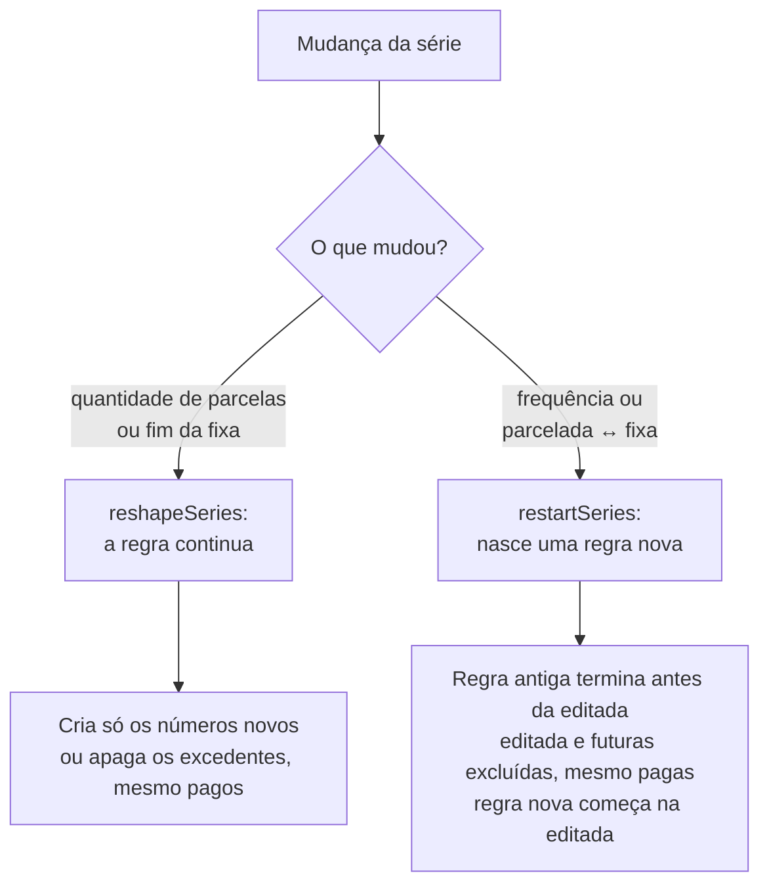

# Recorrências

Regras das séries de lançamentos: parcelamentos e lançamentos fixos, o modelo e o calendário que a
regra guarda, a identidade das ocorrências, o complemento na abertura, a edição e a exclusão com
escopo ("somente esta", "esta e as futuras", "todas"), o diálogo de revisão e o que acontece com a
série quando a conta, o cartão, a subcategoria ou a tag muda.

## 1. Conceito

### 1.1 Duas formas de série

Uma recorrência ([`Recurrence.ts`](../../../packages/core/src/domain/recurrence/Recurrence.ts),
tabela `recurrences`) tem uma de duas formas (`RecurrenceTerms`):

- **parcelada** (`installments`): uma compra dividida num número fixo de partes, de 2 a 360; a
  série é finita;
- **fixa** (`fixed`): uma cobrança sem fim inerente (aluguel, assinatura), até uma data de fim
  (`endAt`) ou sem fim.

A **frequência** vale para as duas: diária, semanal, mensal ou anual. Qualquer tipo de lançamento
pode ser recorrente, inclusive transferência e investimento.

### 1.2 Cada ocorrência é uma transação real

Regra de negócio (Recorrências): a regra **materializa uma transação real por ocorrência**, e não
um modelo expandido na leitura. A parcela 3 de 12 precisa cair numa fatura específica, ser paga e
editada individualmente e pesar no saldo do mês; uma ocorrência virtual não faz nada disso. Cada
ocorrência é gravada pelas mesmas regras de qualquer lançamento (`TransactionComposer`), e toda
operação de série grava as ocorrências, a regra e o recálculo de todos os meses afetados numa
única unidade de trabalho
([`RecurrenceService`](../../../packages/core/src/services/recurrence/RecurrenceService.ts)). Ver
[decisões](../decisoes.md) ([ADR 63](../decisoes.md#adr-63)).

A regra pertence diretamente ao perfil (`profile_id`), porque as ocorrências ainda não gravadas
precisam de um perfil onde ser emitidas, independentemente de qualquer linha existente.

Rotas: `recurrences.list`, `recurrences.occurrences`, `recurrences.preview`,
`recurrences.topUp`, `recurrences.planCreate`, `recurrences.planUpdate`, `recurrences.planDelete`;
`repeat` em `transactions.create`/`update` e `scope` em `transactions.update`/`delete`.

## 2. Modelo e calendário

### 2.1 O modelo de cada ocorrência

Regra de negócio (Recorrências): a regra guarda o **modelo** (`RecurrenceTemplate`) — tipo,
origem (conta ou cartão), destino, subcategoria, sócio, meta, nome, descrição, valor, encargos,
moeda e taxa de origem, e as tags (`recurrences_tags`) — e emite as ocorrências a partir dele, e
não copiando de uma ocorrência existente: um valor atípico editado em "somente esta" nunca vaza
para as seguintes. **Tags e descrição são copiadas para todas as ocorrências.** O modelo é
normalizado pelas mesmas regras da transação (nome e descrição aparados, tags sem repetição),
para sempre bater com as ocorrências. Migration
[`0004_recurrence_template.sql`](../../../db/migrations/0004_recurrence_template.sql).

### 2.2 Calendário e dia âncora

O calendário ([`RecurrenceSchedule.ts`](../../../packages/core/src/domain/recurrence/RecurrenceSchedule.ts))
guarda uma ocorrência de referência (`starts_on`, de número `starts_at`) e o **dia âncora**: o dia
do mês (mensal e anual), o dia da semana ISO (semanal) ou nada (diária). A data da ocorrência *n*
é calculada direto a partir da referência, e não avançando uma a uma, para que um mês curto não
contamine os seguintes.

Regra de negócio (Recorrências): **num mês sem o dia âncora, a ocorrência cai no último dia do
mês**, e a seguinte volta ao dia âncora — mensal no dia 31 vence em 31/01, 28/02 (29/02 no
bissexto), 31/03; anual em 29/02 vence em 28/02 nos anos comuns. A aritmética de datas é do
domínio, sem `Date`.

Testes: "calendário da série" em
[`recurrence.test.ts`](../../../packages/core/test/domain/recurrence.test.ts).

### 2.3 Parcelas no cartão

Regra de negócio (Recorrências): na série de cartão, o modelo guarda o **deslocamento de fatura**
(`invoice_offset`): quantos meses a fatura escolhida para a 1ª ocorrência está depois da sugerida
pela data dela. Cada ocorrência cai na fatura sugerida pela **própria** data mais esse
deslocamento. Cair numa fatura paga a reabre, como em qualquer lançamento. Trocar a fatura de uma
compra num escopo de série leva o novo deslocamento às demais.

## 3. Criar uma série

### 3.1 Valor das parcelas

Regra de negócio (Parcelamento): o valor digitado se lê como **total** ("1.000,00 em 3x") ou **por
parcela** ("12x de 100,00"), escolha explícita do usuário — errar o palpite distorceria todo total
mensal pelo número de parcelas. No "valor total", cada parcela é o total dividido pelo número de
parcelas, arredondado na precisão da moeda, e **a diferença do arredondamento vai para a 1ª
parcela**: 1.000,00 em 3x gera 333,34 + 333,33 + 333,33 (`Money.split`, `seriesValueOf`). Depois
de gerada, cada parcela é uma transação comum; o app não reequilibra as outras se uma for editada.
A fixa é sempre por ocorrência.

### 3.2 Parceladas inteiras, fixas até o horizonte

Regra de negócio (Recorrências):

- a **parcelada é gravada inteira** na criação — quem compra em 24x quer ver as 24 parcelas e a
  fatura de cada uma;
- a **fixa é gravada até um horizonte móvel de 12 meses** a partir de hoje (`fixedSeriesHorizon`),
  sem passar do fim, com ou sem fim — doze meses mostram pelo menos uma ocorrência de uma série
  anual, e uma fixa até 2099 emitiria centenas de linhas. O mesmo horizonte vale quando a série
  muda.

A 1ª ocorrência leva as escolhas do formulário (pago, fatura); as seguintes saem do modelo.

### 3.3 Na tela

"Repetir" no formulário (desktop `RepeatSection`, celular a linha "Parcelado · 12x mensal" que
abre uma folha): não repetir, parcelado ou fixo, frequência, parcelas, total ou por parcela, fim
da fixa e a **prévia** das ocorrências com a fatura de cada uma (`recurrences.preview`,
`describeRepeatPreview`), que é igual ao que será gravado. Toda criação de série passa pelo diálogo
de revisão ([§7](#7-diálogos-de-escopo-e-de-revisão)). Na tabela, a coluna "Rec." mostra "3/12" ou
"Fixa", e o painel, "parcela 3 de 12 (valor total …)" ou "fixa mensal".

## 4. Identidade e complemento

### 4.1 O número da ocorrência é a identidade

Regra de negócio (Recorrências): cada ocorrência tem o seu **número** na série
(`transactions.occurrence`, a 1ª é 1), e o id dela é derivado de (série, número)
(`occurrenceIdFor`), e **não da data**: a data muda quando o usuário troca o dia, e dois
aparelhos — um mudando o dia, outro completando a série offline — gerariam a mesma ocorrência com
ids diferentes. Pelo número, geram a mesma linha. Gerar de novo um número já excluído **revive** a
linha, com conteúdo novo e `created_at` novo (senão ela pareceria editada à mão na revisão). Ver
[decisões](../decisoes.md) ([ADR 64](../decisoes.md#adr-64)) e [sincronização](../arquitetura/sincronizacao.md).

### 4.2 Marca d'água e complemento

Regra de negócio (Recorrências): `materialized_count` é a **marca d'água** — quantas ocorrências a
regra já emitiu; só avança. O **complemento** (`recurrences.topUp`) emite do número seguinte à
marca em diante, enquanto a ocorrência estiver ao alcance (parcela existente, ou fixa até o
horizonte e o fim), e avança a marca. Uma marca, e não "existe linha para esta data?", porque:

1. é idempotente — rodar duas vezes não grava nada na segunda;
2. **faz a exclusão valer** — a ocorrência excluída em "somente esta" não volta na próxima
   abertura, porque a marca nunca revisita um número;
3. é inspecionável.

O complemento roda **na abertura do app**, depois da verificação de integridade, e logo após criar
ou mudar uma série. Cada série é complementada na **própria transação**: a que falha é desfeita
sozinha e registrada no log, e as outras seguem. Um número que já está vivo acima da marca
(chegado de outro aparelho) é pulado, não regravado.

Testes: "série fixa e complemento" e "o complemento nunca impede a abertura por uma série" em
[`recurrences.test.ts`](../../../packages/core/test/services/recurrences.test.ts).

### 4.3 Duas ocorrências podem vencer no mesmo dia

Regra de negócio (Recorrências): o calendário nunca gera duas ocorrências na mesma data, mas o
usuário pode mover uma em "somente esta" para a data de outra; o banco não recusa. A proteção
contra gerar a mesma ocorrência duas vezes é o número (id determinístico e índice único
`(recurrence_id, occurrence)`), não a data.

## 5. Editar com escopo

### 5.1 Os três escopos

Regra de negócio (Recorrências): editar uma ocorrência **sempre pergunta o escopo** — **somente
esta**, **esta e as futuras** ou **todas** —, porque nenhum padrão acerta: um aumento de preço vale
daqui para a frente, um nome errado vale para a série inteira, um valor atípico vale para uma linha
só. Adivinhar reescreveria dados que o usuário não pretendia tocar.

- **"Futuras" é definido pelo número** — a editada e as de número maior —, nunca pela data: uma
  ocorrência movida para depois da editada continua anterior a ela na série (`inScope`).
- **Somente esta** grava só a ocorrência e deixa a regra intocada (`TransactionService.update`).
  Mudar a série nesse escopo é recusado (`recurrence-change-requires-scope`).
- **Esta e as futuras** e **todas** vão para o `RecurrenceService.update`.

### 5.2 Só o que mudou vai para as outras

Regra de negócio (Recorrências): nos escopos de série, as outras ocorrências e o modelo recebem
**só o que mudou** na editada (origem, destino, subcategoria, nome, descrição, valor, encargos,
tags, deslocamento de fatura — `changesBetween`), e não o formulário inteiro: renomear a parcela 3
de "1.000,00 em 3x" não pode copiar os 333,33 dela para a 1ª, que tem 333,34. **Pago e data de
pagamento continuam individuais**: só a editada recebe os do formulário. Ver
[decisões](../decisoes.md) ([ADR 65](../decisoes.md#adr-65)).

### 5.3 Trocar a data muda o dia âncora

Regra de negócio (Recorrências): trocar a data em "esta e as futuras" ou "todas" muda o **dia
âncora**, não o período — cada ocorrência vai para o dia novo **dentro do mês em que já está**
(último dia quando o dia não existe) ou para o dia da semana novo **dentro da semana** dela
(`moveToAnchor`). Só a editada recebe a data inteira. Trocar o dia **não muda quais ocorrências a
série tem**: numa fixa com fim, o fim acompanha o dia novo e fica entre a data nova da última
ocorrência e a véspera da seguinte (`Recurrence.reanchoredOn`). Na **diária** não há dia âncora,
e trocar a data só vale em "somente esta" (`recurrence-daily-date-single-only`).

### 5.4 Mudar a série

Regra de negócio (Recorrências): mudar a série (quantidade de parcelas, fim, frequência ou forma)
vale **sempre para a editada e as futuras** — não há escolha de escopo; as outras alterações da
mesma edição também valem para esse escopo. Há dois casos (`seriesChangeOf`):

1. **Quantidade de parcelas ou fim da fixa — a regra continua** (`reshapeSeries`). O calendário
   não muda: só se cria ou se apaga o que a mudança exige, e as demais ocorrências ficam intactas,
   com as edições feitas nelas. As apagadas saem **mesmo pagas**. A nova quantidade não pode ficar
   abaixo do número da editada (`recurrence-installments-below-occurrence`), nem o novo fim antes
   dela (`recurrence-end-before-occurrence`). A parcelada passa a valer por parcela; as parcelas
   novas recebem o valor do formulário se ele mudou, senão o **valor regular** da série (sem o
   resto do arredondamento — `Recurrence.regularValue`), para a série não somar mais que a compra.
   A marca d'água não recua.
2. **Frequência ou forma — nasce uma regra nova** (`restartSeries`). A regra atual termina na
   anterior à editada (ou é excluída, se a editada é a 1ª); a editada e as futuras são excluídas,
   **mesmo pagas**; uma regra nova começa na editada, que vira a 1ª ocorrência dela com os dados
   do formulário. As passadas ficam na regra antiga, sem vínculo com a nova. A parcelada que
   continua parcelada tem como total as parcelas restantes, por parcela; a fixa que vira parcelada
   pede a quantidade e a leitura do valor. Uma regra nova, e não a mesma regenerada, porque a
   numeração antiga não diz nada no calendário novo — uma diária que virasse mensal gravaria
   décadas. Ver [decisões](../decisoes.md) ([ADR 66](../decisoes.md#adr-66)).

Testes: "mudar a quantidade de parcelas ou o término mantém a regra", "mudar a periodicidade ou o
tipo começa uma regra nova" e "o valor de um parcelamento que muda de tamanho" em
[`recurrences.test.ts`](../../../packages/core/test/services/recurrences.test.ts).

### 5.5 Mover de perfil leva a série inteira

Regra de negócio (Recorrências): mover uma ocorrência para outro perfil leva **a regra e todas as
ocorrências vivas**, sempre em "todas" (`recurrence-move-requires-all` nos outros escopos). A
regra é do perfil e continua emitindo nele; tirar uma ocorrência sozinha deixaria a série dividida
e o complemento emitindo no antigo. As referências do perfil (origem, destino, subcategoria,
sócio, meta, tags) vão da editada para todas as ocorrências e para o modelo, inclusive as que a
editada não mudou. A regra é revista, não recriada: id, calendário e marca d'água continuam. Mudar
de perfil e mudar a série na mesma edição não cabe. Na tela, mudar o perfil de uma ocorrência vai
direto à revisão de "todas". Testes:
[`moveProfile.test.ts`](../../../packages/core/test/services/moveProfile.test.ts).

## 6. Excluir com escopo

Regra de negócio (Recorrências): a exclusão de uma ocorrência pergunta os mesmos três escopos:

- **somente esta**: exclui a ocorrência; a marca d'água impede que o complemento a recrie;
- **esta e as futuras**: exclui a editada e as de número maior e **encerra a série** antes dela
  (`Recurrence.endingBefore`) — na fixa, o fim vira a véspera da data que o **calendário** dá à
  editada (e não a gravada, que pode ter sido movida); na parcelada, a quantidade vira o número
  anterior e, no "valor total", o total passa a ser a soma das parcelas que ficam. Sem ocorrência
  restante, a regra é excluída;
- **todas**: exclui a série inteira e a regra.

**Ocorrências pagas não são protegidas**: saem também, e o diálogo de revisão as mostra antes.
Todos os meses afetados são recalculados.

## 7. Diálogos de escopo e de revisão

Regra de interface (Recorrências): o app **confirma antes de executar** toda criação de série e
toda edição ou exclusão em "esta e as futuras" ou "todas" num **diálogo de revisão** que diz o que
está em jogo — as ocorrências excluídas, criadas e alteradas, quais estão pagas, quais foram
editadas à mão, os saldos de quais meses e contas mudam —, e não um aviso genérico
([perfis §5.3](perfis.md#53-confirmações-dizem-o-que-muda)).

- **Plano por ensaio:** `recurrences.planCreate`, `planUpdate` e `planDelete`
  ([`SeriesPlanner`](../../../packages/core/src/services/recurrence/SeriesPlanner.ts)) executam a
  própria operação numa transação desfeita (`UnitOfWork.rehearse`) e comparam a série antes e
  depois: o plano nunca discorda do que a confirmação grava, e uma recusa de regra aparece já no
  plano.
- **Editada à mão:** a ocorrência conta como editada à mão quando `updated_at` passa de
  `created_at` em mais de 1 segundo — aproximação aceita (marcar pago também escreve na linha).
- **Fluxo:** o diálogo de escopo vem primeiro, quando há escolha; **"somente esta" grava direto**
  do diálogo de escopo, sem revisão (mexe numa linha só, a que o usuário está vendo); "esta e as
  futuras" e "todas" seguem para a revisão. Mudar a série vai direto à revisão de "esta e as
  futuras"; mudar o perfil, à de "todas".
- **Textos:** `scopeChoices` e `describeSeriesPlan` do `client` (resumo, avisos de pagas e editadas
  à mão, grupos com 5 linhas e "e mais n transações"), usados pelo desktop (`ScopeDialog`,
  `SeriesReviewDialog`) e pelo celular.

Testes: [`seriesPlans.test.ts`](../../../packages/core/test/services/seriesPlans.test.ts),
[`recurrenceView.test.ts`](../../../packages/client/test/recurrenceView.test.ts),
[`recurrences.spec.ts`](../../../apps/desktop/e2e/recurrences.spec.ts),
[`recurrences.test.tsx`](../../../apps/mobile/test/recurrences.test.tsx).

## 8. Séries e cadastros

Regras de negócio (Recorrências):

1. **Desativar** a conta ou o cartão da série **não a para**: ela continua emitindo, porque
   desativar não muda nenhum saldo, nem o previsto dos meses seguintes. A ocorrência gerada usa a
   política `generated` do `TransactionComposer`. Para parar, exclui-se "esta e as futuras".
2. **Excluir** a conta ou o cartão de origem, ou a conta de destino, **exclui a regra** na mesma
   cadeia, e o alerta conta as séries ("N repetições, que param de gerar lançamentos") —
   [contas §5.2](contas.md#52-excluir-em-cadeia-o-que-é-apagado-junto).
3. Excluir uma subcategoria movendo os lançamentos **move também o modelo** das regras; uma série
   viva sem ocorrência viva conta como uso da subcategoria, para a exclusão pedir para onde mover
   ([categorias e tags](categorias-e-tags.md)).
4. Excluir uma tag a tira das regras.

Testes: "cadeias que levam a regra junto" em
[`recurrences.test.ts`](../../../packages/core/test/services/recurrences.test.ts).

## 9. Limitações conhecidas

- Depois de gerada, uma parcela editada em "somente esta" pode fazer a série deixar de somar o
  total da compra; manter a soma coerente é responsabilidade do usuário.
- Valores passados são mutáveis por design (a ferramenta corrige o histórico): um relatório gerado
  duas vezes pode dar resultados diferentes, e `updated_at` é o único rastro da revisão.
